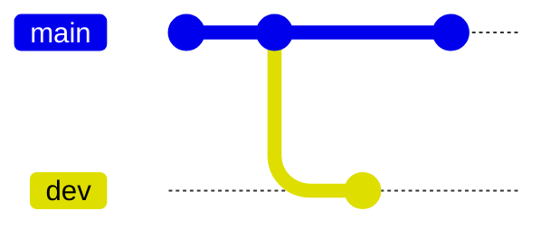
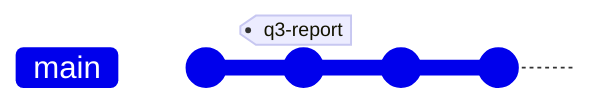
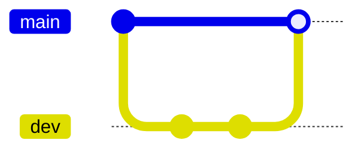
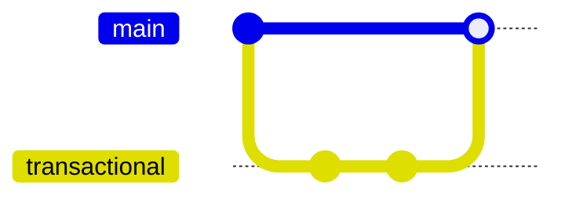
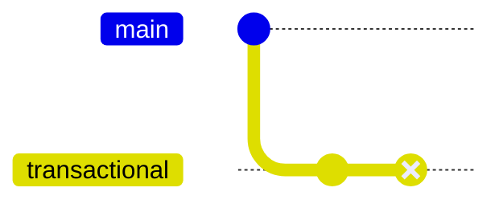

## The catalog

Bauplan versions the state of your lake similarly to how Git versions code. For every branch, the catalog records its [namespaces](/concepts/tables#namespaces) (think of them as folders for now) and the [tables](/concepts/tables#tables) within them. Each branch has a *history*: the series of commits that produced its current state.

## Data branches

A data branch is a pointer to a commit of the *whole* lake, so creating a branch amounts to writing one pointer. No data or metadata files are copied, which makes branching cheap and fast *regardless* of the size of the lake. A new branch sees exactly the tables and namespaces of the commit it was created from.

Writes to a branch create new data files, metadata files, and a commit on that branch only. Other branches keep pointing at their own state, so readers of any other branch, including `main`, don’t see those changes until they’re merged.



:::note

The diagrams on this page branch from and merge into `main`, but you can create a branch from any branch and merge any branch into any other.

:::

## Commits, tags and time travel

Every *write* to the catalog is a **commit** on a branch. This includes operations you might not think of as writes, such as creating or deleting a namespace, or merging two branches. Each commit has a unique identifier, and together the commits make up the branch's history.

A commit also records its author, its parent commit (two parents for a merge), and the job, project and user that produced it. `bauplan commit` shows the history of the active branch:

```text
commit 4307792b4e2a325e4e42e3e0b595cf79c68016be6023314a5ac345c85833a9bc
Author: John Doe <john.doe@bauplanlabs.com>
Author Date: 2025-05-13T18:31:40.133920Z
Commit Date: 2025-05-13T18:31:40.139839199Z
Properties:
    bpln_job_id = 7d3c81d7-a779-4754-8c72-2311cc905da7
    bpln_project_id = 7a1878f8-d736-4079-bc1d-c23910948153
    bpln_username = jdoe
Parent Hashes:
    300266b7781b59093649742c254f639d2f9085f629f9f1eaa9a0d732838b0e72
    268bbd29de8113a0faf5478b85972fdd755c9503569124d21d72f32fef562810

    Run job_id=7d3c81d7-a779-4754-8c72-2311cc905da7
```

A **tag** is a name for a fixed commit. It does not move when the branch it was created from receives new commits, and you cannot write to it. Tags are useful for naming states worth returning to, such as the data behind a published report.



*Reads* can target the head of a branch or any past state of the lake, identified by a commit, a tag or a point in time. A point in time resolves to the last commit on the branch at or before it.

The CLI and SDK take the state to read as a **ref**. A branch name such as `main` refers to the head of the branch, `main@<hash>` to a specific commit on `main`, and `@<hash>` to a commit without going through a branch. A ref that points to a commit or a tag is read-only: only branches take writes.

Tags also take relative syntax. `v1.0^1` refers to the commit before the tagged one, and `v1.0*2025-05-19T06:11:33Z` to the last commit before that timestamp.

## Merges

A merge takes every table and namespace that was added, changed or deleted on the source branch since the two branches diverged, and applies those changes to the destination branch. The result is a single commit on the destination branch. The merge is atomic: either all changes are applied or none are.



As in Git, merges can conflict. If a table was changed on both the source and destination branches since they diverged, Bauplan raises a merge conflict and rejects the merge.

## Transactional branches

Branches keep unmerged work isolated from production data, which typically lives on main. Bauplan also guarantees that a failing job never leaves a branch in an inconsistent state.

Consider a pipeline that updates two tables and fails after writing the first. Without protection, the branch would be left half-updated. To prevent this, Bauplan runs every job that writes in an ephemeral **transactional branch**, whether it’s a pipeline, a data import, or a table creation.

The job takes the latest commit on the branch it runs on, creates a transactional branch from it, performs all of its writes there, and merges back only if every step succeeds. On success, the transactional branch is deleted. On failure, the merge never happens and the target branch is left untouched. The transactional branch is kept with its partial writes so that you can inspect what went wrong.

When every step succeeds, Bauplan merges the transactional branch, and all of its changes land on the target branch at once:



When a step fails, nothing is merged and the target branch stays at its last commit:



## Data branches vs Git branches

Data branches look a lot like Git branches, but they differ in three ways:

| | Git branches | Data branches |
|---|---|---|
| Unit of versioning and conflicts | Lines in a file | Whole tables |
| Where branches live | Local clone and remote | Only in the cloud |
| Deleting a branch | Unreachable commits are eventually garbage-collected | Removes the pointer only. No data is deleted and no storage is freed |
