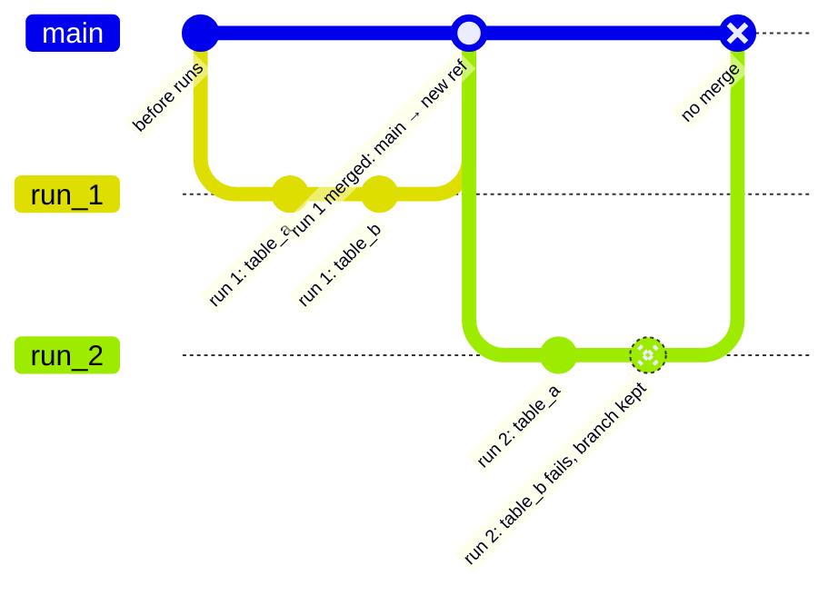

In Bauplan, every pipeline run behaves like a **database transaction**.
That means:

- **If the run succeeds, Bauplan commits all outputs**.
- **If the run fails,** the data on your current branch **remains
  untouched.**

This behavior applies automatically - whether you're developing locally
or running production jobs on a schedule.

Bauplan enforces transactionality with **temporary execution branches**:

- When you trigger a run, the platform forks your current branch to
  create an isolated branch: Bauplan materializes intermediate outputs in
  this temporary branch.
- If the run succeeds, Bauplan merges the outputs into your working
  branch, making it point to the latest commit - your branch now
  reflects the results of that pipeline run.
- If the run fails, your working branch remains unchanged.
  Bauplan preserves intermediate artifacts for inspection.

This guarantees that **every change to your lakehouse is atomic,
isolated, and versioned**.

The diagram shows two runs started from `main`. The first one succeeds and
is merged; the second one fails and `main` is left unchanged.

The failed `run_2` branch is kept, along with the tables it wrote before
failing, so you can inspect them before re-running.
