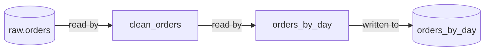
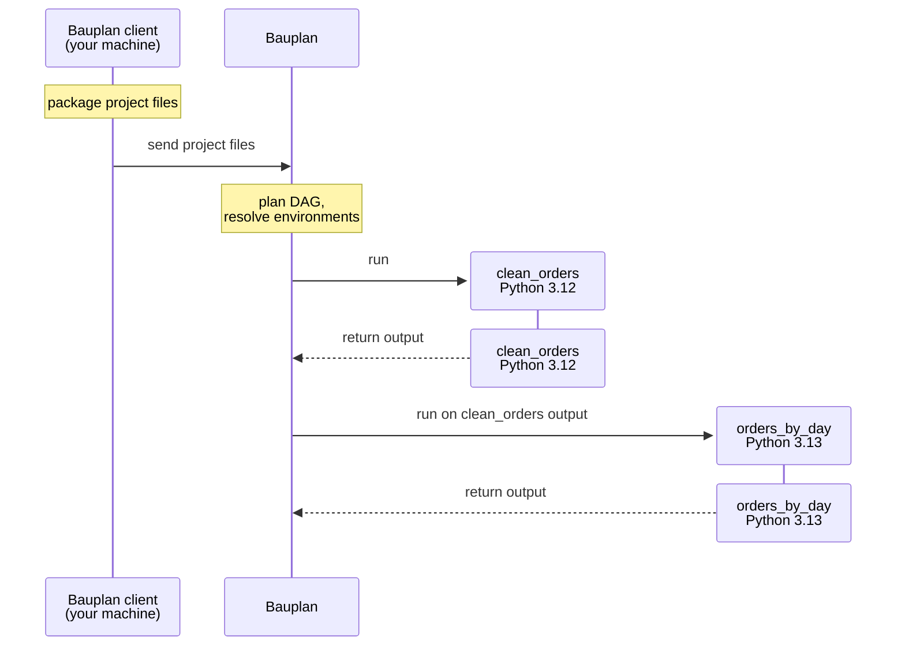
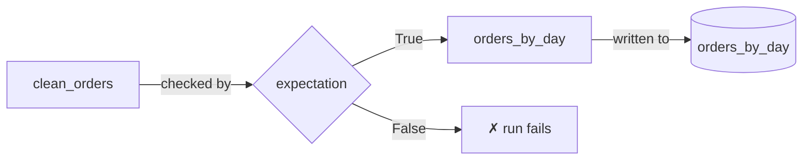

## Pipelines

In Bauplan, a **pipeline** is a directed acyclic graph (DAG) of models. A model is a function, written in Python or SQL, that reads one or more tables and returns *exactly one* table. Pipelines are organized in **projects**, which are directories holding all the files needed to run them.

A pipeline is a *write* operation. It produces and writes tables that people, dashboards and agents can read, and it computes them the same way on every run. This makes pipelines the natural home for business logic. In production, keep ad hoc SQL queries to lightweight reads of tables a pipeline has already produced, with at most simple filters. Move any complex logic into a pipeline as early as possible.

Splitting that logic across several models, rather than writing one large query, has concrete advantages in Bauplan:

1. Each model runs as a separate function with its own memory, so a large transformation becomes several steps, each needing less memory than the whole would.
2. Each model declares the schema of what it reads and returns, so a broken assumption fails at the step that made it.
3. Each model chooses whether and how to write its output, so only the tables consumers need are written.
4. [Expectations](#expectations) can check any intermediate model, not only the final table.

### Anatomy of a model

A model's input tables come either from the catalog or from the outputs of other models in the same project. Bauplan derives the DAG from these inputs, so a model that reads the output of another runs after it. Data moves in and out of models as Arrow tables. By default, the name of the table a model produces is its function name, or its file name for a SQL model.

In the example below, `clean_orders` reads the catalog table `raw.orders`, and `orders_by_day` reads the output of `clean_orders`:

```python type:ignore
from typing import Annotated

import bauplan
import pyarrow as pa


@bauplan.model()
@bauplan.python("3.12")
def clean_orders(
    orders: Annotated[pa.Table, bauplan.Model("raw.orders")],
) -> pa.Table:
    ...


@bauplan.model(materialization_strategy="REPLACE")
@bauplan.python("3.13")
def orders_by_day(
    clean_orders: Annotated[pa.Table, bauplan.Model("clean_orders")],
) -> pa.Table:
    ...
```

Bauplan derives this DAG from the inputs. Only `orders_by_day` is written to the catalog, because `clean_orders` keeps the default strategy, `NONE`, described below:



### Materialization strategies

The materialization strategy of a model decides what happens to its output after the model runs:

- **NONE** is the default. The output exists only during the run, as input for downstream models, and nothing is written to the catalog.
- **REPLACE** drops the table and creates it again from the output on every run.
- **APPEND** adds the rows of the output to the table. Columns that are new in the output are added to the table. Nothing is deduplicated, so appending the same rows twice stores them twice.
- **OVERWRITE_PARTITIONS** deletes the rows that match a filter you set on the model and writes the output in their place, in one commit. Filter on the table's partition columns only. This is how a pipeline reprocesses a window of data without duplicating it.

For example, this model uses `OVERWRITE_PARTITIONS` to replace only the rows for 2026 and leave the other years untouched:

```python type:ignore
@bauplan.model(
    materialization_strategy="OVERWRITE_PARTITIONS",
    partitioned_by=["year"],
    overwrite_filter="year = 2026",
)
def events_by_year(
    events: Annotated[pa.Table, bauplan.Model("events")],
) -> pa.Table:
    ...
```

If the same model runs twice, each run producing 1,000 rows for 2026, the table ends up as follows. The `OVERWRITE_PARTITIONS` row uses the filter `year = 2026` from the example above:

| Strategy | Table after the second run |
|---|---|
| `NONE` | No table |
| `REPLACE` | The 1,000 rows of the second run |
| `APPEND` | 2,000 rows: the 1,000 of the first run plus the 1,000 of the second |
| `OVERWRITE_PARTITIONS` | The 1,000 rows of the second run, which replace the 2026 rows of the first. Rows for other years, if any, are kept |

### Execution model

Only two things change the lakehouse: importing files and running pipelines. Here is a run of the example project:



Models run on Bauplan, next to the data, and the repository is never deployed: each run carries only the code it needs. Each model declares its own Python version and packages, so models in one pipeline can use different versions. Your local `pyproject.toml` and `requirements.txt` have no effect.

## Expectations

An expectation is a check on data that runs inside a pipeline. It is a Python function that reads one or more tables or model outputs and returns `True` if the data is acceptable and `False` if it is not. Expectations are to tables what unit tests are to code. The difference is that they run before the results are published, so a failing check stops bad data from ever reaching the branch.

Expectations behave as nodes of the pipeline DAG, like models, but they produce no table. They can read catalog tables and the outputs of any model in the pipeline, whether written to the catalog or not.

The diagram adds an expectation to the example pipeline. It checks the output of `clean_orders`, which is never written to the catalog. If the expectation returns `False`, the run halts. Models that haven't run yet don't run, and nothing the run wrote reaches the branch:



### Standard and custom expectations

Bauplan ships a [library of standard expectations](/reference/bauplan-standard-expectations) for the most common cases.

A custom expectation is any Python function that returns a boolean. Like a model, it declares its own packages. Custom expectations cover rules the standard expectations can't express, such as relations between columns, freshness or consistency between two tables.