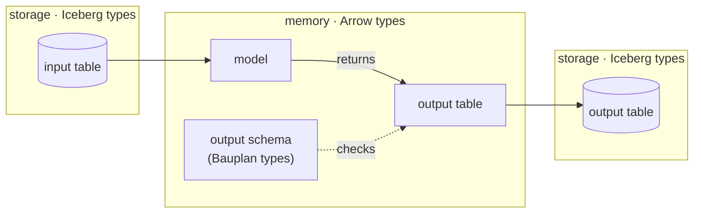

In Bauplan, the **semantic layer** isn't a separate system. It's declared in code, next to the [models](/concepts/pipelines#anatomy-of-a-model) that produce the data, and its documentation is stored in the Iceberg metadata of their output tables.

By semantic layer, we mean everything that describes what a table contains: each column's type, whether it can be null, what it means and which upstream columns it derives from.

Declaring semantics in code means they're versioned with the code, reviewed in the same pull request as the transformation they describe, and shipped with every run. Storing the documentation every time a table is written means it’s versioned with the data too. As a result, `main` carries the approved data together with the approved definitions. There is no separate metadata store to keep in sync and nothing to install beyond the SDK.

## Schemas

A table schema is a named, ordered set of typed fields representing all or some of the columns of a table. It's how the semantic layer is expressed in code. A schema acts as an *input* to a model when it declares the columns the model reads, and as an *output* when it declares the columns the model returns.

Each field has four elements:

1. **A name**, which is the column identifier.
2. **A data type**, expressed as a [Bauplan type](#three-type-systems) such as `Int32`. A field that accepts nulls must say so explicitly, as in `Int32 | None`.
3. **A documentation string**, which describes in natural language what the field represents.
4. **Lineage**, which records the field in another schema that it derives from, if any.

In the example below, `Orders` is the input schema of the `revenue` model and `Revenue` is its output schema. The `revenue_usd` field has all four elements: its name, the type `Float64 | None`, a documentation string, and lineage pointing to `Orders['amount']`.

```python type:ignore
from typing import Annotated

import pyarrow
import bauplan
from bauplan import Float64, String, TableField, TableSchema


class Orders(TableSchema):
    order_id: String
    amount: Float64 | None


class Revenue(TableSchema):
    """Revenue per order, in USD."""

    order_id: Annotated[String, TableField(doc='Order identifier', lineage=Orders['order_id'])]
    revenue_usd: Annotated[
        Float64 | None,
        TableField(doc='Order amount converted to USD', lineage=Orders['amount']),
    ]


@bauplan.model()
def revenue(
    orders=bauplan.Model('orders', projection_schema=Orders),
) -> Annotated[pyarrow.Table, Revenue]:
    ...
```

### Three type systems

Three type systems meet in a pipeline. Iceberg types describe the data at rest in object storage. Arrow types describe the data in memory, as it moves through a pipeline and as queries return it. Bauplan types are the subset of Arrow types declared in a schema, and their names stay close to Arrow's.

The diagram shows where each type system applies. Tables are stored with Iceberg types, and a model works on them as Arrow tables in memory. Before the model's output is written back, Bauplan checks it against the Bauplan types of the output schema, which the model declares in its return annotation (`-> Annotated[pyarrow.Table, Revenue]` in the example above):



#### Type mapping

The table maps each Bauplan type to its Arrow and Iceberg types:

| Bauplan type | Arrow type | Iceberg type |
| :--- | :--- | :--- |
| `Bool` | `bool` | `boolean` |
| `Int32` | `int32` | `int` |
| `Int64` | `int64` | `long` |
| `Float64` | `float64` | `double` |
| `String` | `large_string` | `string` |
| `Binary` | `large_binary` | `binary` |
| `Date32` | `date32` | `date` |
| `Date64` | `date64` | - |
| `TimestampMicro` | `timestamp[us]` | `timestamp` |
| `TimestampNano` | `timestamp[ns]` | `timestamp_ns` |
| `TimestampMicroUTC` | `timestamp[us, tz=UTC]` | `timestamptz` |
| `TimestampNanoUTC` | `timestamp[ns, tz=UTC]` | `timestamptz_ns` |
| `Any` | any | any other type |

`Any` is a catch-all for types that have no Bauplan name.

`Date64` has no Iceberg type, so no catalog column reads back as `Date64`. Use `Date32` for dates you read from or write to the catalog.

Iceberg stores the UTC timestamp types as UTC instants. It doesn't keep the timezone they were written from.

### How schemas are enforced

A `TableSchema` is a declaration, like the column list in a `CREATE TABLE` statement.
Wherever it is attached, as a model's output or an input's `projection_schema`, Bauplan
checks the table against it.

If a column's type differs from the declared type, Bauplan casts it, as long as the
table below allows that cast. The run fails if the table has:

- a column whose type differs and can't be cast
- null values in a required column
- a column the schema doesn't declare
- no column for a declared attribute

Only a `projection_schema` on an input drops columns. Bauplan first selects the schema
columns from the input table, then applies the checks. A model's output is never
projected. An input without a `projection_schema` is passed to the model unchecked.

Bauplan only casts to a wider type, so no value is lost:

| From | To |
|------|----|
| `Int32` | `Int64` |
| `Int32` | `Float64` |
| `Date32` | `Date64` |
| `TimestampMicro` | `TimestampNano` |
| `TimestampMicroUTC` | `TimestampNanoUTC` |
| Any string type | `String`, `Binary` |
| Any binary type | `Binary` |

For example, `Int64` to `Int32` fails, and so does converting between timestamps with and
without a timezone.

Two attributes in one schema can't name the same column. Bauplan rejects the schema
before the run starts.

## Where the documentation is stored

Every time a model writes its output table, Bauplan stores the documentation from the output schema in the table's Iceberg metadata, where any engine that reads Iceberg can find it:

- Nullability is stored with the column type. `Float64 | None` becomes an optional column and `Float64` a required one.
- A field's `doc` goes in the `doc` property of the column, as defined in the [Iceberg schema spec](https://iceberg.apache.org/spec/#schemas).
- The table's documentation goes in the `comment` table property, one of Iceberg's [informational properties](https://iceberg.apache.org/docs/latest/configuration/#informational-properties).

The table's documentation is the model's docstring. If a Python model has no docstring, Bauplan uses the docstring of its output schema. A SQL model always uses the docstring of its output schema, which it names in a comment:

```sql
-- bauplan: output_schema = Revenue
```
