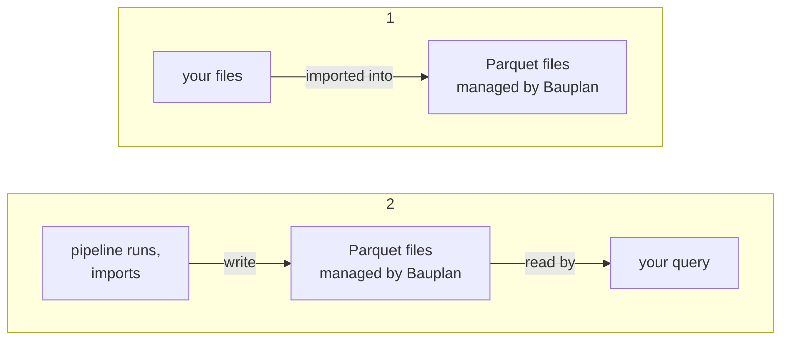
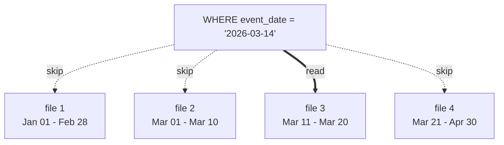

## Tables

Every Bauplan table is an [Apache Iceberg](https://iceberg.apache.org/) table whose data is stored as Parquet files in object storage.

### Managed and external tables

{/* vale Google.Slang = NO */}
What separates the two kinds of table is who manages the data files. [TL;DR.](/concepts/tables#summary)
{/* vale Google.Slang = YES */}

#### Managed tables

**For a managed table, Bauplan manages the data files.** When you import source files, Bauplan reads them and writes new Parquet files. The originals are left untouched and the table no longer depends on them, so you can delete them after the import and the table stays readable. Managed tables are the only tables you can import into repeatedly, and the only tables pipelines should write to.

Your queries read the Parquet files that Bauplan manages, not your originals. Later imports and pipeline runs add new files to the table:

**A managed table can gain columns without being rewritten.** When a model that writes with `APPEND` or `OVERWRITE_PARTITIONS` returns a column the table doesn't have, Bauplan adds it to the table's metadata. Existing files stay as they are, and their rows read as null in the new column. Imports never change a table's columns. To rename or drop a column, recreate the table with `REPLACE` (see [Materialization strategies](/concepts/pipelines#materialization-strategies)).

**A managed table costs one copy of the data.** In exchange, its files are laid out for fast reads (see [File layout and partitioning](/concepts/tables#file-layout-and-partitioning)) and survive whatever happens to the sources.

#### External tables

**For an external table, you manage the data files.** They stay in your object storage and Bauplan only reads them. External tables come in two kinds:

- **From Parquet files:** Bauplan registers existing Parquet files as a table. It writes Iceberg metadata in the lakehouse and leaves the data files where they are.
- **From Iceberg metadata:** Bauplan registers a table that another system already maintains by pointing at one of its metadata files. Bauplan writes no metadata of its own, and the table reflects that metadata file until you register it again.

Both kinds are read-only, so you can't import into them.

There is no copy: your queries read your files directly, so the files have to stay in place:

**An external table costs no extra storage, but it inherits everything about the source files**, including their layout, sizes, row groups and lifetime. Nothing tells Bauplan when a lifecycle rule, a script or a person changes or deletes those files. The table keeps pointing at them, and the next query that reads a missing file fails with an error naming the external table.

#### Summary

| | Managed | External |
|---|---|---|
| Data files | Written and controlled by Bauplan | Stay in place, Bauplan only reads them |
| Extra storage | One copy of the data | None |
| Writable | Yes, by imports and pipelines | No, read-only |
| File layout | Optimized by Bauplan ([details](/concepts/tables#file-layout-and-partitioning)) | Inherited from source files |
| If source files are deleted | Table stays readable | Queries fail |

### File layout and partitioning

Object storage is cheap and durable, but every read is a network request, far slower than the local NVMe disks that typically back a relational database. So in a lakehouse, the fastest read is the one you skip: a query is fast when the engine can avoid opening files it doesn't need. File layout and partitioning determine how many files it can skip.

**Skipping relies on statistics.** Parquet stores the *minimum*, *maximum* and *null count* for every column in each row group, and Iceberg records the same statistics per file in its metadata. Given a filter such as `WHERE event_date = '2026-03-14'`, the engine discards every file whose `event_date` range cannot contain a match before fetching a single byte of it.

The diagram shows that query against four files. Only one file's range contains March 14, so the engine reads that file and skips the other three:

Statistics only rule out files that cover a narrow range of values. If rows land in files in random order, every file spans the whole year and the engine has to read all of them.

**File size determines how well skipping works.** With too many small files, the engine spends its time on per-file overhead, since each file adds an entry to the metadata and a request to object storage. With files that are too large, each one covers such a wide range of values that the per-file statistics rule almost nothing out. Bauplan chooses the size of a managed table's files when it writes them. An external table keeps the sizes of its source files.

**Partitioning lets the engine skip files in bulk.** A partitioned table writes rows with different values of the partition columns to separate files, so a filter on a partition column eliminates whole groups of files at once, without checking each file's statistics. Bauplan writes a managed table's files according to the partitioning you choose, whatever the layout of the source files. The cost is slower writes, because each write has to split its rows into separate files by partition value. A table can be partitioned by part of a column's value, such as the day of a timestamp. Queries filter on the timestamp itself and still skip whole partitions.

For example, take a table that holds a year of events in 3,000 files, and a query for one day:

| Layout | Files whose statistics the engine checks | Files it reads |
|---|---|---|
| Unpartitioned, rows in random order | 3,000 | 3,000 |
| Unpartitioned, rows in date order | 3,000 | about 8 |
| Partitioned by day | about 8 | about 8 |

**Source file layout still matters for imports**, because object storage is slow to list. Finding the files that match a pattern takes time proportional to the number of objects under the prefix, and no amount of memory or compute speeds it up.

:::tip

- Partition managed tables on the column your queries filter on most, typically a date.
- Organize source files so that an import can target a narrow prefix, for example with Hive-style partitioning such as `date=2026-01-01/`.

:::

## Namespaces

A namespace is a named group of tables, the equivalent of a schema in a relational database. Tables are addressed by their *fully qualified name*, `namespace.table`. If you reference a table without a namespace, Bauplan assumes it’s in the default namespace, `bauplan`. Like tables, namespaces are versioned per branch, so creating a namespace is a commit on that branch.

Use namespaces to organize tables that coexist in a branch. A common scheme is one namespace per source system for raw data and one per layer or domain for modeled data. With hundreds of tables a flat default namespace becomes hard to navigate. Separate namespaces also let tables with the same name coexist, for example when two source systems each produce an `orders` table.
