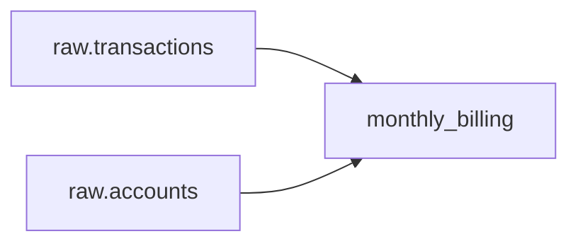
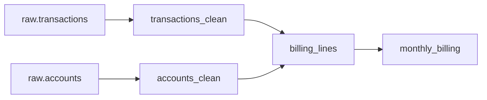

Split a pipeline into small models, one per table transformation. Use this page when you write a new pipeline, or when a model has grown to do several things at once.

**Don't write the whole pipeline as one model.** A single model that reads its inputs whole, cleans them, joins them and aggregates them hides every intermediate result inside one function:



```python type:ignore
@bauplan.model(materialization_strategy="REPLACE")
@bauplan.python("3.13", pip={"polars": "2.1.0"})
def monthly_billing(
    # No projection: every column of both tables is loaded
    transactions: Annotated[pa.Table, bauplan.Model("raw.transactions")],
    accounts: Annotated[pa.Table, bauplan.Model("raw.accounts")],
) -> Annotated[pa.Table, MonthlyBilling]:
    """Billed amount per account and month."""
    import polars as pl

    # Four steps in one function: nothing in between can be checked, reused or run in parallel
    transactions_clean = pl.DataFrame(transactions).with_columns(
        pl.col("account_id").str.to_uppercase()
    )

    accounts_clean = pl.DataFrame(accounts).with_columns(
        pl.col("account_id").str.to_uppercase()
    )

    lines = transactions_clean.join(accounts_clean, on="account_id", how="left")

    return (
        lines.group_by("account_id", pl.col("posted_at").dt.month_start().alias("month"))
        .agg(pl.col("amount").sum())
        .to_arrow()
    )
```

No expectation can check the joined lines, no dry run can show them, and no other model can reuse them. The two cleaning steps can't run in parallel, and the one model holds all the data in memory at once. Splitting doesn't add writes: Bauplan [passes the output](/concepts/pipelines#execution-model) of a model that isn't materialized to the next model, without writing it.

## List the transformations

Write down each step the data goes through: the preparation of each source, each join, each change of grain, and each output. A billing pipeline that cleans two sources, joins them and aggregates them by month has four steps:



**Prepare each shared input once.** When several models load and clean the same input, create one preparation model and make all of them depend on it.

**Compute shared work in a parent model.** When several outputs share an expensive join or aggregation, compute it once in a parent model and derive each output in a child. Otherwise every output repeats the expensive step.

**Rename or cast columns in the model that uses them.** A separate model that only renames or casts columns for a single consumer adds a step to the DAG with nothing worth checking or reusing.

## Write one model per transformation

Give each step its own model. Declare its output schema in the return annotation and describe it in a docstring, which becomes the documentation of its table. A model reads another model's output with `bauplan.Model("<model name>")`, so the signatures alone show how the data flows, and the DAG reads as a description of the transformation:

```python
from typing import Annotated

import bauplan
import pyarrow as pa


class TransactionColumns(bauplan.TableSchema):
    """The transaction columns needed for billing."""

    account_id: bauplan.String | None
    amount: bauplan.Float64 | None
    posted_at: bauplan.TimestampMicro | None


class AccountColumns(bauplan.TableSchema):
    """The account columns needed for billing."""

    account_id: bauplan.String | None
    segment: bauplan.String | None


class BillingLines(bauplan.TableSchema):
    """Transactions with their account attributes."""

    account_id: bauplan.String | None
    amount: bauplan.Float64 | None
    posted_at: bauplan.TimestampMicro | None
    segment: bauplan.String | None


class MonthlyBilling(bauplan.TableSchema):
    """Billed amount per account and month."""

    account_id: bauplan.String | None
    month: bauplan.TimestampMicro | None
    amount: bauplan.Float64 | None

# Step 1: clean the transactions
@bauplan.model()
@bauplan.python("3.13", pip={"polars": "2.1.0"})
def transactions_clean(
    transactions: Annotated[pa.Table, bauplan.Model("raw.transactions", projection_schema=TransactionColumns)],
) -> Annotated[pa.Table, TransactionColumns]:
    """Normalize the account key of every transaction."""
    import polars as pl

    return pl.DataFrame(transactions).with_columns(pl.col("account_id").str.to_uppercase()).to_arrow()

# Step 2: clean the accounts, independent of step 1, so the two run in parallel
@bauplan.model()
@bauplan.python("3.13", pip={"polars": "2.1.0"})
def accounts_clean(
    accounts: Annotated[pa.Table, bauplan.Model("raw.accounts", projection_schema=AccountColumns)],
) -> Annotated[pa.Table, AccountColumns]:
    """Normalize the account key of every account."""
    import polars as pl

    return pl.DataFrame(accounts).with_columns(pl.col("account_id").str.to_uppercase()).to_arrow()

# Step 3: join
@bauplan.model()
@bauplan.python("3.13", pip={"polars": "2.1.0"})
def billing_lines(
    transactions: Annotated[pa.Table, bauplan.Model("transactions_clean")],
    accounts: Annotated[pa.Table, bauplan.Model("accounts_clean")],
) -> Annotated[pa.Table, BillingLines]:
    """Attach account attributes to every transaction."""
    import polars as pl

    return pl.DataFrame(transactions).join(pl.DataFrame(accounts), on="account_id", how="left").to_arrow()

# Step 4: aggregate, and the only materialized model, since it is the output consumers read
@bauplan.model(materialization_strategy="REPLACE")
@bauplan.python("3.13", pip={"polars": "2.1.0"})
def monthly_billing(
    lines: Annotated[pa.Table, bauplan.Model("billing_lines")],
) -> Annotated[pa.Table, MonthlyBilling]:
    """Billed amount per account and month."""
    import polars as pl

    return (
        pl.DataFrame(lines)
        .group_by("account_id", pl.col("posted_at").dt.month_start().alias("month"))
        .agg(pl.col("amount").sum())
        .to_arrow()
    )
```

## Materialize only the outputs

Every materialized model writes and commits a table on each run. Leave the intermediate models on the default strategy, which writes nothing. Materialize only the models whose tables consumers read: in this pipeline, `monthly_billing`.

To choose whether `monthly_billing` replaces its table on each run, appends to it, or [rewrites a window of partitions](/how-to/build-pipelines/how-to-materialize-pipeline-outputs#overwrite-a-window-of-partitions), follow [how to materialize pipeline outputs](/how-to/build-pipelines/how-to-materialize-pipeline-outputs).

## Related

- [How to materialize pipeline outputs](/how-to/build-pipelines/how-to-materialize-pipeline-outputs)
- [How to run jobs concurrently](/how-to/performance/how-to-run-jobs-concurrently)
- [How to speed up reads](/how-to/performance/how-to-speed-up-reads)
- [Pipelines and expectations](/concepts/pipelines)
