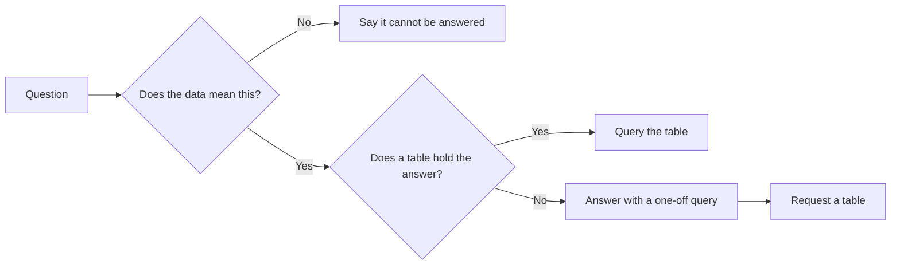

An AI assistant such as Claude Desktop, connected to the Bauplan MCP server, can answer questions about your data in plain language. It finds the tables, writes the SQL, runs it on Bauplan and returns the result.

The agent handles each question like this:



## Connect the assistant with a read-only key

Connect the assistant to the Bauplan MCP server, as shown in [set up your agent](/learn/set-up-your-agent#mcp-server). Authenticate with the API key of a user that has the reader role. That user can read every branch but cannot write, and neither can an agent that uses its key. You may need to create a dedicated user for this, such as a service user with only the reader role.

## Document what the data means

The agent maps each question to tables and columns. Names alone are not enough. "Revenue" can be gross or net, a "customer region" is not a "supplier region," and an order is not a line item.

Write the meaning in the models that build the tables. The docstring of a model, or of its output `TableSchema` if the model has none, becomes the description of its table. The `doc` of each field in its `TableSchema` becomes the description of the column. The agent reads both through the catalog.

```python
from typing import Annotated

from bauplan import Date32, Float64, String, TableField, TableSchema


class CustomerRevenue(TableSchema):
    """Revenue per customer and day, from delivered orders only"""

    customer_id: Annotated[String, TableField(doc="Customer who placed the order")]
    order_date: Annotated[Date32, TableField(doc="Day the order was placed, in UTC")]
    revenue: Annotated[Float64, TableField(doc="Net revenue in USD: price minus discount, before tax")]
```

The docs live in the same code as the model. A change to what a column means is reviewed in the same pull request as the change to how it is computed. See [semantics](/concepts/semantics).

## Write the instructions for the agent

Most assistants accept project instructions or a system prompt. Use them to teach the agent how to answer:

```text
You answer questions about company data for people without technical background.

Before answering, read the descriptions of the tables and columns you use.
If an existing table answers it, query that table on main.
If no table answers it but the data can, answer with a query on main,
and say that the answer comes from a one-off query.
If the data cannot answer it, say so in one sentence, and suggest a close
question the data can answer. Never estimate or invent a number.
If the question can be read in more than one way, state the reading you chose.

Lead with the answer. Use a chart for trends and comparisons, a single number
for a single number. With every answer, give the SQL you ran and the job ID.
```

## Check where an answer comes from

Each query the agent runs is a job in Bauplan, with its SQL in the job list. The job ID the agent gives with every answer lets you look up the query behind a number.

## Turn one-off answers into tables

A one-off query is not reviewed. It may read raw tables or use an interpretation nobody checked, and the next person who asks may get a different number. When no table answers a question, turn the query into a table that someone reviews, and let the agent read that table next time.

You can automate this with an issue tracker and a coding agent in CI:

1. Connect the assistant to your issue tracker as well. Add to its instructions that, after a one-off answer, it files an issue with the question, how it interpreted it, the SQL it ran, the result, and the schemas of the tables it read.
2. Have each new issue start a CI job in the repository of your pipelines. The job runs a coding agent that reads the issue and the repository, writes the SQL as models in a pipeline, and checks them with a dry run on its own branch.
3. The coding agent opens a pull request, and a person reviews and merges it.
4. The scheduler runs the new pipeline and writes the table on `main`. The next time someone asks the question, the agent queries that table.

The coding agent in CI writes to branches and needs its own API key with write access, separate from the read-only key of the assistant. See [how to bring data to production](/how-to/publish/how-to-bring-data-to-production).

For a working implementation with Linear as the issue tracker and a GitHub Action that runs Claude Code, see the [executive questions example](https://github.com/BauplanLabs/bauplan/tree/main/examples/projects/executive-questions-with-mcp).

## Related

- [Set up your agent](/learn/set-up-your-agent)
- [How to query tables](/how-to/consume/how-to-query-tables)
- [Semantics](/concepts/semantics)
