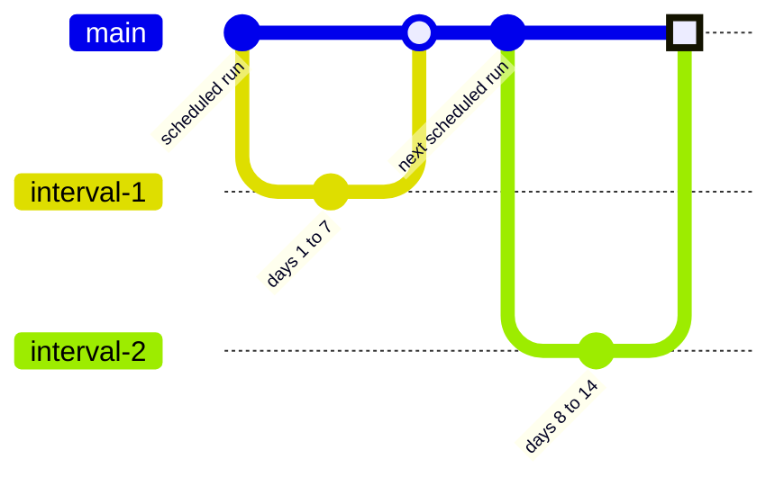

A backfill recomputes a table over a range of past periods: after a bug in a model is fixed, after the source data for some days is delivered again, or when a new table has to be filled with its history before the schedule takes over. The scheduled pipeline already knows how to compute one period, so a backfill should not be a second implementation of it. It runs the same projects, with the same models, over windows in the past instead of the current one.

Two things make a backfill more than a loop over dates. First, the whole range rarely fits in one run: a year of data takes longer and needs more memory than the hour or the day a scheduled run reads, and a failure halfway through throws away everything computed so far. Second, the "ordinary" scheduled runs keep writing to `main` while the backfill runs, and two jobs that publish the same table at the same time conflict (see [how to handle merge conflicts](/how-to/publish/how-to-handle-merge-conflicts)). The approach on this page answers both: it splits the range into intervals, oldest first, and publishes each interval on its own, from its own branch, at a moment when the scheduled runs are not merging.

Each interval is computed on a branch created from the latest `main` and merged as soon as it is ready, between the commits of the scheduled runs:



## Make the pipeline rewrite a window

A backfill can rerun a pipeline over any window only if a run rewrites exactly the window it is given, and nothing else. This is what the `OVERWRITE_PARTITIONS` materialization strategy does when the window is passed as run parameters: the model deletes the partitions inside `overwrite_filter` and writes its output in their place, reading its inputs over the same window.

```python type:ignore
@bauplan.model(
    materialization_strategy="OVERWRITE_PARTITIONS",
    partitioned_by=["event_date"],
    overwrite_filter="event_date >= $start_date AND event_date < $end_date",
)
```

The full model, and the rules that keep the filter and the output consistent, are in [how to overwrite partitions](/how-to/shape-pipeline-outputs/how-to-overwrite-partitions). With a pipeline written this way, the scheduled run and the backfill differ only in the parameters: the scheduler passes the current window, the backfill passes a past one. Running the same window twice writes the same partitions twice, so a backfill that overlaps what the schedule has already written does not duplicate anything.

## Keep the backfill in the repository

A backfill is a one-off intervention tied to the state of the code and of the data when it was written. Keep it next to the scheduled pipelines but outside their folders, so that an orchestrator never picks it up, with one folder per backfill, named with the UTC time it was written and a short description:

```tree
repo/
  src/
    transformation/
      pipelines/                                    # the scheduled projects, reused by the backfill
        events_clean/
        daily_active_users/
  backfills/
    20261103160000_rebuild_daily_active_users/
      README.md                                     # which tables and days, why, and after what
      main.py                                       # the loop on this page
```

The backfill folder contains no models of its own, it runs the scheduled projects. Write a new backfill instead of editing an old one, so that the `backfills` folder stays a record of what was rewritten and why. The README says which tables and which range the backfill rewrites, why, and what must have run before it, such as a migration that creates the table it fills; see [how to migrate tables](/how-to/operate/how-to-migrate-tables).

## Split the range into intervals

Choose an interval size that one run handles comfortably, and split the range into consecutive, half-open intervals, so that every day belongs to exactly one of them. The last day of the range is included, and the last interval is shorter when the days do not divide evenly:

```python
from datetime import date, timedelta


def intervals(from_date: date, to_date: date, interval_days: int) -> list[tuple[date, date]]:
    """Split the days from from_date to to_date, both included, into intervals [start, end), oldest first"""

    # A non-positive interval would never advance
    if interval_days < 1:
        raise ValueError(f"interval_days must be at least 1, got {interval_days}")

    if from_date > to_date:
        raise ValueError("from_date is after to_date")

    # to_date is included, so the last interval ends the day after it
    end = to_date + timedelta(days=1)

    result = []
    start = from_date

    while start < end:
        interval_end = min(start + timedelta(days=interval_days), end)
        result.append((start, interval_end))
        start = interval_end

    return result
```

The interval size is a trade-off. Larger intervals mean fewer runs and fewer commits on `main`, but each run takes longer, needs more memory, and is more likely to overlap with a scheduled merge. Smaller intervals make each run cheap and each failure small, at the price of more commits.

## Stay out of the way of the scheduled runs

A scheduled run typically creates its branch from `main`, writes the table and merges it back. If the backfill merges into `main` between the moment the scheduled run branches and the moment it merges, both have changed the same table, and the merge that lands second is rejected; see [how to handle merge conflicts](/how-to/publish/how-to-handle-merge-conflicts). The scheduled run then fails because of the backfill, not because of anything in its own data or code.

Scheduled runs merge at predictable times, since they follow the schedule. Wait until that part of the hour is over before creating a branch and before merging:

```python
import time
from datetime import UTC, datetime

# The minutes of every hour in which the scheduled runs branch and merge: match them to your schedule
UNSAFE_MERGE_MINUTES = range(10, 30)


def wait_for_safe_merge_minute() -> None:
    """Sleep while the scheduled runs may be merging into the base branch"""

    now = datetime.now(UTC)

    if now.minute in UNSAFE_MERGE_MINUTES:
        resume_at = now.replace(minute=UNSAFE_MERGE_MINUTES.stop, second=0, microsecond=0)
        time.sleep((resume_at - now).total_seconds())
```

The backfill checks again before merging, since the computation of an interval can last long enough to reach the next unsafe window.

## Publish each interval from its own branch

Each interval runs on a branch created from the latest `main`. The projects run in the order of the DAG, so a downstream project reads the tables its upstream project has just written on the same branch. The branch is then merged, and deleted.

If the merge is rejected with a conflict, something else changed on `main` a table that the backfill also changed on its branch, and retrying the merge of that branch would fail every time. The backfill deletes the branch and recomputes the interval on a new one, created from the current `main`.

If a run fails, running it again on a new branch would fail in the same way. The backfill stops and leaves the branch in place for you to inspect; see [how to debug a failed pipeline](/how-to/operate/how-to-debug-a-failed-pipeline).

```python type:ignore
import bauplan
from bauplan.exceptions import MergeConflictError

BASE_BRANCH = "main"
NAMESPACE = "analytics"

# The scheduled projects, in the order of the DAG: daily_active_users reads events_clean
PROJECTS = ("src/transformation/pipelines/events_clean", "src/transformation/pipelines/daily_active_users")

# Each attempt recomputes the interval on a new branch after a merge conflict
MAX_MERGE_ATTEMPTS = 5


def publish_interval(client: bauplan.Client, start: date, end: date) -> None:
    """Compute one interval on a branch from the latest base branch and merge it, recomputing it after a conflict"""

    username = client.info().user.username

    for _ in range(MAX_MERGE_ATTEMPTS):
        # A new branch per attempt, from the state of main at this moment
        wait_for_safe_merge_minute()
        stamp = datetime.now(UTC).strftime("%Y%m%d%H%M%S")
        branch = f"{username}.backfill-{start:%Y%m%d}-{end:%Y%m%d}-{stamp}"
        client.create_branch(branch, from_ref=BASE_BRANCH)

        # The window of the interval, as the overwrite_filter of every model expects it
        parameters: dict[str, str | int | float | bool | None] = {
            "start_date": start.isoformat(),
            "end_date": end.isoformat(),
        }

        for project in PROJECTS:
            state = client.run(project, ref=branch, namespace=NAMESPACE, parameters=parameters)

            # A failed run fails the same way on any branch
            if str(state.job_status).lower() != "success":
                raise RuntimeError(f"{project} failed on {branch} in job {state.job_id}: {state.error}")

        # The runs can outlast the safe minutes, so check again before merging
        wait_for_safe_merge_minute()

        try:
            client.merge_branch(
                source_ref=branch,
                into_branch=BASE_BRANCH,
                commit_message=f"Backfill {start} to {end}",
            )
        except MergeConflictError:
            # main changed under the branch: discard it and recompute from the new main
            client.delete_branch(branch)
            continue

        client.delete_branch(branch)
        return

    raise RuntimeError(f"merge of {start} to {end} still conflicting after {MAX_MERGE_ATTEMPTS} attempts")
```

## Run the backfill

The entry point splits the range and publishes the intervals one after the other, oldest first:

```python type:ignore
from typing import Annotated

import typer


def main(
    from_date: Annotated[datetime, typer.Option(formats=["%Y-%m-%d"], help="First day to recompute")],
    to_date: Annotated[datetime, typer.Option(formats=["%Y-%m-%d"], help="Last day to recompute, included")],
    interval_days: Annotated[int, typer.Option(help="Days computed and merged together")] = 7,
) -> None:
    """Recompute the tables of PROJECTS over the range, publishing one interval at a time"""

    client = bauplan.Client()

    for start, end in intervals(from_date.date(), to_date.date(), interval_days):
        publish_interval(client, start, end)


if __name__ == "__main__":
    typer.run(main)
```

```sh title="Recompute October"
uv run python backfills/20261103160000_rebuild_daily_active_users/main.py --from-date 2026-10-01 --to-date 2026-10-31
```

Each interval is merged before the next one starts, so `main` always holds a consistent table: the intervals already published are recomputed, the others are as they were. If the backfill stops, because a run failed or the merge kept conflicting, the intervals already merged stay published. Once you have fixed the cause, start the backfill again from the first interval that is missing.

## In production

### Run the scheduled projects, not a copy of them

A backfill with its own version of the models computes the past with different logic from the present, and the two drift apart with the next change to either. Reuse the projects that run on schedule, and pass the window as parameters. If the scheduled pipeline cannot be run over an arbitrary window, change it so that it can, before writing the backfill.

### Publish every interval as soon as it is computed

Computing the whole range on one branch and merging it at the end keeps the branch alive for the whole backfill, while the scheduled runs change the same tables on `main`. The longer the branch lives, the more certain the conflict at the end, and the whole backfill is lost with it. One branch per interval, merged right away, keeps each branch short and each conflict cheap to recover from.

### Run long backfills from the orchestrator

A backfill over months runs for hours, and a laptop that sleeps or loses the network stops it halfway. For anything long, run the same loop from the orchestrator that runs the schedule, as a job of its own that you start by hand, with the retry and polling policies of the scheduled runs; see [how to deploy a pipeline](/how-to/deploy/how-to-deploy-a-pipeline) and [how to poll running jobs](/how-to/deploy/how-to-run-jobs-detached-and-poll-them).

## Related

- [How to run incremental workloads](/how-to/performance/how-to-run-incremental-workloads)
- [How to parametrize a pipeline](/how-to/build-pipelines/how-to-parametrize-a-pipeline)
- [How to roll back a table](/how-to/operate/how-to-roll-back-a-table)
