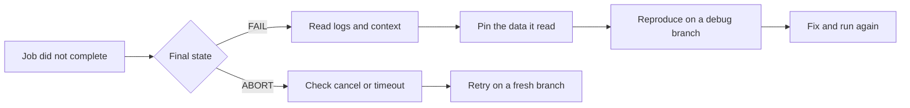

When a pipeline run fails, Bauplan keeps everything you need to understand why: the final state of the job, the logs of every model, the code that was shipped, and the commit the run read from. The data that run saw stays reachable even after `main` has moved on, so you can reproduce the failure on exactly the same inputs.

Start from how the job ended. A job in `FAIL` stopped because of something in the run itself, such as an exception in a model, a failing expectation or a type contract the output did not respect. Running it again on the same data fails the same way, so find the cause before you rerun.

A job in `ABORT` was stopped from the outside, because it was cancelled or timed out. Nothing is necessarily wrong with the code, and the first thing to check is why it was stopped.



## Get the job and its final state

A run reports a failed job through the state it returns, not through an exception, so start from its `job_id`. You can retrieve a `job_id` in several ways. The simplest one is to use the CLI, and run

```sh
bauplan job ls
```

to list all the jobs recently run and read their status. 

## Read the logs and the job context

The job logs contain what every model printed, including the Python traceback of the model that failed. The job context, on the other hand, tells you where and what the job ran: the ref it was submitted against, the transactional branch that held its writes, the DAG and the exact code that was shipped.

```python type:ignore
# Everything the models printed, tracebacks included
for event in client.get_job_logs(job_id):
    print(f"[{event.level}] {event.message}")

context = client.get_job_context(job_id, include_snapshot=True)

# Project name, the ref the job ran against (e.g. main), and the transaction branch that held its writes
print(context.project_name, context.ref, context.tx_ref)

# Check the code that actually ran, to see it is the version you think it is
for path, source in context.snapshot_dict.items():
    print(path)
```

## Pin the data the run read

A run resolves its inputs at the commit its ref pointed to when the job started. If you rerun the same code against the current `main`, you read data that may have changed since, and the failure may disappear or turn into a different one. Create a debug branch from the commit the failed run read instead:

```python type:ignore
# Fetch the job that failed
job = client.get_job(job_id)

# The ref the job was submitted against, for example main
source_branch = context.ref
if source_branch is None:
    raise RuntimeError(f"job {job_id} has no ref in its context")

# The head of that branch when the job started is the state the run read
commit = next(
    iter(
        client.get_commits(
            source_branch,
            filter_by_authored_date_end_at=job.started_at,
            limit=1,
        )
    )
)

username = client.info().user.username
debug_branch = f"{username}.debug-{job_id[:8]}"
client.create_branch(debug_branch, from_ref=f"{source_branch}@{commit.ref.hash}")
```

Query the inputs of the failing model on the debug branch to find the rows that break it:

```python type:ignore
rows = client.query(
    "SELECT order_id, amount FROM orders WHERE amount IS NULL",
    ref=debug_branch,
)
print(rows.num_rows)
```

When the failure is in the middle of a DAG, `context.tx_ref` is the transactional branch the run wrote to, and it holds the tables the models before the failure had written. Querying it shows the intermediate outputs as the failing model received them, without recomputing the upstream models.

## Reproduce and fix on the debug branch

Run the pipeline on the debug branch as a dry run, so that it computes every model and checks every expectation without materializing anything:

```python type:ignore
state = client.run("./pipelines/orders", ref=debug_branch, dry_run=True)
print(state.job_status, state.error)
```

A dry run that fails the same way as the original job confirms that you are looking at the failure and not at a different one. From there, change one thing at a time, in the code or in the data on the debug branch, and dry run again after each change. When the dry run completes, run it once for real on the debug branch and check the outputs it wrote. Delete the debug branch once the fix is merged.

## Related

- [How to poll running jobs](/how-to/deploy/how-to-run-jobs-detached-and-poll-them)
- [How to add expectations to a pipeline](/how-to/build-pipelines/how-to-add-expectations-to-a-pipeline)
- [Catalog and branches](/concepts/catalog-and-branches)
- [Pipelines](/concepts/pipelines#execution-model)
