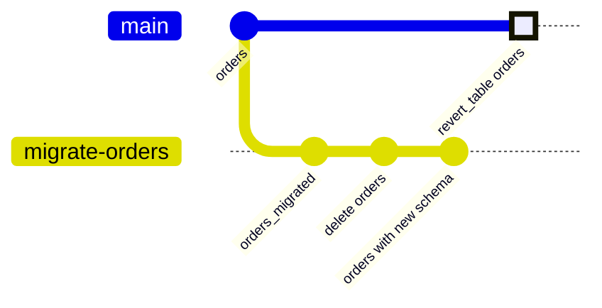

The schema of the data coming from an upstream service is not guaranteed to stay the same, and the tables your pipelines build change with the requirements of whoever reads them. Bauplan extends the schema of a table on its own, but it never removes columns from it. When you append rows with a column the table does not have, Bauplan adds the column, and the rows already in the table get null in it. When you append rows that lack a column the table has, the column stays, and the new rows get null in it.

Removing or retyping a column takes a deliberate step called a **migration**, as in a relational database. Whether you need one depends on what changed:

| Change upstream | What to do |
| :--- | :--- |
| A column is added | Nothing: the next append adds it |
| A column is removed | Run a migration, as shown on this page |
| A column changes type | Run a migration with the same steps |
| The structure of a nested column changes | Nothing, if the column is stored as `string`; see [store nested columns as strings](#store-nested-columns-as-strings) |

If a scheduled pipeline writes the table with the `REPLACE` materialization strategy, you do not need a migration: update the pipeline, and its next run writes the table from scratch with the new schema. Otherwise, follow this page, which removes a column `discount_code` from a table `orders`.

## Approach to migrations

The main difference with respect to a relational database is that there is no `ALTER TABLE`: a column is removed or retyped only by writing the table again with the new schema. A pipeline, however, cannot read the table it writes, since that would be a cycle in the DAG. The migration therefore goes through an intermediate table, on a working branch, and only the final table is brought back to `main`.

The example on this page starts from a table `orders` on `main`. The shop stops accepting discount codes, and the upstream service removes the column `discount_code` from the files it delivers. The table keeps the column, and every new order lands with `discount_code` set to null. The migration removes `discount_code` from `orders`, without losing the rows, the column docs or the partitioning the table already has.

The migration takes five steps. First, you create a working branch from `main`, so that nothing you do is visible to the readers of `main` until the end. On that branch, a first pipeline reads `orders`, drops the column and materializes the result as a new table `orders_migrated`. You then delete `orders` on the working branch, which frees its name, and a second pipeline writes `orders_migrated` back as `orders`, now with the new schema. Finally, `revert_table` replaces `orders` on `main` with its state on the working branch, in a single commit that carries over only that table, and you delete the working branch.



## Lay out the migration

A migration runs once, so keep it away from the pipelines that run on a schedule, in a `migrations` folder at the root of the repository. Give each migration its own subfolder, named with a UTC timestamp followed by a short description, so that the folder sorted by name is the history of every schema change:

```tree
repo/
  src/
    transformation/
      pipelines/                        # pipelines that run on a schedule
        orders/
  migrations/                           # one-off migrations, never scheduled
    20261019101500_drop_discount_code/
      main.py                           # runs the migration
      migrate/
        bauplan_project.yaml
        models.py                       # orders -> orders_migrated
      copy_back/
        bauplan_project.yaml
        models.py                       # orders_migrated -> orders
```

Create the two projects ("migrate" and "copy_back") with `bauplan init`, so that each one gets its own project id, then replace their `models.py`.

## Write the schema after the migration

Both projects output the migrated table, and the typed SDK requires a schema on the output of every model. Write that schema once, as a `TableSchema` class that describes `orders` after the change, and use it in both `models.py` files. Copy the doc of each column into the class as well, otherwise the migrated table loses it.

```python
from typing import Annotated

import bauplan
from bauplan import Date32, String, TableField, TableSchema


class OrdersMigrated(TableSchema):
    """Schema of orders after the migration"""

    order_id: Annotated[String, TableField(doc="Order identifier")]
    customer_id: Annotated[String, TableField(doc="Customer who placed the order")]
    order_date: Annotated[Date32, TableField(doc="Day the order was placed")]
    # discount_code is not listed, so the migrated table no longer has it
```

## Write the two pipelines

The first project, "migrate," reads `orders` and applies the change, writing the end results to a new, temporary table named `orders_migrated`. Since we will need to delete the original `orders` table between the run of the "migrate" and "copy_back" projects, it is important that this temporary table is materialized.

For the "migrate" project, `models.py` holds the schema class above, followed by the model:

```python type:ignore
import pyarrow as pa


@bauplan.model(materialization_strategy="REPLACE")
@bauplan.python("3.13", pip={"polars": "2.0.0"})
def orders_migrated(
    orders: Annotated[pa.Table, bauplan.Model("orders")],
) -> Annotated[pa.Table, OrdersMigrated]:
    """orders without the discount_code column"""
    import polars as pl

    return pl.DataFrame(orders).drop("discount_code").to_arrow()
```

The second project, "copy_back", with the same schema class at the top of its `models.py`, writes `orders_migrated` under the original name `orders`. Since it re-creates `orders` from scratch, everything that belongs to the table and not to the data must be declared here: the docstring becomes the table comment, and `partitioned_by` must repeat the partitioning of the original table.

```python type:ignore
import pyarrow as pa


@bauplan.model(materialization_strategy="REPLACE", partitioned_by=["order_date"])
@bauplan.python("3.13")
def orders(
    orders_migrated: Annotated[
        pa.Table,
        bauplan.Model("orders_migrated", projection_schema=OrdersMigrated),
    ],
) -> Annotated[pa.Table, OrdersMigrated]:
    """One row per order placed on the shop"""
    return orders_migrated
```

## Run the migration on a branch

Before you start, pause every job that writes the table: see [stop every writer of the table while the migration runs](#stop-every-writer-of-the-table-while-the-migration-runs).

The `main.py` of the migration runs the steps in order, on a working branch created from `main`.

```python
from datetime import UTC, datetime
from pathlib import Path

import bauplan

# The two projects live next to this script
MIGRATION_DIR = Path(__file__).parent
TABLE = "orders"
NAMESPACE = "sales"
BASE_BRANCH = "main"


def run_project(client: bauplan.Client, project: str, branch: str) -> None:
    """Run one of the two projects on the working branch, and stop the migration if it does not succeed"""
    state = client.run(str(MIGRATION_DIR / project), ref=branch, namespace=NAMESPACE)

    if str(state.job_status).lower() != "success":
        raise RuntimeError(f"{project} failed in job {state.job_id}: {state.error}")


client = bauplan.Client()

# A fresh branch for every attempt, so that a failed attempt is never reused
stamp = datetime.now(UTC).strftime("%Y%m%d%H%M%S")
branch = f"{client.info().user.username}.migrate-{TABLE}-{stamp}"
client.create_branch(branch, from_ref=BASE_BRANCH)

# orders -> orders_migrated, then orders is deleted and written again with the new schema
run_project(client, "migrate", branch)
client.delete_table(TABLE, branch=branch, namespace=NAMESPACE)
run_project(client, "copy_back", branch)

# Check the migrated table here, before it replaces the one on main

# Replace only orders on main: orders_migrated and the deletion stay on the working branch
client.revert_table(TABLE, namespace=NAMESPACE, source_ref=branch, into_branch=BASE_BRANCH, replace=True)
client.delete_branch(branch)
```

If any step fails, the script stops before `revert_table`: `main` is untouched, and the working branch stays in place with the state of the failed attempt for you to inspect. Delete it once you know what went wrong.

`revert_table` is what makes the migration safe to publish. A merge of the working branch would bring over every change made on it, including `orders_migrated` and the deletion of `orders`, while `revert_table` replaces one table on `main` with its state on the working branch, in a single commit. Readers of `main` see the old table until that commit and the new one after it, and never a table that is missing or half migrated.

<Note>
Only admins can revert a table on `main`.
</Note>

## In production

### Stop every writer of the table while the migration runs

`revert_table` with `replace=True` replaces `orders` on `main` with the copy on the working branch, which was taken when the branch was created. Rows that an import or a scheduled pipeline appends to `orders` on `main` in the meantime are not in that copy, and they are lost when the migrated table replaces the original. Pause ingestion and the scheduled pipelines that write the table for the duration of the migration.

### Update readers and writers before the migration lands

Once the migrated table is on `main`, the pipelines that read it see the new schema, and whatever writes it must produce the new schema from then on. A writer that still produces `discount_code` does not fail but its next append adds the column back to the table. Merge the code changes to those pipelines together with the migration, and resume them only after it has run.

### Store nested columns as strings

A nested column typed as a `struct` spells out every field and its type, so every field added, renamed or retyped upstream becomes a schema change of the table, and a migration. Stored as `string`, the column absorbs these changes, and only the pipelines that parse it need to follow them. Choose the type at import, as shown in [how to control types at import](/how-to/import-and-lay-out-tables/how-to-control-types-at-import), and promote to columns of their own only the fields you need, as shown in [how to extract nested fields at import time](/how-to/import-and-lay-out-tables/how-to-extract-nested-fields-at-import-time). Turning an existing `struct` column into a `string` is a type change, and goes through a migration like the one on this page.

### Never change a table on main by deleting and recreating it

Deleting `orders` on `main` and creating it again makes the table disappear for every reader and pipeline until it is back, and leaves `main` without it if anything fails in between. Run every step on a working branch and publish the result with one `revert_table`.

## Related

- [Semantics](/concepts/semantics)
- [How to roll back a table](/how-to/operate/how-to-roll-back-a-table)
- [How to materialize pipeline outputs](/how-to/shape-pipeline-outputs/how-to-materialize-pipeline-outputs)
