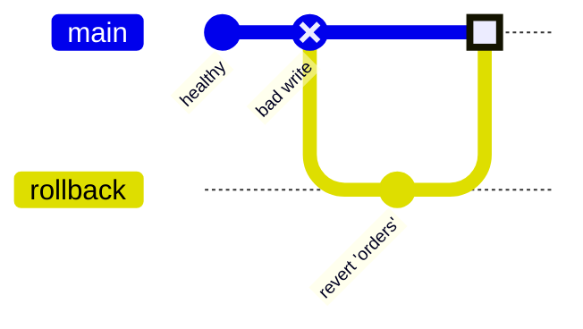

When a table ends up with bad data because a pipeline wrote wrong rows, you can use Bauplan's time travel capability to roll it back to a healthy state. Since a state is identified by a commit on the catalog, rolling back a table means writing the state of a previous commit as a new commit on top of the branch.



## Find the last healthy commit

List the recent commits of the corrupted branch, for instance `main`, which tell you who or which job wrote what, and when:

```python
import bauplan

client = bauplan.Client()

for commit in client.get_commits("main", limit=20):
    author = commit.author.name if commit.author else None
    print(commit.ref.hash, commit.authored_date, author, commit.properties.get("bpln_job_id"))
```

Pick the commit just before the bad write, and read the table as it was at that commit, by passing the ref `main@<hash>` to the query. The same query on `main` and on the candidate commit shows whether that state is the one you want to return to:

```python type:ignore
healthy_ref = "main@93011e704c9990740b6d70ff97240bb11a9d0504c8d504c82a2acd2274f2514d"

check = """
SELECT order_date, COUNT(*) AS orders
FROM sales.orders
GROUP BY order_date
ORDER BY order_date DESC
LIMIT 7
"""

print(client.query(check, ref="main"))
print(client.query(check, ref=healthy_ref))
```

## Roll back the affected tables

If no other table was computed from the bad data, roll back that one table. If the bad write fed other tables in the same DAG, roll them all back together.

### Roll back one table

`revert_table` replaces the table on the target branch with its state at the source ref, in one commit:

```python type:ignore
client.revert_table(
    "orders",
    namespace="sales",
    source_ref=healthy_ref,
    into_branch="main",
    replace=True,
)
```

`replace=True` is required because the table exists on `main`; without it, the call fails with `RevertDestinationTableExistsError`. If the table on `main` is already identical to the state you are reverting to, the call fails with `RevertIdenticalTableError`, which usually means you picked the wrong commit. Only the table you name changes: every other table on `main` keeps its current state.

<Note>
Only admins can revert a table on `main`.
</Note>

### Roll back several tables at once

When the bad write touched several tables, reverting them one by one on `main` produces one commit per table, and readers can see a mix of old and new tables between two reverts. Revert them on a branch instead, check them there, and merge the branch, so that `main` moves from the bad state to the healthy one in a single commit:

```python type:ignore
# Corrupted tables
TABLES = ["orders", "customers"]

username = client.info().user.username
rollback_branch = f"{username}.rollback-orders-and-customers"
client.create_branch(rollback_branch, from_ref="main")

# Each revert is a commit on the rollback branch, not on main
for table in TABLES:
    client.revert_table(
        table,
        namespace="sales",
        source_ref=healthy_ref,
        into_branch=rollback_branch,
        replace=True,
    )

# Check the reverted tables on the branch before publishing them
print(client.query(check, ref=rollback_branch))

client.merge_branch(source_ref=rollback_branch, into_branch="main")
client.delete_branch(rollback_branch)
```

## Related

- [Catalog and branches](/concepts/catalog-and-branches)
- [How to migrate tables](/how-to/operate/how-to-migrate-tables)
- [How to backfill a table](/how-to/operate/how-to-backfill-a-table)
