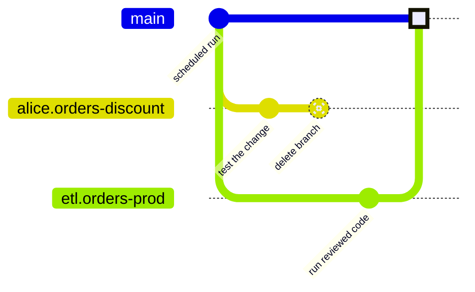

Dashboards, applications, and downstream jobs read from `main`, and only the scheduler writes to it. People and agents develop and test pipelines on their own branches. A change reaches production as code through a reviewed pull request, and the scheduler publishes its results on `main` at the next run. Nobody merges data into `main` by hand.



## Give production its own user

Create a Bauplan user for production, for instance `etl`, and give its API key only to the orchestrator. Every scheduled job runs as this user, on a branch named after the [branch naming conventions](/how-to/publish/how-to-name-branches), and only branches created by a scheduled job are merged into `main`.

To create a new user, head to the [Bauplan web app](https://app.bauplanlabs.com/dashboard), select your organization and click "Manage." If you are an administrator for this organization, you will have the possibility to invite new users from the "Members" tab on the left of the pop-up window.

## Develop the change on two branches

Each pipeline change uses two parallel branches, a Git branch for the code and a Bauplan branch for the data it produces. Create both from `main`, for instance `feature/orders-discount` in Git and `alice.orders-discount` in Bauplan. Write the code on the Git branch and run it on the Bauplan branch.

```python
import bauplan

client = bauplan.Client()

username = client.info().user.username
branch = f"{username}.orders-discount"

client.create_branch(branch, from_ref="main")
state = client.run(project_dir="pipelines/orders", ref=branch, strict=True)
print(state.job_status, state.error)
```

## Publish through the pull request

When you are satisfied, open a pull request for the Git branch, and do not merge the Bauplan branch into `main`. Once the pull request is reviewed and merged into Git `main`, the scheduler picks up the new code on its next run, computes the tables on its own branch from the current state of `main`, and merges that branch.

## Related

- [How to Write-Audit-Publish](/how-to/publish/how-to-write-audit-publish)
- [How to clean up branches](/how-to/publish/how-to-clean-up-branches)
- [How to deploy a pipeline](/how-to/deploy/how-to-deploy-a-pipeline)
