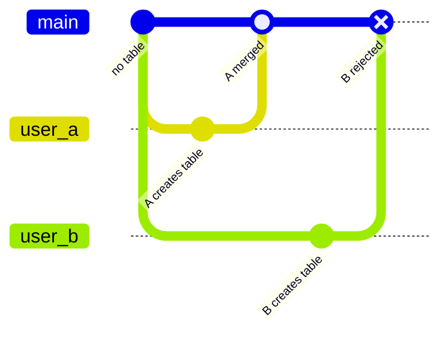
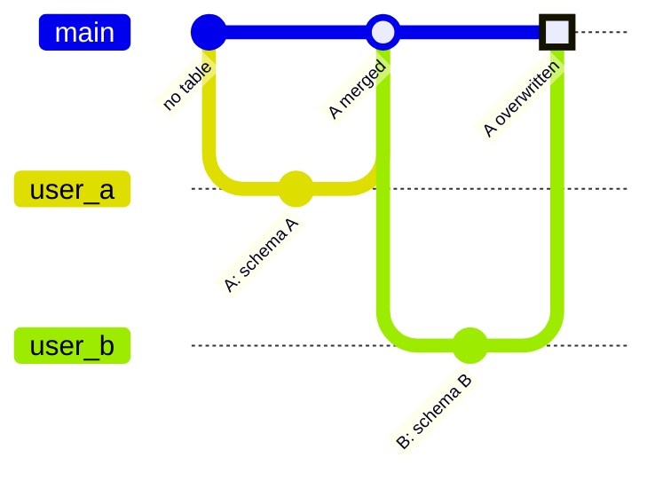
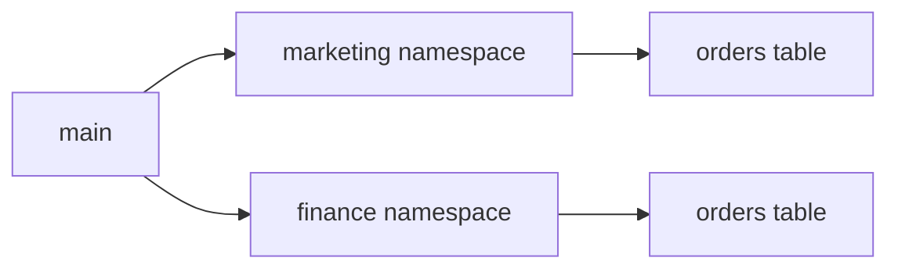
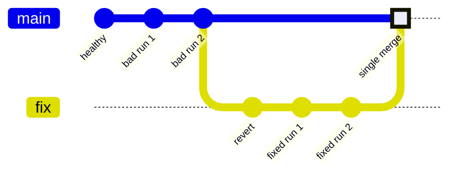

Merging a branch applies all its changes since it diverged from the destination, every modified table and namespace, in a single atomic commit. If a table was also modified on the destination during that time, Bauplan reports a conflict and does not merge. Conflicts are checked per table, not per row, because Bauplan never combines two versions of the same table.

Some conflicts are therefore rejected by Bauplan, while others go through silently and are only noticed downstream. Three scenarios cover most of them:

| Scenario | What happens |
| :--- | :--- |
| [Concurrency conflict](#concurrency-conflicts) | Two branches change the same table, and Bauplan rejects the second merge |
| [Naming conflict](#naming-conflicts) | Two producers write tables with the same name, and the second silently replaces the first |
| [Corrupted table](#corrupted-tables) | A buggy pipeline wrote wrong values over several runs, and the table must be repaired |

Runnable versions of these scenarios are in the [Bauplan examples repository](https://github.com/BauplanLabs/bauplan/tree/main/examples/learn/06-how-to-manage-conflicts).

## Concurrency conflicts

Two users branch from `main` before a table exists, and both create it. User A merges first: `main` has not moved since A branched, so the merge goes through. User B branched from the same earlier commit, so both `main` and B's branch now introduce the table, from divergent histories. Bauplan cannot reconcile the two, and rejects B's merge with `MergeConflictError` rather than silently overwrite A's work:



The same happens whenever two branches change the same table, for instance two runs of a job started in parallel. You avoid it by keeping branches short-lived, created just before the write, merged as soon as the audit passes, and by giving each table a single writer. Let only scheduled jobs write to `main`, so there is one serialized path into it (see [how to bring data to production](/how-to/publish/how-to-bring-data-to-production)), and run the jobs that write the same table one after another, not in parallel. To import many files into one table, use a single import over a pattern (such as `client.import_data("my_table", "s3://my_bucket/my_files/*.parquet")`, for example), not one import per file.

When a merge is rejected, do not try to fix the branch. Its tables were computed from a state of `main` that no longer exists, so delete it, create it again from the current `main`, rerun the job, and merge:

```python type:ignore
from bauplan.exceptions import MergeConflictError

try:
    client.merge_branch(source_ref=branch, into_branch="main")
except MergeConflictError:
    client.delete_branch(branch)
    # Recompute from the current main on a new branch, then merge again
```

## Naming conflicts

When B branches from `main` after A has already merged, both merges succeed. B's table has the same fully qualified name as A's, so for Bauplan B's merge is a legitimate update of an existing table: it replaces A's schema and data without any error.



A table referenced without a namespace resolves to the default `bauplan` namespace, so producers that use bare names all write into the same place. Give each independent producer its own namespace: the fully qualified names of their tables then differ, and both tables can live on `main`.



If an overwrite has already happened, the previous state is not lost: it is still readable at the commit before B's merge, and you can bring it back as in [how to roll back a table](/how-to/operate/how-to-roll-back-a-table). See [namespaces](/concepts/tables#namespaces).

## Corrupted tables

When a buggy pipeline has written wrong values over several runs, repair the tables on a side branch and merge once. Fork the branch from the latest state of `main`, revert the affected tables to the last healthy commit with `revert_table`, replay the fixed pipeline as many times as needed, audit the result, and merge:



Repairing in place exposes consumers to every intermediate state: a table reverted but not yet recomputed, or recomputed for only some days. On a side branch, consumers keep reading the old `main` until the single merge swaps every repaired table in at once. [How to roll back a table](/how-to/operate/how-to-roll-back-a-table) shows how to find the healthy commit and revert several tables on a branch, and [how to backfill a table](/how-to/operate/how-to-backfill-a-table) shows how to replay a pipeline over past periods.

## Related

- [Catalog and branches](/concepts/catalog-and-branches#merges)
- [How to name branches](/how-to/publish/how-to-name-branches)
- [How to clean up branches](/how-to/publish/how-to-clean-up-branches)
