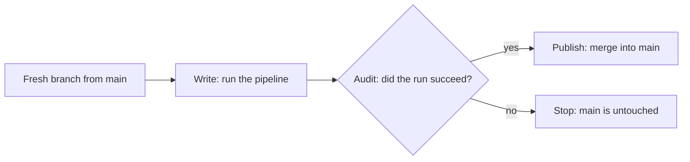

Write-Audit-Publish is the pattern every job that writes production data follows, so that bad data never reaches `main`. The job writes on a branch of its own, audits what it wrote with checks that can fail it, and publishes with a single merge only if every check passed.



## Write on a fresh branch

Create a new branch from the latest state of `main` for every run, named after the [branch naming conventions](/how-to/publish/how-to-name-branches), and run the pipeline on it. If you want a model's output saved as a table, set its [materialization strategy](/concepts/pipelines#materialization-strategies). Models without one don't write anything.

```python
from datetime import datetime, timezone

import bauplan

client = bauplan.Client()

stamp = datetime.now(timezone.utc).strftime("%Y%m%d%H%M%S")
branch = f"{client.info().user.username}.orders-transformation-prod-{stamp}"

client.create_branch(branch, from_ref="main")
state = client.run(project_dir="pipelines/orders", ref=branch)
```

The run writes its tables to this branch only, so `main` doesn't change until you merge.

## Audit with checks that fail the run

The audit is not a separate step that runs after the write but is part of the pipeline. Put [expectations](/concepts/pipelines#expectations) next to the models they check, and an output schema in the return annotation of each model. An expectation runs right after the model it checks, and the first one to fail fails the run. A model that returns columns or types other than the declared ones fails the run with `bauplan.ModelOutputContractError` before anything is materialized.

A run is [atomic](/concepts/catalog-and-branches#transactional-branches): when it fails, none of its writes reach the branch, and the branch keeps the data it had before the run. What is left for the job to do is read the state the run returned:

```python type:ignore
if state.job_status != "SUCCESS":
    raise RuntimeError(f"audit failed, branch not merged: {state.error}")
```

[How to add expectations to a pipeline](/how-to/build-pipelines/how-to-add-expectations-to-a-pipeline) shows how to write the checks themselves.

## Publish with one merge

If the run succeeded, merge the branch into `main`. Every table the run wrote reaches `main` in one commit, so consumers see either the previous state or the new one, never a mix:

```python type:ignore
client.merge_branch(source_ref=branch, into_branch="main")
client.delete_branch(branch)
```

If the run failed, the job stops before the merge, and `main` keeps the data of the last successful run. Delete the branch now, or keep it to [debug the failure](/how-to/operate/how-to-debug-a-failed-pipeline) and let [how to clean up branches](/how-to/publish/how-to-clean-up-branches) remove it later.

## Related

- [How to bring data to production](/how-to/publish/how-to-bring-data-to-production)
- [How to handle merge conflicts](/how-to/publish/how-to-handle-merge-conflicts)
- [Pipelines and expectations](/concepts/pipelines#expectations)
