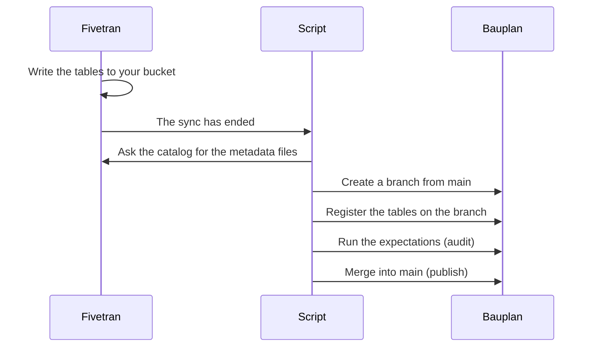

[Fivetran](https://www.fivetran.com/) copies data from databases, SaaS applications and files into a destination, on a schedule you set per connection. With its [Managed Data Lake Service](https://fivetran.com/docs/managed-data-lake-service), the destination is your own bucket, where Fivetran writes and maintains Apache Iceberg tables. Bauplan reads those tables where they are, either on Amazon S3 or Google Cloud Storage depending on your deployment, and registers each one as an external table.

## How Fivetran and Bauplan fit together

Fivetran owns the tables. It writes their data files and their Iceberg metadata to your bucket, and lists them in the Fivetran Catalog, an Iceberg REST catalog that comes with every destination. Bauplan has read-only access to them, and registers a table by pointing at its current metadata file, the `metadata.json` that describes one state of the table.

A registered table is frozen at that state. When Fivetran syncs again, it commits a new state with a new metadata file, and Bauplan keeps reading the previous one until you register the table again. New data therefore never appears on `main` on its own. After each sync, your script should register the new states on a branch, audit the tables there, and publish them all with one merge.



## Prerequisites

1. A Managed Data Lake destination on S3 or on Google Cloud Storage, in the same cloud as your Bauplan deployment. If it uses the bucket of that deployment, its prefix path must not be under the one where Bauplan keeps its own tables, normally `iceberg/`. The examples below use the prefix `fivetran`. Choose it before the first sync, because Fivetran does not let you change it once the destination is saved.
2. The server endpoint, the catalog name, the client ID and the client secret of the Fivetran Catalog. You find them in **Catalog Integration > Base configuration** on the page of the destination in Fivetran, and they give read-only access.
3. Read access to that prefix for the two identities Bauplan uses in your cloud account, described in the next section.

## Give Bauplan read access to the tables

Two identities created when Bauplan was deployed need to read the files of Fivetran. The catalog reads the metadata file of a table when you register it, and the job executor reads the metadata and the data when a query or a pipeline uses the table. Grant both of them read access only, because only Fivetran should write to its tables.

### On AWS

Attach this policy to the Job Executor role, and leave its trust policy as it is.

```json
{
  "Version": "2012-10-17",
  "Statement": [
    {
      "Sid": "ListFivetranPrefix",
      "Effect": "Allow",
      "Action": "s3:ListBucket",
      "Resource": "arn:aws:s3:::<BUCKET>",
      "Condition": {
        "StringLike": {
          "s3:prefix": "fivetran/*"
        }
      }
    },
    {
      "Sid": "GetFivetranBucketLocation",
      "Effect": "Allow",
      "Action": "s3:GetBucketLocation",
      "Resource": "arn:aws:s3:::<BUCKET>"
    },
    {
      "Sid": "ReadFivetranTables",
      "Effect": "Allow",
      "Action": "s3:GetObject*",
      "Resource": "arn:aws:s3:::<BUCKET>/fivetran/*"
    }
  ]
}
```

The Data Catalog role only needs the metadata files.

```json
{
  "Version": "2012-10-17",
  "Statement": [
    {
      "Sid": "GetFivetranBucketLocation",
      "Effect": "Allow",
      "Action": "s3:GetBucketLocation",
      "Resource": "arn:aws:s3:::<BUCKET>"
    },
    {
      "Sid": "ReadFivetranMetadata",
      "Effect": "Allow",
      "Action": "s3:GetObject*",
      "Resource": "arn:aws:s3:::<BUCKET>/fivetran/*.metadata.json"
    }
  ]
}
```

### On Google Cloud

Grant the Storage Object Viewer role on the bucket to the `bauplan-job-executor` and `bauplan-catalog` service accounts.

```sh
for account in bauplan-job-executor bauplan-catalog; do
  gcloud storage buckets add-iam-policy-binding gs://<BUCKET> \
    --member="serviceAccount:${account}@<PROJECT>.iam.gserviceaccount.com" \
    --role="roles/storage.objectViewer"
done
```

The role covers every object of the bucket. If the bucket also holds data that Bauplan should not read, restrict the role to the prefix of Fivetran with an [IAM condition](https://cloud.google.com/storage/docs/access-control/iam#conditions) on the resource name.

## Register and publish a sync

Every Fivetran connection writes to a schema of its own, so one run of the script covers the tables of one schema. It asks the Fivetran Catalog, through [PyIceberg](https://py.iceberg.apache.org/), for the current metadata file of each table and registers it on a branch created for that run. If the audit passes, it merges the branch into `main`.

```python title="publish_fivetran.py"
import os
from datetime import UTC, datetime

import bauplan
from pyiceberg.catalog.rest import RestCatalog


def fivetran_catalog() -> RestCatalog:
    """Connect to the Fivetran Catalog with the read-only credentials of the destination."""

    endpoint = os.environ["FIVETRAN_CATALOG_ENDPOINT"]
    client_id = os.environ["FIVETRAN_CLIENT_ID"]
    client_secret = os.environ["FIVETRAN_CLIENT_SECRET"]

    return RestCatalog(
        "fivetran",
        **{
            "uri": endpoint,
            "warehouse": os.environ["FIVETRAN_CATALOG_NAME"],
            "oauth2-server-uri": f"{endpoint}/v1/oauth/tokens",
            "credential": f"{client_id}:{client_secret}",
            "scope": "PRINCIPAL_ROLE:ALL",
        },
    )


def publish_schema(schema: str, audit_dir: str, base_branch: str = "main") -> None:
    """Register the current state of every table of a Fivetran schema, audit it and publish it."""

    client = bauplan.Client()
    catalog = fivetran_catalog()

    # A fresh branch per run, so that each run starts from the current state of the base branch
    stamp = datetime.now(UTC).strftime("%Y%m%d%H%M%S")
    branch = f"{client.info().user.username}.fivetran-{schema}-{stamp}"
    client.create_branch(branch=branch, from_ref=base_branch)
    client.create_namespace(namespace=schema, branch=branch, if_not_exists=True)

    # Registering again with overwrite moves a table to the metadata file of the last sync
    for identifier in catalog.list_tables(schema):
        table = catalog.load_table(identifier)
        client.create_external_table_from_metadata(
            table=identifier[-1],
            metadata_json_uri=table.metadata_location,
            namespace=schema,
            branch=branch,
            overwrite=True,
        )

    # The audit only reads the tables, so a dry run is enough
    audit = client.run(
        project_dir=audit_dir, ref=branch, namespace=schema, dry_run=True
    )
    if audit.job_status != "SUCCESS":
        raise RuntimeError(f"audit failed, {branch} not merged: {audit.error}")

    # All the tables of the schema reach the base branch in one commit
    client.merge_branch(source_ref=branch, into_branch=base_branch)
    client.delete_branch(branch=branch)
```

The audit is a Bauplan project that contains [expectations](/concepts/pipelines#expectations) on the registered tables. When one fails, the script stops before the merge, so `main` keeps the state of the previous sync and the branch stays available to find out what is wrong with the new one.

Registering is a catalog operation and reads no data, so most of the time goes into the audit. The namespace takes the name of the Fivetran schema, which keeps every source apart.

## Run the script after every sync

Call `publish_schema` once the sync of that connection has ended. A run in the middle of a sync can register some tables before Fivetran updates them and others after, and publish them together. Fivetran sends a `sync_end` event through its [webhooks](https://fivetran.com/docs/developer-resources/webhooks), which you can use to start the script from your orchestrator; see [how to deploy a pipeline](/how-to/deploy/how-to-deploy-a-pipeline).

Do not let the script fall behind the syncs. Fivetran keeps the current metadata file of a table and the three before it, and deletes the older ones, along with the snapshots that have left the retention period of the destination ([table maintenance](https://fivetran.com/docs/managed-data-lake-service)). A table that has not been registered for several syncs can point at files that no longer exist, and its reads then fail. Set the **Snapshot Retention Period** of the destination to more than the longest time you expect the script to be stopped, and alert on its failures. The metadata limit counts versions rather than time, so a longer retention period does not extend it.

## Build managed tables from the registered ones

The same limit applies to the history of a registered table. Going back to an old commit of `main` brings back the table as it was registered then, but its files are only there as long as Fivetran keeps them. Let your pipelines read the registered tables and write managed tables, whose history does not depend on Fivetran.

The first model of such a pipeline is also the place to deal with the columns Fivetran adds. By default, a row deleted at the source stays in the table with `_fivetran_deleted` set to true, so every read has to exclude it.

```python title="models.py"
from typing import Annotated

import bauplan
import pyarrow as pa


class Accounts(bauplan.TableSchema):
    """One row per account that still exists in the source."""

    id: bauplan.String
    name: bauplan.String | None
    industry: bauplan.String | None
    _fivetran_synced: bauplan.TimestampMicroUTC | None


@bauplan.model(materialization_strategy="REPLACE")
@bauplan.python("3.13")
def accounts(
    account: Annotated[
        pa.Table,
        # Fivetran marks deleted rows instead of removing them
        bauplan.Model(
            "salesforce.account",
            projection_schema=Accounts,
            filter="_fivetran_deleted = false",
        ),
    ],
) -> Annotated[pa.Table, Accounts]:
    """Managed copy of the accounts, without the rows deleted at the source."""

    return account
```

Tables synced in [history mode](https://fivetran.com/docs/core-concepts/syncoverview/sync-modes/history-mode) have no `_fivetran_deleted` column. They keep one row per version of a record, and `_fivetran_active` is true on the current one. The other columns Fivetran may add are in its [list of system columns](https://fivetran.com/docs/core-concepts/syncoverview/system-columns-and-tables).

## Related

- [From existing Iceberg tables](/how-to/ingest-from-a-source/from-existing-iceberg-tables)
- [How to choose between managed and external tables](/how-to/import-and-lay-out-tables/how-to-choose-between-managed-and-external-tables)
- [How to Write-Audit-Publish](/how-to/publish/how-to-write-audit-publish)
