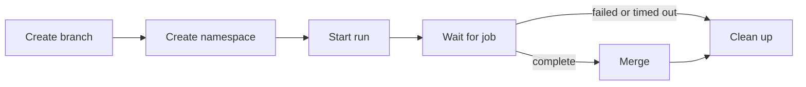

[Airflow](https://airflow.apache.org/) schedules DAGs of tasks, retries the tasks that fail and keeps the history of every run. To orchestrate Bauplan with it, wrap each Bauplan command your pipelines need in a TaskFlow task, keep the tasks in one module and compose the DAGs from them. Every DAG run then writes on a branch of its own, which a setup task creates and a teardown task deletes; in between, the run starts the pipeline as a detached job, waits for it with a sensor and publishes the branch with a single merge.

| Bauplan | Airflow |
| :--- | :--- |
| A command of the Python SDK, such as creating a branch, running a pipeline or merging | A TaskFlow task in a shared module |
| A kind of operation, such as a catalog change or a long job | The retries, delays and timeouts of the task |
| A branch created for one run and deleted after it | A setup task paired with a teardown task |
| A job that runs for minutes or hours | A task that submits it, then a sensor in reschedule mode that waits for it |
| The slice of data one run processes, for instance one day | The data interval of the DAG run |
| Run parameters of the pipeline | Task arguments rendered from the context of the run |



The examples use Airflow 3 and the Task SDK in `airflow.sdk`. Airflow 3.3 supports Python 3.10 to 3.14, while Bauplan needs 3.11 or later. Install `bauplan` wherever the DAG processor and the workers run. The workers also need an API key in `BAUPLAN_API_KEY`, the variable that `bauplan.Client()` reads by default.

## Keep the Bauplan calls in one module of tasks

Each task makes a single call to the SDK and hands its outcome to Airflow, as a return value or as an exception. Since the tasks contain no pipeline logic, a fix to how a command is called or retried lands in this module and reaches every DAG.

```tree
dags/
  bauplan_tasks.py              # one task per Bauplan command
  orders_transformation.py      # composes the tasks into a DAG
  pipelines/
    orders_transformation/      # the Bauplan project the DAG runs
```

The DAG processor imports every DAG file at short intervals to detect changes. For this reason `bauplan` is imported inside the task functions, where only the workers execute it:

```python
from datetime import UTC, datetime, timedelta

from airflow.sdk import PokeReturnValue, task
from airflow.sdk.exceptions import AirflowFailException

# Seconds between two status checks of a running job
POLL_INTERVAL_SECONDS = 60


# Never retried, because an attempt whose completion was lost has already created the branch
@task(retries=0)
def create_branch(base_branch: str, prefix: str) -> str:
    """Create the branch one DAG run writes on and return its name"""
    import bauplan

    client = bauplan.Client()

    # A timestamp in the name gives every attempt its own branch, also when a cleared run starts again
    stamp = datetime.now(UTC).strftime("%Y%m%d%H%M%S")
    branch = f"{client.info().user.username}.{prefix}-{stamp}"

    client.create_branch(branch, from_ref=base_branch)
    return branch


# Patient retries, because catalog operations are quick and safe to repeat
@task(
    retries=5,
    retry_delay=timedelta(seconds=30),
    retry_exponential_backoff=2.0,
    max_retry_delay=timedelta(minutes=5),
)
def create_namespace(branch: str, namespace: str) -> None:
    """Create a namespace on a branch if it does not exist yet"""
    import bauplan

    bauplan.Client().create_namespace(namespace, branch, if_not_exists=True)


# Two retries at most, because an attempt that lost its answer may have started a job already
@task(retries=2, retry_delay=timedelta(seconds=30))
def start_run(
    project_dir: str, branch: str, namespace: str, parameters: dict[str, str]
) -> str:
    """Submit a pipeline run without waiting for it, and return its job id"""
    import bauplan

    state = bauplan.Client().run(
        project_dir=project_dir,
        ref=branch,
        namespace=namespace,
        parameters=dict(parameters),
        detach=True,
    )
    if state.job_id is None:
        raise RuntimeError(f"run on {branch} returned no job id")
    return state.job_id


@task.sensor(poke_interval=POLL_INTERVAL_SECONDS, mode="reschedule", retries=3)
def wait_for_job(job_id: str) -> PokeReturnValue:
    """Check a job once, and report whether it completed"""
    import bauplan
    from bauplan.schema import JobState

    job = bauplan.Client().get_job(job_id)

    # While the job runs, the sensor gives its worker slot back until the next check
    if job.status in (JobState.NOT_STARTED, JobState.RUNNING):
        return PokeReturnValue(is_done=False)
    if job.status == JobState.COMPLETE:
        return PokeReturnValue(is_done=True, xcom_value=job_id)

    # Retrying cannot help once the job has failed or was aborted
    raise AirflowFailException(
        f"job {job_id} is {job.human_readable_status}: {job.error_message}"
    )


# Patient retries, because catalog operations are quick and safe to repeat
@task(
    retries=5,
    retry_delay=timedelta(seconds=30),
    retry_exponential_backoff=2.0,
    max_retry_delay=timedelta(minutes=5),
)
def merge_branch(branch: str, base_branch: str) -> None:
    """Publish a branch into its base branch"""
    import bauplan
    from bauplan.exceptions import MergeConflictError

    # If the base branch moved, every attempt conflicts again; only a run on a new branch can merge
    try:
        bauplan.Client().merge_branch(
            source_ref=branch,
            into_branch=base_branch,
            commit_message=f"Merge {branch} into {base_branch}",
        )
    except MergeConflictError as error:
        raise AirflowFailException(
            f"{base_branch} moved while {branch} was computing"
        ) from error


# Patient retries, because catalog operations are quick and safe to repeat
@task(
    retries=5,
    retry_delay=timedelta(seconds=30),
    retry_exponential_backoff=2.0,
    max_retry_delay=timedelta(minutes=5),
)
def clean_up(branch: str, job_id: str | None) -> None:
    """Cancel the job of a run if it is still running, then delete the branch of the run"""
    import bauplan
    from bauplan.schema import JobState

    client = bauplan.Client()

    # After a sensor timeout the job may still be running; the job id is None if it never started
    running = (JobState.NOT_STARTED, JobState.RUNNING)
    if job_id is not None and client.get_job(job_id).status in running:
        client.cancel_job(job_id)

    client.delete_branch(branch, if_exists=True)
```

When a DAG needs another command, for instance `import_data` or `revert_table`, add a task for it here instead of calling the SDK from inside a single DAG.

## Give every kind of operation its own retries

When a task fails, Airflow repeats the whole call up to `retries` times. How many repetitions make sense, if any, depends on the operation:

1. Branch creation is never retried. If an attempt created the branch but its worker died before reporting success, a retry would create a second branch for the same run.
2. Catalog operations, such as creating a namespace, merging or deleting a branch, are quick and safe to repeat, and they get several attempts with exponential backoff. A merge conflict, however, would recur on every attempt; in that case the task raises `AirflowFailException` and fails at once.
3. Starting a job gets only a few attempts. If an attempt started the job and then lost its answer, each retry adds another job on the same branch.
4. The sensor retries the errors of a single check, for instance when the service is briefly unreachable. If the job itself failed or was aborted, the sensor raises `AirflowFailException` and the run fails immediately; another attempt would only find the same job in the same state.

## Wait for jobs with a sensor in reschedule mode

Since a Bauplan job can run for hours, the module splits it into two tasks. `start_run` submits the job with `detach=True` and returns its id within seconds; `wait_for_job` is a sensor in `reschedule` mode that calls `get_job` once per check. While the job is running, the sensor gives its worker slot back to the scheduler between checks and occupies a worker only for the few seconds each check takes.

The `timeout` of the sensor bounds the wait, counting from the first check. If it expires, the sensor fails without retrying, the merge does not run, and the teardown cancels the job before deleting its branch. The DAG sets the timeout with `override`, because each pipeline has its own expected duration.

## Compose the DAG from the module

The DAG passes the branch name and the job id between tasks as XComs. It marks the branch creation as a setup with `as_setup()` and the clean-up as its teardown with `as_teardown(setups=branch)`. Airflow runs a teardown after the tasks it encloses have finished, whatever their outcome, provided that its setup succeeded; the branch is therefore deleted whether the run merged, failed or timed out.

The roles are declared here rather than with the `@setup` and `@teardown` decorators in the module. In Airflow 3.3 a `@teardown` function raises `ValueError` when the same Python process calls it a second time, as happens with two DAGs in one file or with a DAG factory:

```python type:ignore
from datetime import timedelta
from pathlib import Path

import pendulum
from airflow.sdk import Param, chain, dag
from airflow.timetables.interval import CronDataIntervalTimetable

from bauplan_tasks import (
    clean_up,
    create_branch,
    create_namespace,
    merge_branch,
    start_run,
    wait_for_job,
)

# Workers read the Bauplan project from the folder next to this file
PROJECT_DIR = Path(__file__).parent / "pipelines" / "orders_transformation"


@dag(
    # Each daily run covers the day before its start, from midnight to midnight UTC
    schedule=CronDataIntervalTimetable("@daily", timezone="UTC"),
    start_date=pendulum.datetime(2026, 11, 1, tz="UTC"),
    catchup=False,
    # Runs of the same tables merge into the same base branch, one at a time
    max_active_runs=1,
    params={
        "base_branch": Param("main", type="string"),
        "namespace": Param("orders", type="string"),
    },
)
def orders_transformation() -> None:
    """Compute the orders tables for the data interval of the run and publish them with one merge"""
    branch = create_branch(
        "{{ params.base_branch }}", prefix="orders-transformation"
    ).as_setup()
    namespace_ready = create_namespace(branch, "{{ params.namespace }}")

    # The data interval of the run becomes the run parameters of the pipeline
    job_id = start_run(
        project_dir=str(PROJECT_DIR),
        branch=branch,
        namespace="{{ params.namespace }}",
        parameters={
            "start_date": "{{ data_interval_start | ds }}",
            "end_date": "{{ data_interval_end | ds }}",
        },
    )
    job_done = wait_for_job.override(timeout=timedelta(hours=2))(job_id)
    merged = merge_branch(branch, "{{ params.base_branch }}")

    # The clean-up runs once the setup succeeded, whatever happened to the tasks in between
    chain(namespace_ready, job_id)
    chain(job_done, merged, clean_up(branch, job_id).as_teardown(setups=branch))


orders_transformation()
```

The base branch and the namespace are DAG `params`, which a manual trigger can override. When a run fails, clearing the failed task, from the UI or with `airflow tasks clear`, also clears its setup and teardown. The run then starts again on a new branch from the current head of the base branch, which after a merge conflict already contains the changes that caused it.

Other DAGs combine the same tasks differently. An ingestion DAG, for instance, runs an import task before `start_run` on the same branch; one merge then publishes the imported table together with the tables that the pipeline computes from it.

## Process the data interval of each run

Take the period that a run processes from its data interval, not from the current time; a late run, or one that a backfill creates, then still processes its own period. In Airflow 3, however, a cron string in `schedule` produces a `CronTriggerTimetable`, whose runs have no interval at all (`data_interval_start` equals `data_interval_end`). The DAG above uses a `CronDataIntervalTimetable` instead, under which each daily run covers the previous day.

Task arguments are Jinja templates that Airflow renders before the task runs. Through them the DAG passes the interval as the run parameters `start_date` and `end_date`, which the project declares in `bauplan_project.yml`:

```yaml
parameters:
  start_date:
    type: str
    default: "2026-11-01"
  end_date:
    type: str
    default: "2026-11-02"
```

Every model filters its inputs on the two parameters. Because the last one writes with `OVERWRITE_PARTITIONS` and replaces only the days of the window, running the DAG twice for the same interval rewrites that day and nothing else:

```python type:ignore
@bauplan.python("3.13", pip={"polars": "2.1.0"})
@bauplan.model(
    materialization_strategy="OVERWRITE_PARTITIONS",
    partitioned_by=["order_date"],
    overwrite_filter="order_date >= $start_date AND order_date < $end_date",
)
def daily_orders(
    orders: Annotated[
        pa.Table,
        Model("orders", filter="created_at >= $start_date AND created_at < $end_date"),
    ],
) -> Annotated[pa.Table, DailyOrdersSchema]:
    """One row per order and day, for the days of the window only"""
    ...
```

The parameters are described in [how to parametrize a pipeline](/how-to/build-pipelines/how-to-parametrize-a-pipeline); [how to backfill a table](/how-to/operate/how-to-backfill-a-table) applies the same strategy to longer ranges.

## Test and backfill the DAG

`airflow dags test` executes every task of one DAG run in a single process, without a scheduler, and is the quickest check before deploying. Here `-c` overrides the `params` to publish to a development branch:

```sh
airflow dags test orders_transformation 2026-11-20 -c '{"base_branch": "alice.dev"}'
```

To load past days, create a backfill with at most one active run:

```sh
airflow backfill create --dag-id orders_transformation --from-date 2026-11-01 --to-date 2026-11-15 --max-active-runs 1
```

If several runs were active at the same time, they would branch from the same commit and every merge after the first would conflict. `max_active_runs=1` in the DAG applies the same limit to scheduled runs. For the alternatives, see [how to handle merge conflicts](/how-to/publish/how-to-handle-merge-conflicts).

`client.run` reads the project from the disk of the worker that calls it. Ship the Bauplan projects with the DAG files, in the same DAG bundle or image, and keep `PROJECT_DIR` relative to the DAG file.

## Related

- [Deployment](/how-to/deploy/how-to-deploy-a-pipeline)
- [How to Write-Audit-Publish](/how-to/publish/how-to-write-audit-publish)
- [How to name branches](/how-to/publish/how-to-name-branches)
- [Temporal](/integrations/orchestrators/temporal)
