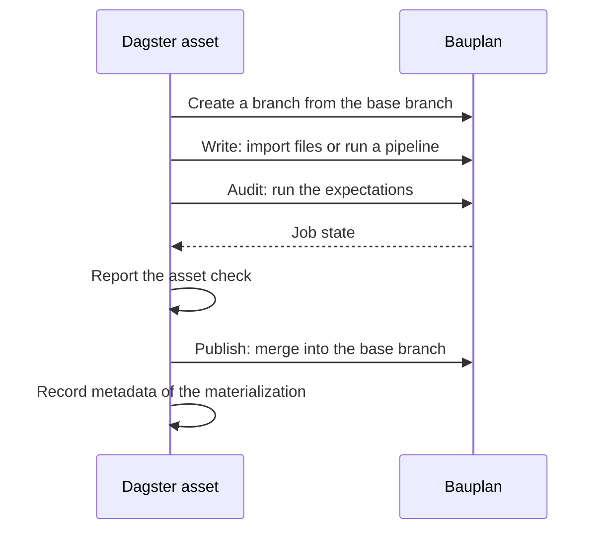

[Dagster](https://dagster.io/) orchestrates data work around software-defined assets, where each asset is a piece of data Dagster knows how to produce, with its partitions, its checks and its history. Bauplan tables map onto assets directly. An asset calls the Bauplan Python SDK to import, audit, transform and publish one (partition of a) table, and Dagster schedules it, records what happened and shows the lineage. Dagster runs the workflow while Bauplan runs the imports, the pipelines and the lakehouse.

## How Bauplan and Dagster fit together

The two tools split the work along a clear line. Dagster decides *when* and *what* to materialize: it holds the asset graph, the schedules and sensors, the partitions, the retries and the UI where you launch runs and read their history. Bauplan does the data work: it imports files, runs pipelines and expectations, and keeps every write isolated on a branch until it is merged. Nothing in Bauplan needs to know about Dagster, and nothing in Dagster needs to know how Bauplan stores tables: the only contact point is the Bauplan Python SDK, called from inside the asset functions.

Each materialization of an asset is one write-audit-publish cycle on Bauplan. The asset creates a branch from the base branch, writes on it (an import or a pipeline run), audits the result with expectations, and merges into the base branch only if the audit passed. If any step fails, the asset raises, Dagster marks the materialization as failed, and the base branch is untouched.



The rest of the integration follows from that cycle, and maps Bauplan concepts onto Dagster ones:

| Bauplan | Dagster |
| :--- | :--- |
| A table, imported or computed by a pipeline | A software-defined asset |
| The slice of data one run writes, for instance one day | A partition of the asset |
| The expectations that audit a branch before the merge | An asset check reported by the asset itself |
| A query or a dry run on the base branch after the merge | A standalone `@asset_check` |
| Row counts, schema, branch and job identifiers | Materialization metadata |

The rest of the page builds the integration on a small example: two source tables, `transactions` and `account_events`, imported from object storage, and a summary table, `account_activity_summary`, computed from both. The example partitions everything by day, because the source files arrive one day at a time, but the same structure works for any partitioning, or none. The complete, runnable version, with synthetic data, the audit projects and a small CLI, is in the [Bauplan examples repository](https://github.com/BauplanLabs/bauplan/tree/main/examples/learn/07-ingestion-and-transformation-with-dagster).

## Share one Bauplan client as a resource

Every asset and check needs a Bauplan client. Declare it once as a Dagster resource that reads the API key from the environment, which keeps the key out of the code, and cache the client and the username on it. The username matters because every branch the assets create must start with it:

```python
import os
from functools import cached_property
from pathlib import Path

import bauplan
import dagster as dg

# The namespace is part of the table names the code and the queries use
NAMESPACE = "finance"

# The branch the assets publish to, overridable to point a dev deployment elsewhere
BASE_BRANCH = os.environ.get("BASE_BRANCH", "main")

AUDIT_DIR = Path(__file__).parent / "ingestion" / "pipelines" / "audit"
TRANSFORM_DIR = (
    Path(__file__).parent / "transformation" / "pipelines" / "account_summary"
)


class BauplanResource(dg.ConfigurableResource):
    """One Bauplan client shared by every asset and check of a run"""

    api_key: str

    @cached_property
    def client(self) -> bauplan.Client:
        return bauplan.Client(api_key=self.api_key)

    # The username is the mandatory prefix of every branch the assets create
    @cached_property
    def username(self) -> str:
        return self.client.info().user.username


RESOURCES = {"bauplan_client": BauplanResource(api_key=dg.EnvVar("BAUPLAN_API_KEY"))}

# One Dagster partition per day prefix on object storage
daily_partitions = dg.DailyPartitionsDefinition(
    start_date="2026-06-15", end_date="2026-07-15"
)
```

Because the partitions definition is shared by all three assets, the Dagster partition `2026-06-16` means the same day for the source prefixes, for the imports and for the summary.

## Import one partition on its own branch

The write step of the cycle imports the files of one day into the source table, on a branch created for this attempt only. The first partition also creates the table, partitioned by day on the same timestamp column, and the table and the Dagster partitions then line up. The import runs detached and the helper polls it, which keeps a long import from holding an open request; see [how to run jobs detached and poll them](/how-to/deploy/how-to-run-jobs-detached-and-poll-them).

The two functions below use only the Bauplan SDK and know nothing about Dagster: the same code would import a partition from a script or from any other orchestrator. The next section wraps them into a Dagster asset, which adds the audit, the publish step and what Dagster records about the run.

```python type:ignore
import os
import time
from datetime import datetime
from uuid import uuid4

import bauplan
from bauplan.schema import JobState

# Job states that mean the job has stopped running
TERMINAL_STATES = (JobState.COMPLETE, JobState.FAIL, JobState.ABORT)


def wait_for_job(
    client: bauplan.Client, job_id: str, timeout_seconds: int = 600
) -> None:
    """Poll a detached Bauplan job until it stops, and raise unless it completed"""
    deadline = time.monotonic() + timeout_seconds

    # Poll until the job reaches a terminal state, cancelling it past the deadline
    while True:
        job = client.get_job(job_id)
        if job.status in TERMINAL_STATES:
            break
        if time.monotonic() > deadline:
            client.cancel_job(job_id)
            raise TimeoutError(f"job {job_id} still {job.human_readable_status}")
        time.sleep(2)

    if job.status != JobState.COMPLETE:
        raise RuntimeError(f"job {job_id} failed: {job.error_message}")


def import_partition(
    client: bauplan.Client,
    username: str,
    table: str,
    day: datetime,
    timestamp_column: str,
) -> dict[str, str]:
    """Import one day of a source table on a new ingestion branch"""
    # Point the import at the prefix of this day only, which limits it to listing and reading one partition of the source files
    uri = (
        f"s3://{os.environ['BUCKET_NAME']}/{os.environ['PREFIX']}/{table}"
        f"/year={day:%Y}/month={day:%m}/day={day:%d}/*.parquet"
    )

    # A new branch per attempt keeps a retry from picking up the leftovers of a failed one
    branch = f"{username}.{table}-ingestion-{day:%Y-%m-%d}-{uuid4().hex[:8]}"
    client.create_branch(branch=branch, from_ref=BASE_BRANCH)
    client.create_namespace(namespace=NAMESPACE, branch=branch, if_not_exists=True)

    # The first partition creates the table, partitioned by day like the Dagster partitions
    if not client.has_table(table=table, namespace=NAMESPACE, ref=branch):
        client.create_table(
            table=table,
            namespace=NAMESPACE,
            search_uri=uri,
            branch=branch,
            partitioned_by=f"day({timestamp_column})",
        )

    # Import detached and poll, which keeps a long import from holding an open request
    state = client.import_data(
        table=table, namespace=NAMESPACE, search_uri=uri, branch=branch, detach=True
    )
    if state.job_id is None:
        raise RuntimeError(f"import of {table} on {branch} returned no job id")
    wait_for_job(client, state.job_id)

    return {"branch": branch, "uri": uri, "job_id": state.job_id}
```

Since imports keep track of the files they have already imported, importing the same day twice into a table does not add its rows twice.

## Audit and publish inside the ingestion asset

The ingestion asset runs the whole write-audit-publish cycle for one partition: it imports the day on its branch, audits it, and merges into the base branch only if the audit passed. The audit is a Bauplan project that holds only the [expectations](/concepts/pipelines#expectations) of the table, for instance that `txn_id` is unique or that `currency` takes one of the supported values.

The asset declares the audit as an asset check with `check_specs`, and reports its outcome with an `AssetCheckResult` before deciding whether to merge. The audit that gates the merge is then the same event you see in the Checks tab of the Dagster UI, with the Bauplan job id, the branch and the error as metadata. One factory builds the asset for both source tables:

```python type:ignore
from collections.abc import Iterator

from bauplan.exceptions import BauplanError


def build_ingestion_asset(table: str, timestamp_column: str) -> dg.AssetsDefinition:
    """A daily asset that imports, audits and publishes one partition of a source table"""

    @dg.asset(
        name=table,
        partitions_def=daily_partitions,
        kinds={"bauplan"},
        check_specs=[dg.AssetCheckSpec(name="audit_expectations", asset=table)],
    )
    def ingest(
        context: dg.AssetExecutionContext, bauplan_client: BauplanResource
    ) -> Iterator[dg.AssetCheckResult | dg.MaterializeResult]:
        client = bauplan_client.client
        day = datetime.strptime(context.partition_key, "%Y-%m-%d")

        # Write: import the partition on its own ingestion branch
        imported = import_partition(
            client, bauplan_client.username, table, day, timestamp_column
        )
        branch = imported["branch"]

        # Audit: run the expectations of the table on the ingestion branch
        state = client.run(
            project_dir=str(AUDIT_DIR / table),
            ref=branch,
            namespace=NAMESPACE,
            cache=False,
        )
        passed = str(state.job_status).lower() == "success"
        check_metadata = {
            "bauplan_job_id": str(state.job_id),
            "bauplan_branch": branch,
            "error": str(state.error or ""),
        }
        yield dg.AssetCheckResult(
            check_name="audit_expectations", passed=passed, metadata=check_metadata
        )
        if not passed:
            raise dg.Failure(
                description=f"audit failed on {branch}, branch kept for debugging",
                metadata=check_metadata,
            )

        # Publish: merge only after a clean audit, then drop the ingestion branch
        try:
            client.merge_branch(source_ref=branch, into_branch=BASE_BRANCH)
        except BauplanError as merge_error:
            raise dg.Failure(
                description=f"merge of {branch} failed, branch kept for debugging",
                metadata={"bauplan_branch": branch},
            ) from merge_error

        # A failed clean-up only deserves a warning, because the data is already published
        try:
            client.delete_branch(branch=branch)
        except BauplanError:
            context.log.warning(f"deletion of {branch} failed")

        # Report what was published, read from the base branch
        window = context.partition_time_window
        yield dg.MaterializeResult(
            metadata=table_metadata(
                client,
                table,
                partition_predicate=(
                    f"{timestamp_column} >= TIMESTAMP '{window.start:%Y-%m-%d} 00:00:00' "
                    f"AND {timestamp_column} < TIMESTAMP '{window.end:%Y-%m-%d} 00:00:00'"
                ),
                extra={
                    "bauplan_branch": branch,
                    "bauplan_import_job_id": imported["job_id"],
                    "dagster/uri": imported["uri"],
                },
            )
        )

    return ingest


transactions = build_ingestion_asset("transactions", "txn_ts")
account_events = build_ingestion_asset("account_events", "event_ts")
```

`client.run` reports a failed run through the state it returns, not through an exception. For this reason the asset reads `job_status` and raises `dg.Failure` itself. A failed audit or a rejected merge leaves the ingestion branch in place, and its name is in the metadata of the failure. You can then query the rejected data before deleting the branch. See [how to Write-Audit-Publish](/how-to/publish/how-to-write-audit-publish) for the pattern on its own.

## Transform one partition

Because the summary asset depends on both source assets, Dagster shows it downstream of them and materializes it after them. It runs the transformation project for one day on a new branch forked from the base branch, where the sources were just published, and turns the partition window into the run parameters `start_date` and `end_date`:

```python type:ignore
@dg.asset(
    partitions_def=daily_partitions,
    deps=[transactions, account_events],
    kinds={"bauplan"},
)
def account_activity_summary(
    context: dg.AssetExecutionContext, bauplan_client: BauplanResource
) -> dg.MaterializeResult:
    """Run the summary pipeline for one day on a branch and publish it with a merge"""
    client = bauplan_client.client
    window = context.partition_time_window
    start_date = f"{window.start:%Y-%m-%d}"
    end_date = f"{window.end:%Y-%m-%d}"

    # A new branch per run, forked from the base branch the sources were published to
    branch = f"{bauplan_client.username}.account-summary-transformation-{context.partition_key}-{uuid4().hex[:8]}"
    client.create_branch(branch=branch, from_ref=BASE_BRANCH)

    # The partition window becomes the run parameters of the pipeline
    state = client.run(
        project_dir=str(TRANSFORM_DIR),
        ref=branch,
        namespace=NAMESPACE,
        cache=False,
        parameters={"start_date": start_date, "end_date": end_date},
    )
    if str(state.job_status).lower() != "success":
        raise dg.Failure(
            description=f"transformation on {branch} failed, branch kept for debugging",
            metadata={"bauplan_branch": branch, "error": str(state.error or "")},
        )

    # Publish the partition, keeping the branch if the merge is rejected
    try:
        client.merge_branch(source_ref=branch, into_branch=BASE_BRANCH)
    except BauplanError as merge_error:
        raise dg.Failure(
            description=f"merge of {branch} failed, branch kept for debugging",
            metadata={"bauplan_branch": branch},
        ) from merge_error
    client.delete_branch(branch=branch)

    return dg.MaterializeResult(
        metadata=table_metadata(
            client,
            "account_activity_summary",
            partition_predicate=f"date >= DATE '{start_date}' AND date < DATE '{end_date}'",
            extra={
                "bauplan_branch": branch,
                "bauplan_job_id": str(state.job_id),
                "bauplan_run_duration_seconds": round(state.duration or 0.0, 2),
            },
        )
    )
```

On the Bauplan side, the models read only the window with a `filter` on the run parameters, and the last model replaces only the days of the window with the `OVERWRITE_PARTITIONS` strategy. Materializing the same Dagster partition twice therefore rewrites that day and leaves the others untouched:

```python type:ignore
@bauplan.python("3.13", pip={"polars": "2.1.0"})
@bauplan.model(
    materialization_strategy="OVERWRITE_PARTITIONS",
    partitioned_by=["date"],
    overwrite_filter="date >= $start_date AND date < $end_date",
)
def account_activity_summary(
    daily_account_spend: Annotated[pa.Table, Model("daily_account_spend")],
    account_events: Annotated[
        pa.Table,
        Model(
            "account_events",
            filter="event_ts >= $start_date AND event_ts < $end_date",
        ),
    ],
) -> Annotated[pa.Table, AccountActivitySummarySchema]:
    """Per-account daily view: settled spend joined with event and login counts"""
    ...
```

The two parameters are declared in the `bauplan_project.yaml` of the transformation project. See [how to backfill a table](/how-to/operate/how-to-backfill-a-table) for the same strategy applied to longer ranges.

## Add checks that run after publishing

The audit inside the ingestion asset runs before the merge, as part of the materialization, and cannot be run again on its own. Checks you want to define and version on the orchestrator side, or to re-run from the UI at any time, are standalone `@asset_check` definitions that read the base branch. Dagster runs them after each materialization of their asset:

```python type:ignore
@dg.asset_check(asset=transactions)
def transactions_txn_id_unique(bauplan_client: BauplanResource) -> dg.AssetCheckResult:
    """No duplicate txn_id may survive on the base branch"""
    duplicates = (
        bauplan_client.client.query(
            "SELECT COUNT(*) - COUNT(DISTINCT txn_id) AS n FROM transactions",
            ref=BASE_BRANCH,
            namespace=NAMESPACE,
        )
        .column("n")
        .to_pylist()[0]
    )
    return dg.AssetCheckResult(
        passed=duplicates == 0, metadata={"duplicate_txn_ids": int(duplicates or 0)}
    )


@dg.asset_check(asset=transactions)
def transactions_audit(bauplan_client: BauplanResource) -> dg.AssetCheckResult:
    """The ingestion expectations, run again on the base branch without writing anything"""
    state = bauplan_client.client.run(
        project_dir=str(AUDIT_DIR / "transactions"),
        ref=BASE_BRANCH,
        namespace=NAMESPACE,
        dry_run=True,
        cache=False,
    )
    return dg.AssetCheckResult(
        passed=str(state.job_status).lower() == "success",
        metadata={"error": str(state.error or "")},
    )
```

The first check is a query: it counts duplicate transaction ids on the published table. The second runs the same audit project as the ingestion asset, on the base branch and with `dry_run=True`. It therefore writes nothing and can be launched manually whenever you want to re-audit the published data. The Checks tab shows the latest evaluation of each check; the history per partition stays in the run logs of each materialization.

## Attach Bauplan metadata to each materialization

Every successful materialization returns a `MaterializeResult` whose metadata describes the published table, read from the base branch. The helper below fills the keys that the Dagster UI renders on its own: the total row count, the rows of the materialized partition and the column schema. The assets add the Bauplan branch and job identifiers, the imported files for the source tables and the run duration for the summary:

```python type:ignore
def table_metadata(
    client: bauplan.Client, table: str, partition_predicate: str, extra: dict[str, Any]
) -> dict[str, Any]:
    """Row counts and column schema of a published table, in the keys the Dagster UI renders"""
    partition_rows = (
        client.query(
            f"SELECT COUNT(*) AS n FROM {table} WHERE {partition_predicate}",
            ref=BASE_BRANCH,
            namespace=NAMESPACE,
        )
        .column("n")
        .to_pylist()[0]
    )
    table_info = client.get_table(table=table, ref=BASE_BRANCH, namespace=NAMESPACE)

    return {
        "dagster/row_count": int(table_info.records or 0),
        "dagster/partition_row_count": int(partition_rows or 0),
        "dagster/column_schema": dg.TableSchema(
            columns=[
                dg.TableColumn(name=field.name, type=field.type)
                for field in table_info.fields
            ]
        ),
        **extra,
    }
```

With these keys, the asset catalog shows how the table grew partition by partition, and every materialization links back to the Bauplan job that produced it.

## Wire the definitions and run them

Collect the assets, the checks, two jobs that group the ingestion and the transformation assets, and the resource in one `Definitions` object:

```python type:ignore
defs = dg.Definitions(
    assets=[transactions, account_events, account_activity_summary],
    asset_checks=[transactions_txn_id_unique, transactions_audit],
    jobs=[
        dg.define_asset_job(
            name="ingestion",
            selection=dg.AssetSelection.assets("transactions", "account_events"),
        ),
        dg.define_asset_job(
            name="transformation",
            selection=dg.AssetSelection.assets("account_activity_summary"),
        ),
    ],
    resources=RESOURCES,
)
```

Start the Dagster UI from the folder that holds the definitions:

```sh
cd src && uv run dg dev -m definitions
```

The Assets page shows `transactions` and `account_events` feeding `account_activity_summary`, with a bar of daily partitions under each asset. Select an asset, click Materialize and pick a partition; the `ingestion` and `transformation` jobs launch the same assets from the Jobs page. For a quick run without the UI, `dg.materialize` materializes one partition from a script, with the same resources:

```python type:ignore
result = dg.materialize(
    assets=[transactions],
    selection=dg.AssetSelection.assets("transactions")
    | dg.AssetSelection.checks_for_assets("transactions"),
    partition_key="2026-06-16",
    resources=RESOURCES,
    raise_on_error=False,
)
```

Since each such run uses an ephemeral Dagster instance, its history does not appear in a later UI session.

To load a range of days, launch a backfill from the partition dialog of an asset, and keep the backfill concurrency at 1. Parallel runs of the same table branch from the same commit and merge into the same base branch, and all but the first merge are then rejected as conflicts; see [how to handle merge conflicts](/how-to/publish/how-to-handle-merge-conflicts).

## Related

- [Deployment](/how-to/deploy/how-to-deploy-a-pipeline)
- [How to Write-Audit-Publish](/how-to/publish/how-to-write-audit-publish)
- [How to name branches](/how-to/publish/how-to-name-branches)
