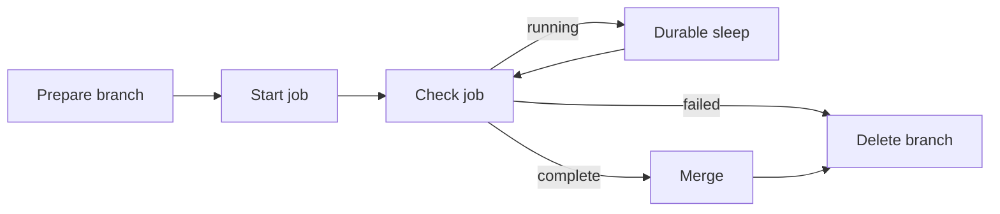

[DBOS](https://www.dbos.dev/) checkpoints every step of a workflow in a database. If a crash interrupts a workflow, it resumes after the last step that completed instead of starting over. To orchestrate Bauplan with it, wrap each Bauplan command in a step with the retries its operation needs. Each workflow run works on its own branch and publishes it with a single merge.

| Bauplan | DBOS |
| :--- | :--- |
| A command of the Python SDK, such as creating a branch, starting a job or merging | A step |
| A kind of operation, such as a catalog change or the start of a job | The retry settings of its steps |
| A branch that one run creates and merges once | One workflow execution |
| A job that runs for minutes or hours | A start step, then a loop of a status step and a durable sleep |
| A pipeline that runs every day, one day at a time | A schedule that enqueues the workflow on a queue with a concurrency of one |



The example runs a Bauplan project that rebuilds one day of an orders table every day:

```tree
pipelines/
  bauplan_steps.py        # one DBOS step per Bauplan command
  orders_workflow.py      # composes the steps into the workflow of one pipeline
  orders/                 # the Bauplan project the workflow runs
    bauplan_project.yaml
    models.py
main.py                   # configures DBOS, registers the queue and the schedule
```

## Write one step per Bauplan command

Each step makes a single call to the SDK and returns a value DBOS can checkpoint, such as a branch name or a job id. DBOS never runs a completed step again, but it runs the step that was in progress at the time of a crash from the start. Every step must therefore tolerate a second execution:

1. Preparing the branch deletes and recreates a branch whose name contains the day that the run processes. It runs before the job writes anything, which makes a second execution harmless.
2. Catalog operations are safe to repeat and get ten attempts with backoff, except for merge conflicts, which `should_retry` excludes because they fail the same way every time.
3. Starting a job gets three attempts only. If an attempt loses its response after Bauplan accepted the job, the next attempt submits a second one.

```python title="pipelines/bauplan_steps.py"
from dataclasses import dataclass, field

import bauplan
from bauplan.exceptions import MergeConflictError
from bauplan.schema import JobState
from dbos import DBOS


@dataclass(frozen=True)
class RunParams:
    """A pipeline run to start on a branch"""

    project_dir: str
    ref: str
    namespace: str
    parameters: dict[str, str] = field(default_factory=dict)


@dataclass(frozen=True)
class JobOutcome:
    """The state of a Bauplan job when it was last read"""

    job_id: str
    state: JobState
    human_readable_status: str
    error_message: str | None = None


def is_retryable(error: BaseException) -> bool:
    """Tell DBOS whether another attempt of a catalog step can succeed"""
    # Merge conflicts repeat on every attempt and are not worth retrying
    return not isinstance(error, MergeConflictError)


# Catalog operations are quick and safe to repeat, with patient retries for transient errors
catalog_step = DBOS.step(
    retries_allowed=True,
    max_attempts=10,
    interval_seconds=30,
    backoff_rate=2.0,
    should_retry=is_retryable,
)


@catalog_step
def prepare_branch(base_branch: str, prefix: str, run_label: str) -> str:
    """Create a fresh branch for one run from the base branch and return its name"""
    client = bauplan.Client()
    branch = f"{client.info().user.username}.{prefix}-{run_label}"

    # A previous run of the same day may have left this branch behind if it stopped before its clean-up
    client.delete_branch(branch, if_exists=True)
    client.create_branch(branch, from_ref=base_branch)
    return branch


@catalog_step
def create_namespace(branch: str, namespace: str) -> None:
    """Create a namespace on a branch if it does not exist yet"""
    bauplan.Client().create_namespace(namespace, branch, if_not_exists=True)


# Three attempts at most, because the job may already exist if an attempt lost its response
@DBOS.step(retries_allowed=True, max_attempts=3, interval_seconds=30)
def start_run(params: RunParams) -> str:
    """Submit a pipeline run without waiting for it, and return its job id"""
    state = bauplan.Client().run(
        project_dir=params.project_dir,
        ref=params.ref,
        namespace=params.namespace,
        parameters=dict(params.parameters),
        detach=True,
    )
    if state.job_id is None:
        raise RuntimeError(f"run on {params.ref} returned no job id")
    return state.job_id


@catalog_step
def read_job(job_id: str) -> JobOutcome:
    """Read the current state of a job"""
    job = bauplan.Client().get_job(job_id)
    return JobOutcome(job_id, job.status, job.human_readable_status, job.error_message)


@catalog_step
def cancel_job(job_id: str) -> None:
    """Stop a job that the workflow no longer waits for"""
    bauplan.Client().cancel_job(job_id)


@catalog_step
def merge_branch(source_ref: str, into_branch: str) -> None:
    """Publish a branch into its base branch"""
    bauplan.Client().merge_branch(
        source_ref=source_ref,
        into_branch=into_branch,
        commit_message=f"Merge {source_ref} into {into_branch}",
    )


@catalog_step
def delete_branch(branch: str) -> None:
    """Delete a branch, succeeding if it is already gone"""
    bauplan.Client().delete_branch(branch, if_exists=True)
```

Add a step for any other command a workflow needs, such as `import_data`, instead of calling the SDK in the workflow body, where DBOS would repeat the call on every recovery.

## Wait for jobs with a durable sleep

If a long job ran inside a single step, a crash would submit it again. The workflow instead starts the job with `detach=True` and alternates a status read and `DBOS.sleep` until the job ends. Both are checkpointed, which means that after a crash the workflow keeps waiting on the job it already started.

The run timeout limits the number of reads. When the limit is reached, the workflow cancels the job and fails. `SetWorkflowTimeout` does not work here, because DBOS cancels a workflow only at its next step and the Bauplan job would keep running.

## Compose the workflow from the steps

The workflow deletes the branch in a `finally` block. If the job does not complete, the workflow raises `PipelineFailedError`. DBOS leaves the workflow in `ERROR` and does not recover it, because the job would fail again on the same data. The day to process comes from the scheduled time rather than the clock, which keeps late runs and backfills on their own day:

```python type:ignore title="pipelines/orders_workflow.py"
from dataclasses import dataclass
from datetime import datetime, timedelta

from bauplan.schema import JobState
from dbos import DBOS

from pipelines.bauplan_steps import (
    RunParams,
    cancel_job,
    create_namespace,
    delete_branch,
    merge_branch,
    prepare_branch,
    read_job,
    start_run,
)

# Seconds between two reads of a running job
POLL_INTERVAL_SECONDS = 30

# Job states that mean the job has stopped running
FINAL_JOB_STATES = (JobState.COMPLETE, JobState.FAIL, JobState.ABORT)


class PipelineFailedError(Exception):
    """A Bauplan job of the pipeline did not complete"""


@dataclass(frozen=True)
class PipelineParams:
    """What every run of the workflow computes and where it publishes it"""

    project_dir: str
    namespace: str
    base_branch: str = "main"
    branch_prefix: str = "orders-daily"
    run_timeout_minutes: int = 60


@DBOS.workflow()
def orders_pipeline(scheduled_time: datetime, params: PipelineParams) -> None:
    """Rebuild the day before the scheduled time on a new branch and publish it with one merge"""
    # The day comes from the schedule, which keeps late runs and backfills on their own period
    start = (scheduled_time - timedelta(days=1)).date()
    end = scheduled_time.date()

    branch = prepare_branch(
        params.base_branch, params.branch_prefix, start.strftime("%Y%m%d")
    )

    try:
        # The target namespace may not exist yet on the base branch
        create_namespace(branch, params.namespace)

        job_id = start_run(
            RunParams(
                project_dir=params.project_dir,
                ref=branch,
                namespace=params.namespace,
                parameters={
                    "start_date": start.isoformat(),
                    "end_date": end.isoformat(),
                },
            )
        )

        # After a crash, the checkpointed reads and sleeps let the workflow keep waiting on the same job
        outcome = read_job(job_id)
        reads_left = params.run_timeout_minutes * 60 // POLL_INTERVAL_SECONDS
        while outcome.state not in FINAL_JOB_STATES:
            if reads_left == 0:
                cancel_job(job_id)
                raise PipelineFailedError(f"job {job_id} ran out of time")

            DBOS.sleep(POLL_INTERVAL_SECONDS)
            outcome = read_job(job_id)
            reads_left -= 1

        # A retry of the workflow would fail again on the same data
        if outcome.state != JobState.COMPLETE:
            raise PipelineFailedError(
                f"job {job_id} ended as {outcome.human_readable_status}: {outcome.error_message}"
            )

        merge_branch(branch, params.base_branch)

    # Whether the run merged or failed, its branch is not needed anymore
    finally:
        delete_branch(branch)
```

Other pipelines reuse the same steps. An ingestion workflow imports and runs on the same branch and publishes both with one merge. When pipelines depend on each other, each one runs as a child workflow of a parent that starts it only after the pipelines it reads from have merged.

## Schedule the workflow on a queue

`main.py` registers the queue and the schedule after `DBOS.launch()`, as DBOS requires. Checkpoints go to a SQLite file by default; in production, point `DBOS_SYSTEM_DATABASE_URL` at Postgres. The queue has a global concurrency of one, because concurrent runs on the same base branch would make every merge after the first fail as a conflict. With `automatic_backfill=True`, DBOS also enqueues the runs that the schedule missed while the process was down:

```python type:ignore title="main.py"
import os
import threading

from dbos import DBOS, DBOSConfig

from pipelines.orders_workflow import PipelineParams, orders_pipeline

config: DBOSConfig = {
    "name": "bauplan-pipelines",
    "system_database_url": os.environ.get("DBOS_SYSTEM_DATABASE_URL"),
}


def main() -> None:
    """Host the Bauplan workflows, their queue and their schedules in one process"""
    DBOS(config=config)
    DBOS.launch()

    # Runs that publish to the same base branch merge one at a time
    DBOS.register_queue("bauplan-pipelines", global_concurrency=1)

    # Every day at 02:00 UTC, and on restart DBOS also enqueues the days that the process missed
    DBOS.apply_schedules(
        [
            {
                "schedule_name": "orders-daily",
                "workflow_fn": orders_pipeline,
                "schedule": "0 2 * * *",
                "context": PipelineParams(
                    project_dir="pipelines/orders", namespace="orders"
                ),
                "automatic_backfill": True,
                "cron_timezone": None,
                "queue_name": "bauplan-pipelines",
            }
        ]
    )

    # DBOS runs the workflows on its own threads, while the main thread only keeps the process alive
    threading.Event().wait()


if __name__ == "__main__":
    main()
```

The process needs the Bauplan project directories and `BAUPLAN_API_KEY`. Run it as a long-lived service.

DBOS builds the ID of a scheduled run from the schedule name and time, which makes each time run once. `DBOS.backfill_schedule` loads a range of past days and skips the days that have already run. When a run fails, `DBOS.fork_workflow` restarts it from the step you choose once you have fixed the cause.

## Related

- [Deployment](/how-to/deploy/how-to-deploy-a-pipeline)
- [How to parametrize a pipeline](/how-to/build-pipelines/how-to-parametrize-a-pipeline)
- [How to Write-Audit-Publish](/how-to/publish/how-to-write-audit-publish)
- [Temporal](/integrations/orchestrators/temporal)
