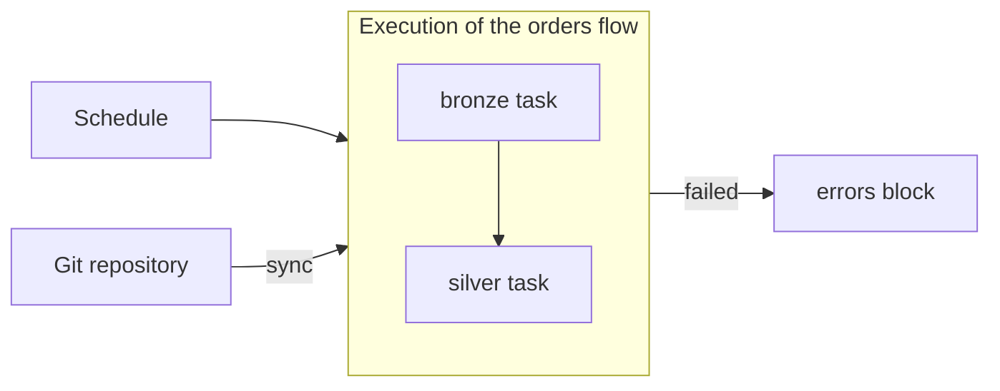

[Kestra](https://kestra.io/) runs workflows that you write as YAML flows. It schedules them, retries their tasks, and lets you backfill or execute them again from a UI. To orchestrate Bauplan with it, write each step of a pipeline as a Python function that publishes its result on a branch of its own; a flow then calls these functions from its script tasks, one task per step.

| Bauplan | Kestra |
| :--- | :--- |
| A step that writes on a new branch and merges it, such as an import or a pipeline run | A Python `Commands` task |
| The Python code of the steps and the Bauplan projects | Namespace files |
| The API key of the Bauplan user that runs scheduled jobs | A secret |
| The branch a flow publishes into | A key of the KV store |
| The day a run processes | The date of its Schedule trigger |
| A pipeline that runs on a schedule, one run at a time | A flow with a Schedule trigger and a concurrency limit |



The example has two steps. The first imports into a bronze table the files that an orders service delivers every day; the second runs a Bauplan project that rebuilds the same day of a silver table. Each execution of the flow processes one day. The bronze table and both namespaces already exist.

```tree
kestra/
  flows/
    orders.yml                # the flow of the pipeline
    sync.yml                  # pulls the flows and the files from Git
  files/
    pipelines/                # namespace files, which Kestra mounts in the working directory of each task
      __init__.py
      publish.py              # publishes a computation on a branch and waits for jobs
      steps.py                # one function per step, no Kestra code
      main.py                 # the command line the tasks call
      orders/                 # the Bauplan project of the silver step
        bauplan_project.yaml
        models.py
```

## Write each step as a function that publishes its own branch

Every step creates a branch from the base branch, computes on it, merges it and deletes it. A conflict on the merge means that the base branch moved during the computation, in which case the step starts again on a new branch that starts from the new head. `publish_on_branch` writes this pattern once and takes the computation as an argument:

```python title="kestra/files/pipelines/publish.py"
import time
from collections.abc import Callable
from datetime import UTC, datetime

import bauplan
from bauplan.exceptions import MergeConflictError
from bauplan.schema import JobState

POLL_INTERVAL_SECONDS = 10
MAX_MERGE_ATTEMPTS = 5


class JobFailedError(Exception):
    """A Bauplan job failed or was aborted"""


class MergeRetriesExhaustedError(Exception):
    """Every attempt to publish a branch ended in a merge conflict"""


def wait_for_job(
    client: bauplan.Client, job_id: str | None, timeout_seconds: int
) -> str:
    """Wait for a detached job to complete and return its id, cancelling it past the timeout"""
    if job_id is None:
        raise RuntimeError("the job was submitted without a job id")

    deadline = time.monotonic() + timeout_seconds

    while True:
        job = client.get_job(job_id)

        # Keep waiting unless the job completed, failed or was aborted
        if job.status == JobState.COMPLETE:
            return job_id
        if job.status in (JobState.FAIL, JobState.ABORT):
            raise JobFailedError(
                f"job {job_id} {job.human_readable_status}: {job.error_message}"
            )

        # Kestra kills the attempt at the task timeout without stopping the Bauplan job,
        # which is why the step cancels the job itself before that happens
        if time.monotonic() > deadline:
            client.cancel_job(job_id)
            raise TimeoutError(f"job {job_id} still {job.human_readable_status}")

        time.sleep(POLL_INTERVAL_SECONDS)


def publish_on_branch(
    base_branch: str,
    slug: str,
    compute: Callable[[bauplan.Client, str], str],
) -> str:
    """Compute on a new branch, merge it and return the id of the job it published"""
    client = bauplan.Client()
    username = client.info().user.username

    for _ in range(MAX_MERGE_ATTEMPTS):
        # Every attempt forks a new branch from the current head of the base branch
        stamp = datetime.now(UTC).strftime("%Y%m%d%H%M%S%f")
        branch = f"{username}.{slug}-{stamp}"
        client.create_branch(branch, from_ref=base_branch)

        try:
            job_id = compute(client, branch)
            client.merge_branch(source_ref=branch, into_branch=base_branch)
            return job_id

        # When the base branch moves under the computation, compute again from its new head
        except MergeConflictError:
            continue

        # Whether the merge happened or not, the branch of this attempt is not needed anymore
        finally:
            client.delete_branch(branch, if_exists=True)

    raise MergeRetriesExhaustedError(
        f"{slug} still conflicts with {base_branch} after {MAX_MERGE_ATTEMPTS} attempts"
    )
```

Each step then reduces to its computation and to the time its job may take. The functions do not import Kestra, which means you can call them from a script or a notebook as well:

```python type:ignore title="kestra/files/pipelines/steps.py"
from datetime import date, timedelta
from pathlib import Path

import bauplan

from pipelines.publish import publish_on_branch, wait_for_job

SOURCE_URI = "s3://my-bucket/raw/orders"
SILVER_PROJECT = Path(__file__).parent / "orders"

# Both stay below the timeout of their Kestra task, with room for the branch and the merge
IMPORT_TIMEOUT_SECONDS = 20 * 60
RUN_TIMEOUT_SECONDS = 60 * 60


def bronze_orders(base_branch: str, day: date) -> str:
    """Append the files of one day to the bronze table"""

    def compute(client: bauplan.Client, branch: str) -> str:
        # The import lists only the prefix that holds the files of this day
        state = client.import_data(
            table="orders",
            search_uri=f"{SOURCE_URI}/dt={day:%Y-%m-%d}/*.parquet",
            branch=branch,
            namespace="bronze",
            detach=True,
        )
        return wait_for_job(client, state.job_id, IMPORT_TIMEOUT_SECONDS)

    return publish_on_branch(base_branch, "bronze-orders", compute)


def silver_orders(base_branch: str, day: date) -> str:
    """Rebuild one day of the silver table"""

    def compute(client: bauplan.Client, branch: str) -> str:
        # Running the project again replaces the rows of the day, because it overwrites the window
        state = client.run(
            project_dir=str(SILVER_PROJECT),
            ref=branch,
            namespace="silver",
            parameters={
                "start_date": str(day),
                "end_date": str(day + timedelta(days=1)),
            },
            detach=True,
        )
        return wait_for_job(client, state.job_id, RUN_TIMEOUT_SECONDS)

    return publish_on_branch(base_branch, "silver-orders", compute)
```

The silver project has a single model. It reads the rows between the two run parameters that `bauplan_project.yaml` declares and replaces the same rows of its table through the `OVERWRITE_PARTITIONS` strategy:

```python title="kestra/files/pipelines/orders/models.py"
from typing import Annotated

import bauplan
import pyarrow as pa


class BronzeOrders(bauplan.TableSchema):
    """The columns of bronze.orders the model reads"""

    order_id: bauplan.String | None
    amount: bauplan.Float64 | None
    order_date: bauplan.Date32 | None


class OrdersClean(bauplan.TableSchema):
    """One row per order"""

    order_id: bauplan.String
    amount: bauplan.Float64
    order_date: bauplan.Date32


@bauplan.model(
    materialization_strategy="OVERWRITE_PARTITIONS",
    partitioned_by=["order_date"],
    overwrite_filter="order_date >= $start_date AND order_date < $end_date",
)
@bauplan.python("3.13", pip={"polars": "2.1.0"})
def orders_clean(
    bronze_orders: Annotated[
        pa.Table,
        bauplan.Model(
            "bronze.orders",
            projection_schema=BronzeOrders,
            filter="order_date >= $start_date AND order_date < $end_date",
        ),
    ],
) -> Annotated[pa.Table, OrdersClean]:
    """The complete orders of the window, each one once"""
    import polars as pl

    return pl.DataFrame(bronze_orders).drop_nulls().unique("order_id").to_arrow()
```

Running either step twice on the same day gives the same result. The import skips the files it has already imported, while the model overwrites the day instead of appending to it.

Since each step merges on its own, an error in the silver step does not undo the import; for a while, readers of the base branch see the new day in bronze but not yet in silver. If the tables must change together, compute them in a single step and publish them with one merge.

## Expose the steps through a command line

A Kestra script task runs shell commands in a container, which means that the steps need a command line. The one below uses [Typer](https://typer.tiangolo.com/). Each command reports, as a Kestra output, the id of the job it published:

```python type:ignore title="kestra/files/pipelines/main.py"
from datetime import date
from typing import Annotated

import typer
from kestra import Kestra

from pipelines import steps

app = typer.Typer()


@app.command()
def bronze_orders(
    base_branch: Annotated[
        str, typer.Option(help="The branch the step publishes into")
    ],
    day: Annotated[str, typer.Option(help="The day to import, as YYYY-MM-DD")],
) -> None:
    """Import one day of orders into the bronze table"""
    job_id = steps.bronze_orders(base_branch, date.fromisoformat(day))

    # The execution shows the id in its Outputs tab, where the tasks that follow can also read it
    Kestra.outputs({"job_id": job_id})


@app.command()
def silver_orders(
    base_branch: Annotated[
        str, typer.Option(help="The branch the step publishes into")
    ],
    day: Annotated[str, typer.Option(help="The day to rebuild, as YYYY-MM-DD")],
) -> None:
    """Rebuild one day of the silver table"""
    job_id = steps.silver_orders(base_branch, date.fromisoformat(day))
    Kestra.outputs({"job_id": job_id})


if __name__ == "__main__":
    app()
```

From a terminal, the same command processes a day again by hand without going through Kestra:

```sh
python -m pipelines.main silver-orders --base-branch main --day 2026-11-26
```

## Run the steps from a flow

The flow runs the two commands in order, with one `io.kestra.plugin.scripts.python.Commands` task each. What the tasks have in common (the image, the Python dependencies, the namespace files and the API key) sits in `pluginDefaults`:

```yaml title="kestra/flows/orders.yml"
id: orders
namespace: company.data

inputs:
  - id: base_branch
    type: STRING
    description: The Bauplan branch the steps publish into

  - id: day
    type: STRING
    required: false
    defaults: ""
    description: The day to process, as YYYY-MM-DD. Empty means the day before the scheduled date

variables:
  # Kestra evaluates variables lazily, which is why the tasks read this one through render()
  day: "{{ inputs.day != '' ? inputs.day : (trigger.date ?? execution.startDate) | dateAdd(-1, 'DAYS') | date('yyyy-MM-dd') }}"

concurrency:
  limit: 1

pluginDefaults:
  - type: io.kestra.plugin.scripts.python.Commands
    values:
      containerImage: python:3.13-slim
      dependencies:
        - bauplan==0.3.7
        - kestra
        - typer
      namespaceFiles:
        enabled: true
        include:
          - pipelines/**
      env:
        BAUPLAN_API_KEY: "{{ secret('BAUPLAN_API_KEY') }}"

tasks:
  - id: bronze-orders
    type: io.kestra.plugin.scripts.python.Commands
    commands:
      - python -m pipelines.main bronze-orders --base-branch {{ inputs.base_branch }} --day {{ render(vars.day) }}
    timeout: PT30M
    retry:
      type: exponential
      maxAttempts: 4
      interval: PT30S
      maxInterval: PT10M

  - id: silver-orders
    type: io.kestra.plugin.scripts.python.Commands
    commands:
      - python -m pipelines.main silver-orders --base-branch {{ inputs.base_branch }} --day {{ render(vars.day) }}
    timeout: PT1H10M
    retry:
      type: constant
      maxAttempts: 2
      interval: PT1M
```

Kestra copies the namespace files into the working directory of each task and keeps their folders, which is why `python -m pipelines.main` finds the package. In the open-source edition, Kestra reads secrets from the environment of its server, where the API key lives in `SECRET_BAUPLAN_API_KEY` as a base64 string.

## Give each task the retries its step needs

Kestra retries a task whatever the failure, including a job that failed on bad data. Retrying is still safe, because a step gives the same result when it runs twice, handles merge conflicts on a new branch, and cancels its job before Kestra kills the attempt (Kestra stops only the attempt, leaving the job running on Bauplan).

Since the import is cheap, it gets four attempts with backoff; the pipeline run can take an hour and gets one more attempt at most. The `timeout` of a task applies to each attempt and has to stay above the timeout of the job in `steps.py`. [How to retry on failure](/how-to/deploy/how-to-retry-on-failure) explains which Bauplan errors are worth retrying.

## Schedule the flow

A Schedule trigger starts the flow every night and passes it the branch to publish into:

```yaml title="kestra/flows/orders.yml"
triggers:
  - id: nightly
    type: io.kestra.plugin.core.trigger.Schedule
    cron: "0 2 * * *"
    timezone: Etc/UTC
    recoverMissedSchedules: ALL
    inputs:
      base_branch: "{{ kv('ORDERS_BASE_BRANCH') }}"
```

The day comes from the scheduled date of the trigger rather than from the clock. An execution therefore processes its own day even when it starts late, when Kestra creates it for a schedule it missed while it was down, or when it belongs to a backfill, which you start from the Triggers tab of the flow. To process a single day by hand, execute the flow from the UI and fill in `day`.

The base branch comes from the KV store, where each Kestra instance holds its own value; the same flow file then runs unchanged on staging and in production. The input has no default, because a manual execution should state where it publishes.

If an execution is due while another one is still running, it waits in the queue, which is the default behavior of the concurrency limit. Two executions therefore never compute on the same base branch at once.

## React to a failed execution

The `errors` block runs after a task has used up all its attempts. Use it to send an alert with the task that failed and its error:

```yaml title="kestra/flows/orders.yml"
errors:
  - id: notify-failure
    type: io.kestra.plugin.notifications.slack.SlackIncomingWebhook
    url: "{{ secret('SLACK_WEBHOOK_URL') }}"
    messageText: |
      orders {{ render(vars.day) }} failed on branch {{ inputs.base_branch }}
      Task: {{ errorLogs()[0]['taskId'] }}
      Error: {{ errorLogs()[0]['message'] }}
      Execution: {{ execution.id }}
```

If the job failed, the error contains its id, from which [how to debug a failed pipeline](/how-to/operate/how-to-debug-a-failed-pipeline) shows how to read its logs. Once the cause is fixed, execute the flow again with the same `day`. Both steps run from the start, though the import adds nothing for the files it already imported.

## Sync the flow and the code from Git

Keep the flows and the namespace files in Git and let a flow pull them into Kestra. `SyncFlows` updates the flows of a namespace from a directory of the repository; `SyncNamespaceFiles` does the same for the namespace files:

```yaml title="kestra/flows/sync.yml"
id: sync-from-git
namespace: company.data

tasks:
  - id: sync-flows
    type: io.kestra.plugin.git.SyncFlows
    url: git@github.com:my-org/data-platform.git
    branch: main
    privateKey: "{{ secret('GIT_DEPLOY_KEY') }}"
    targetNamespace: company.data
    gitDirectory: kestra/flows

  - id: sync-files
    type: io.kestra.plugin.git.SyncNamespaceFiles
    url: git@github.com:my-org/data-platform.git
    branch: main
    privateKey: "{{ secret('GIT_DEPLOY_KEY') }}"
    namespace: company.data
    gitDirectory: kestra/files

triggers:
  - id: every-five-minutes
    type: io.kestra.plugin.core.trigger.Schedule
    cron: "*/5 * * * *"
```

A merge on `main` then reaches Kestra within five minutes. The key is a read-only deploy key of the repository in PEM format. `sync.yml` sits in `kestra/flows` and updates itself as well; if a broken version of it lands, every later sync stops until you fix it from the UI. Both tasks leave alone what is not in the repository until you set `delete: true`. They need Kestra 2.0.2 or later.

## Related

- [Deployment](/how-to/deploy/how-to-deploy-a-pipeline)
- [How to retry on failure](/how-to/deploy/how-to-retry-on-failure)
- [How to debug a failed pipeline](/how-to/operate/how-to-debug-a-failed-pipeline)
- [Prefect](/integrations/orchestrators/prefect)
