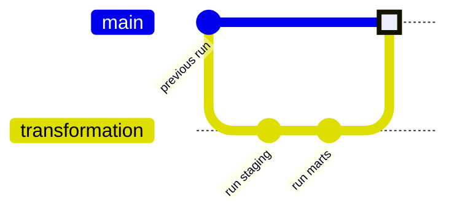

[Orchestra](https://www.getorchestra.io/) is a modern orchestrator, and compared with other orchestrators it is straightforward to use. You define pipelines in its UI or as YAML, and Orchestra runs them on a schedule or after other pipelines, retries failed tasks and sends alerts, with no servers of your own to manage.

Orchestra supports Bauplan natively. Its [Bauplan tasks](https://docs.getorchestra.io/docs/integrations/bauplan/bauplan_execute_pipeline) run a Bauplan pipeline on a branch as one step of an Orchestra pipeline, which is all you need when a step is a single Bauplan command. When a step needs more than that, for instance creating a branch, running several projects on it and merging the result only if all of them succeed, run a Python script instead. This page shows that case, with a small CLI in your repository whose commands Orchestra runs one per task.

The example is a transformation made of two stages, each one a Bauplan project. Each run creates a branch, runs the stages on it one after the other, and merges it into `main` once at the end:



## Write one command per step

Each command of the CLI does a single step, so Orchestra can sequence, retry and report on every step separately: `create-branch` creates the shared branch and hands its name to the next tasks, `run-pipeline` runs one stage and merges it into the shared branch, and `merge-branch` publishes the shared branch. The same commands are the building blocks of other pipelines too. An ingestion pipeline, for instance, can use `create-branch` and `merge-branch` around its own import command.

```tree
pyproject.toml              # bauplan, typer and orchestra-sdk
uv.lock
transformation/
  main.py                   # the commands Orchestra runs
  retry.py                  # retry policies, from How to retry on failure
  pipelines/
    staging/                # first stage, a Bauplan project
    marts/                  # second stage, reads the tables of staging
```

`retry.py` holds the `Retry` class and the three policies of [how to retry on failure](/how-to/deploy/how-to-retry-on-failure), and every SDK call in `main.py` goes through the policy that fits it:

```python type:ignore
import os
import time
from datetime import UTC, datetime
from pathlib import Path
from typing import Annotated

import bauplan
import typer
from bauplan.schema import JobState
from orchestra_sdk.orchestra import OrchestraSDK

from retry import BRANCH_RETRY, READ_RETRY, UNKNOWN_OUTCOME_ERRORS, WRITE_RETRY

# One Bauplan project per stage, in pipelines/<stage>/
PIPELINES_DIR = Path(__file__).parent / "pipelines"

POLL_INTERVAL_SECONDS = 10
POLL_TIMEOUT_SECONDS = 1800

# Job states that mean the job has stopped running
TERMINAL_STATES = (JobState.COMPLETE, JobState.FAIL, JobState.ABORT)

app = typer.Typer(
    help="Transformation steps run by the orchestrator", add_completion=False
)


class StageFailedError(RuntimeError):
    """A Bauplan job of a stage ended in a state other than complete"""


def utc_stamp() -> str:
    """UTC timestamp with microseconds, so two runs started together get different branches"""
    return datetime.now(UTC).strftime("%Y%m%d%H%M%S%f")


def wait_for_job(client: bauplan.Client, job_id: str) -> JobState:
    """Poll a detached job until it stops, cancelling it past the timeout"""
    deadline = time.monotonic() + POLL_TIMEOUT_SECONDS

    while True:
        # The job does not finish within seconds, so wait before the first poll
        time.sleep(POLL_INTERVAL_SECONDS)
        job = READ_RETRY.call(client.get_job, job_id)
        if job.status in TERMINAL_STATES:
            return job.status

        # Stop the job rather than leave it running after the task gives up on it
        if time.monotonic() > deadline:
            client.cancel_job(job_id)
            raise TimeoutError(f"job {job_id} still {job.human_readable_status}")


@app.command("create-branch")
def create_branch(
    base_branch: Annotated[str, typer.Option(help="Branch to fork from")] = "main",
) -> None:
    """Create the shared branch of one transformation run and hand its name to the next tasks"""
    client = bauplan.Client()

    # A new branch per run; without if_not_exists, a name already taken fails the task
    branch = f"{client.info().user.username}.transformation-{utc_stamp()}"
    WRITE_RETRY.call(client.create_branch, branch, from_ref=base_branch)

    # Orchestra injects ORCHESTRA_API_KEY into its tasks; anywhere else, print the name
    orchestra_api_key = os.environ.get("ORCHESTRA_API_KEY")
    if orchestra_api_key is None:
        typer.echo(branch)
        return

    if not OrchestraSDK(api_key=orchestra_api_key).set_output("branch", branch):
        raise RuntimeError(f"could not publish branch {branch} as a task output")


@app.command("run-pipeline")
def run_pipeline(
    stage: Annotated[str, typer.Argument(help="Stage to run, a folder of pipelines/")],
    shared_branch: Annotated[str, typer.Argument(help="Shared branch of this run")],
) -> None:
    """Run one stage on its own branch and merge it into the shared branch if it succeeds"""
    project_dir = PIPELINES_DIR / stage
    if not (project_dir / "bauplan_project.yaml").is_file():
        raise typer.BadParameter(f"no Bauplan project in {project_dir}")

    # Stages only ever merge into the shared branch; the final merge publishes them together
    if shared_branch == "main":
        raise typer.BadParameter("stages merge into the shared branch, not into main")

    client = bauplan.Client()

    # A stage branch forked from the shared branch, so a failed stage leaves it untouched
    stage_branch = f"{client.info().user.username}.transformation-{stage}-{utc_stamp()}"
    WRITE_RETRY.call(client.create_branch, stage_branch, from_ref=shared_branch)
    BRANCH_RETRY.call(
        client.create_namespace, stage, branch=stage_branch, if_not_exists=True
    )

    # Submit detached and poll, so the job id is in the task log however long the stage takes
    state = WRITE_RETRY.call(
        client.run,
        project_dir=str(project_dir),
        ref=stage_branch,
        namespace=stage,
        strict=True,
        cache=False,
        detach=True,
    )
    if state.job_id is None:
        raise StageFailedError(
            f"no job id for stage {stage}; branch {stage_branch} kept"
        )

    # A failed stage keeps its branch for inspection and fails the task
    status = wait_for_job(client, state.job_id)
    if status != JobState.COMPLETE:
        raise StageFailedError(
            f"stage {stage} ended as {status} (job {state.job_id}); branch {stage_branch} kept"
        )

    # The stage output joins the shared branch, and the stage branch is no longer needed
    WRITE_RETRY.call(
        client.merge_branch, source_ref=stage_branch, into_branch=shared_branch
    )
    BRANCH_RETRY.call(client.delete_branch, stage_branch, if_exists=True)


@app.command("merge-branch")
def merge_branch(
    source_branch: Annotated[str, typer.Argument(help="Shared branch of this run")],
    into_branch: Annotated[str, typer.Argument(help="Branch to publish to")] = "main",
) -> None:
    """Publish every stage of the run in one merge, then delete the shared branch"""
    client = bauplan.Client()

    # Tag the merge with the head of the branch, to recognise it on the destination
    merge_properties = {
        "source_branch": source_branch,
        "source_hash": READ_RETRY.call(client.get_branch, source_branch).hash,
    }

    try:
        WRITE_RETRY.call(
            client.merge_branch,
            source_ref=source_branch,
            into_branch=into_branch,
            commit_properties=merge_properties,
        )
    except UNKNOWN_OUTCOME_ERRORS:
        # The merge may have been applied anyway: it failed only if its commit is missing
        applied = READ_RETRY.call(
            client.get_commits,
            into_branch,
            filter_by_properties=merge_properties,
            limit=1,
        )
        if not list(applied):
            raise

    BRANCH_RETRY.call(client.delete_branch, source_branch, if_exists=True)


if __name__ == "__main__":
    app()
```

`run-pipeline` polls the job inside the task, so the Orchestra task stays running for as long as the stage does, and the job id is in the task log. A stage that fails or aborts fails the task and keeps its branch for inspection. A stage that is still running when the polling timeout expires is cancelled, so no job keeps running after Orchestra has given up on it.

## Run the commands locally

The commands do not depend on Orchestra, so you can run a whole transformation from your laptop with your own API key before configuring anything. Outside Orchestra, `create-branch` prints the branch name instead of publishing it:

```sh
BRANCH=$(uv run transformation/main.py create-branch)
uv run transformation/main.py run-pipeline staging "$BRANCH"
uv run transformation/main.py run-pipeline marts "$BRANCH"
uv run transformation/main.py merge-branch "$BRANCH" main
```

Every task in Orchestra runs one of these lines, so you reproduce a failed task by running its command again. To try a change without publishing it, stop before `merge-branch`, query the shared branch, and delete it.

## Connect the repository to Orchestra

Create a Python connection in Orchestra that points at the GitHub repository (if you are using one), and put the API key of the Bauplan user that runs scheduled jobs in its **Secret JSON**. Orchestra exports these secrets as environment variables before each task and redacts them in the logs:

```json
{
  "BAUPLAN_API_KEY": "<API key of the scheduled jobs user>"
}
```

Orchestra also injects `ORCHESTRA_API_KEY` into every task, which `create-branch` uses to publish its output.

## Compose the commands into a pipeline

Each command becomes a `PYTHON_EXECUTE_SCRIPT` task, which installs the dependencies with `uv sync` and runs the command from a checkout of the repository. The order of the steps is the `depends_on` between task groups. The excerpt shows the branch creation, the first stage and the final merge, and every further stage is a group like `run-staging` that depends on the previous one. Orchestra keys groups and tasks by UUIDs, shortened here to names:

```yaml
version: v1
name: transformation
pipeline:
  create-branch-group:
    depends_on: []
    tasks:
      create-branch-task:
        name: create-branch
        integration: PYTHON
        integration_job: PYTHON_EXECUTE_SCRIPT
        connection: <python connection>
        parameters:
          source: GIT
          branch: main
          package_manager: UV
          python_version: '3.12'
          build_command: uv sync
          command: uv run transformation/main.py create-branch
          # Lets the task publish the branch name for the tasks that follow
          set_outputs: true
        configuration:
          retries: 2
  run-staging-group:
    depends_on:
    - create-branch-group
    tasks:
      run-staging-task:
        name: run-staging
        integration: PYTHON
        integration_job: PYTHON_EXECUTE_SCRIPT
        connection: <python connection>
        parameters:
          source: GIT
          branch: main
          package_manager: UV
          python_version: '3.12'
          build_command: uv sync
          command: uv run transformation/main.py run-pipeline staging ${{ ORCHESTRA.PIPELINE_RUN_TASKS['create-branch-task'].OUTPUTS['branch'] }}
        configuration:
          retries: 1
  merge-branch-group:
    depends_on:
    - run-marts-group
    tasks:
      merge-branch-task:
        name: merge-branch
        integration: PYTHON
        integration_job: PYTHON_EXECUTE_SCRIPT
        connection: <python connection>
        parameters:
          source: GIT
          branch: main
          package_manager: UV
          python_version: '3.12'
          build_command: uv sync
          command: uv run transformation/main.py merge-branch ${{ ORCHESTRA.PIPELINE_RUN_TASKS['create-branch-task'].OUTPUTS['branch'] }} main
        configuration:
          retries: 0
```

`set_outputs: true` and the `set_output` call in `create-branch` store the name of the shared branch on the run, and the following tasks read it with the `${{ ORCHESTRA.PIPELINE_RUN_TASKS['<task id>'].OUTPUTS['branch'] }}` expression. No task hardcodes a branch, so two runs never share one. The `branch: main` parameter is the Git branch Orchestra checks out, so the pipeline always runs the reviewed code.

Run the stages one after another, in the order of their dependencies. A stage forks its branch from the shared branch when it starts, so it reads the tables of the stages merged before it, and two stages started in parallel would not see each other's output. Keep `merge-branch` as a task of its own, the only one that writes to `main`, so that a run is published entirely or not at all. In a development environment, you can drop it to run every stage without publishing.

## Retry each command according to what it does

There are two layers of retries. Inside the CLI, every SDK call goes through a policy that matches the call. Reads such as `get_job` retry on any transient error; within Orchestra, `retries` reruns the whole task, which covers what the inner layer cannot, such as a lost worker or an outage that lasts longer than the backoff.

How many times Orchestra should rerun a task depends on what a rerun costs and whether it is safe:

| Task | Orchestra `retries` | Why |
| :--- | :--- | :--- |
| `create-branch` | 2 | Cheap, and every attempt creates a branch with a new name, so a rerun cannot collide with an earlier attempt |
| `run-pipeline` | 1 | A rerun creates a new stage branch from the shared branch and recomputes only that stage, but a stage can take long, so one rerun is enough to cover a transient failure |
| `merge-branch` | 0 | The command already checks whether a merge with an unknown outcome was applied, and a blind rerun after a successful merge would fail on a branch that no longer exists |

A failed expectation or a model error is not transient, so a rerun of `run-pipeline` fails the same way. Keep `retries` low for that task, so that a real failure fails the run quickly instead of running the stage again.

## Related

- [How to deploy a pipeline](/how-to/deploy/how-to-deploy-a-pipeline)
- [How to retry on failure](/how-to/deploy/how-to-retry-on-failure)
- [Dagster](/integrations/orchestrators/dagster)
