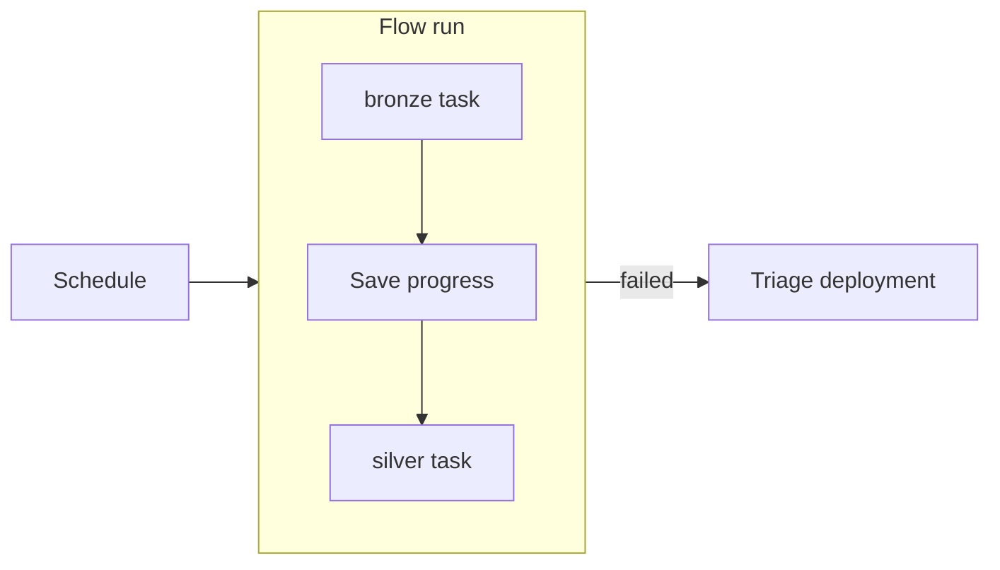

[Prefect](https://www.prefect.io/) turns plain Python functions into tasks and flows, and adds schedules, retries and a run history around them. To orchestrate Bauplan with it you:
1. write each step of a pipeline as a function that publishes its result on Bauplan;
2. wrap the function into a task with the retries that step needs;
3. compose the tasks into a flow.

Prefect decides when a step runs and whether it runs again, while all the heavy-lifting is run on Bauplan.

| Bauplan | Prefect |
| :--- | :--- |
| A step that writes on a new branch and merges it, such as an import or a pipeline run | A task |
| An error that another attempt would not fix, such as a failed job | A retry condition of the task |
| A pipeline made of several steps | A flow |
| How far each step has published | A Variable |
| A pipeline that runs on a schedule, one run at a time | A served deployment with a concurrency limit |



The example below has two steps. The first imports the files that an orders service delivers every day into a bronze table, and the second runs a Bauplan project that rebuilds the same days of a silver table. The bronze table and both namespaces already exist.

```tree
pipelines/
  publish.py              # publishes a computation on a branch, and waits for jobs
  steps.py                # one function per step, no Prefect code
  flows.py                # the tasks, the flow and its deployment
  orders/                 # the Bauplan project of the silver step
    bauplan_project.yaml
    models.py
```

## Write each step as a function that publishes its own branch

Every step follows the same pattern. It creates a branch from the base branch, computes on it, merges it and deletes it. A merge that conflicts means the base branch has moved while the step was computing, and the step then computes again on a new branch. Write the pattern once, in a function that takes the computation as an argument:

```python title="pipelines/publish.py"
import time
from collections.abc import Callable
from datetime import UTC, datetime

import bauplan
from bauplan.exceptions import MergeConflictError
from bauplan.schema import JobState

POLL_INTERVAL_SECONDS = 10
JOB_TIMEOUT_SECONDS = 3600
MAX_MERGE_ATTEMPTS = 5


class JobFailedError(Exception):
    """A Bauplan job ended failed or aborted"""


class MergeRetriesExhaustedError(Exception):
    """Every attempt to publish a branch ended in a merge conflict"""


def wait_for_job(client: bauplan.Client, job_id: str | None) -> None:
    """Wait for a detached job to complete, and cancel it past the timeout"""
    if job_id is None:
        raise RuntimeError("the job was submitted without a job id")

    deadline = time.monotonic() + JOB_TIMEOUT_SECONDS

    while True:
        job = client.get_job(job_id)

        # Only a failed or aborted job is an error, any other state means keep waiting
        if job.status == JobState.COMPLETE:
            return
        if job.status in (JobState.FAIL, JobState.ABORT):
            raise JobFailedError(
                f"job {job_id} {job.human_readable_status}: {job.error_message}"
            )

        # Stop the job rather than leave it running after the task gives up on it
        if time.monotonic() > deadline:
            client.cancel_job(job_id)
            raise TimeoutError(f"job {job_id} still {job.human_readable_status}")

        time.sleep(POLL_INTERVAL_SECONDS)


def publish_on_branch(
    base_branch: str,
    slug: str,
    env: str,
    compute: Callable[[bauplan.Client, str], None],
) -> None:
    """Compute on a new branch and merge it, computing again on another one on conflict"""
    client = bauplan.Client()
    username = client.info().user.username

    for _ in range(MAX_MERGE_ATTEMPTS):
        # A new branch per attempt, forked from the current head of the base branch
        stamp = datetime.now(UTC).strftime("%Y%m%d%H%M%S%f")
        branch = f"{username}.{slug}-{env}-{stamp}"
        client.create_branch(branch, from_ref=base_branch)

        try:
            compute(client, branch)
            client.merge_branch(source_ref=branch, into_branch=base_branch)
            return

        # The base branch moved under the computation: compute again from its new head
        except MergeConflictError:
            continue

        # Published or not, the branch of this attempt is not needed anymore
        finally:
            client.delete_branch(branch, if_exists=True)

    raise MergeRetriesExhaustedError(
        f"{slug} still conflicts with {base_branch} after {MAX_MERGE_ATTEMPTS} attempts"
    )
```

A step is then only its computation. Because these functions do not import Prefect, you can also call them from a script or a CLI, for instance to run one step again by hand:

```python type:ignore title="pipelines/steps.py"
from datetime import date, timedelta
from pathlib import Path

import bauplan

from pipelines.publish import publish_on_branch, wait_for_job

SOURCE_URI = "s3://my-bucket/raw/orders"
SILVER_PROJECT = Path(__file__).parent / "orders"


def bronze_orders(base_branch: str, env: str, start: date, end: date) -> None:
    """Append the files of the days from start to end, excluded, to the bronze table"""

    def compute(client: bauplan.Client, branch: str) -> None:
        # One import per day, which keeps each one to a single prefix
        for offset in range((end - start).days):
            day = start + timedelta(days=offset)
            state = client.import_data(
                table="orders",
                search_uri=f"{SOURCE_URI}/dt={day:%Y-%m-%d}/*.parquet",
                branch=branch,
                namespace="bronze",
                detach=True,
            )
            wait_for_job(client, state.job_id)

    publish_on_branch(base_branch, "bronze-orders", env, compute)


def silver_orders(base_branch: str, env: str, start: date, end: date) -> None:
    """Rebuild the days from start to end, excluded, of the silver table"""

    def compute(client: bauplan.Client, branch: str) -> None:
        # Running the project again replaces the same rows, because it overwrites the window
        state = client.run(
            project_dir=str(SILVER_PROJECT),
            ref=branch,
            namespace="silver",
            parameters={"start_date": str(start), "end_date": str(end)},
            detach=True,
        )
        wait_for_job(client, state.job_id)

    publish_on_branch(base_branch, "silver-orders", env, compute)
```

The project that the silver step runs has a single model. It reads the days between the two run parameters, which are declared in `bauplan_project.yaml`, and replaces the same days of its table with the `OVERWRITE_PARTITIONS` strategy:

```python title="pipelines/orders/models.py"
from typing import Annotated

import bauplan
import pyarrow as pa


class BronzeOrders(bauplan.TableSchema):
    """The columns of bronze.orders the model reads"""

    order_id: bauplan.String | None
    amount: bauplan.Float64 | None
    order_date: bauplan.Date32 | None


class OrdersClean(bauplan.TableSchema):
    """One row per order"""

    order_id: bauplan.String
    amount: bauplan.Float64
    order_date: bauplan.Date32


@bauplan.model(
    materialization_strategy="OVERWRITE_PARTITIONS",
    partitioned_by=["order_date"],
    overwrite_filter="order_date >= $start_date AND order_date < $end_date",
)
@bauplan.python("3.13", pip={"polars": "2.1.0"})
def orders_clean(
    bronze_orders: Annotated[
        pa.Table,
        bauplan.Model(
            "bronze.orders",
            projection_schema=BronzeOrders,
            filter="order_date >= $start_date AND order_date < $end_date",
        ),
    ],
) -> Annotated[pa.Table, OrdersClean]:
    """The complete orders of the window, each one once"""
    import polars as pl

    return pl.DataFrame(bronze_orders).drop_nulls().unique("order_id").to_arrow()
```

Both steps can run twice on the same days without changing the result, which is what makes them safe to retry. The import skips the files it has already imported, and the model replaces the days it computes instead of appending to them.

Since each step merges on its own, an error in the silver step does not undo the import, and only that step runs again. The other side of this choice is that a reader of the base branch can see the new days in bronze before they are in silver. When the tables must change together, compute all of them in a single step and publish them with one merge.

## Give each task the retries its step needs

Wrap each function into a task with `task(...)`, and choose its retries by what another attempt costs:

```python type:ignore title="pipelines/flows.py"
from prefect import Task, task
from prefect.client.schemas.objects import State, TaskRun
from prefect.tasks import exponential_backoff

from pipelines import steps
from pipelines.publish import JobFailedError, MergeRetriesExhaustedError

# Errors that a retry of the same step would meet again
NOT_RETRYABLE = (JobFailedError, MergeRetriesExhaustedError, TimeoutError)


def is_retryable(failed_task: Task, task_run: TaskRun, state: State) -> bool:
    """Tell whether a failed step can succeed if it runs again"""
    error = state.result(raise_on_failure=False)
    return not isinstance(error, NOT_RETRYABLE)


# An import retries patiently, because it is cheap and skips the files already imported
bronze_orders = task(
    name="bronze-orders",
    retries=4,
    retry_delay_seconds=exponential_backoff(backoff_factor=30),
    retry_condition_fn=is_retryable,
)(steps.bronze_orders)

# A pipeline run gets a single retry, because it can take long
silver_orders = task(
    name="silver-orders",
    retries=1,
    retry_delay_seconds=60,
    retry_condition_fn=is_retryable,
)(steps.silver_orders)
```

By default, Prefect retries a task on any exception. `retry_condition_fn` restricts this to the errors that another attempt can fix, such as a service that is briefly unreachable. A failed job, a job that ran out of time and a merge that kept conflicting would end in the same way. For these errors the task fails at once and the flow reports it without waiting for the retries. [How to retry on failure](/how-to/deploy/how-to-retry-on-failure) explains which Bauplan errors are worth retrying.

## Compose the tasks into a flow

The flow calls the tasks in the order of their dependencies, and saves how far each step got in a Prefect Variable as soon as that step has published:

```python type:ignore title="pipelines/flows.py"
from datetime import UTC, date, datetime, timedelta

from prefect import flow
from prefect.variables import Variable

# Where every step starts on the first run of an environment
FIRST_DAY = date(2026, 11, 1)

# A flow that fell behind catches up in bounded steps
MAX_DAYS_PER_RUN = 7


def next_day(variable: str) -> date:
    """The first day a step has not processed yet"""
    saved = Variable.get(variable)
    return date.fromisoformat(saved) if isinstance(saved, str) else FIRST_DAY


@flow(name="orders")
def orders(base_branch: str, env: str) -> None:
    """Bring the days closed since the last run through bronze and silver"""
    today = datetime.now(UTC).date()

    # One pair of Variables per environment keeps a dev run from moving the progress of prod
    bronze_variable = f"orders_{env}_bronze_next_day"
    silver_variable = f"orders_{env}_silver_next_day"

    # Bronze: the days that are over, in bounded steps
    start = next_day(bronze_variable)
    end = min(today, start + timedelta(days=MAX_DAYS_PER_RUN))
    if start < end:
        bronze_orders(base_branch, env, start, end)
        Variable.set(bronze_variable, str(end), overwrite=True)

    # Silver: every day that is in bronze and not in silver, also after a failed run
    start, end = next_day(silver_variable), next_day(bronze_variable)
    if start < end:
        silver_orders(base_branch, env, start, end)
        Variable.set(silver_variable, str(end), overwrite=True)
```

## Serve the flow on a schedule

At the end of `flows.py`, `serve` creates a deployment and runs the flow on a schedule:

```python type:ignore title="pipelines/flows.py"
from prefect.client.schemas.objects import (
    ConcurrencyLimitConfig,
    ConcurrencyLimitStrategy,
)

if __name__ == "__main__":
    orders.serve(
        name="orders-prod",
        cron="0 * * * *",
        parameters={"base_branch": "main", "env": "prod"},
        global_limit=ConcurrencyLimitConfig(
            limit=1, collision_strategy=ConcurrencyLimitStrategy.CANCEL_NEW
        ),
    )
```

`serve` stays running and starts every flow run in a subprocess on the same machine. For this reason the process needs the Bauplan project directories on disk and the API key of the Bauplan user that runs scheduled jobs, in `BAUPLAN_API_KEY`. Run it as a long-lived service, for instance in a container. If the runs need their own infrastructure, deploy the same flow to a Prefect work pool instead.

The concurrency limit keeps two runs from computing the same days and merging into the same branch at the same time. With `CANCEL_NEW`, a run that is due while another one is still going is cancelled, and since every run starts from the saved progress, the days it would have processed go to the next one.

## React to a failed run

Prefect runs state hooks when a flow run ends, after all its retries. Use them to start whatever should happen on a failure, such as an alert or a deployment that investigates the run:

```python type:ignore title="pipelines/flows.py"
from prefect import Flow
from prefect.client.schemas.objects import FlowRun, State
from prefect.deployments import run_deployment

TRIAGE_DEPLOYMENT = "triage/triage"


@orders.on_failure
def start_triage(failed_flow: Flow, flow_run: FlowRun, state: State) -> None:
    """Start the triage deployment on the first failure of a series of scheduled runs"""
    # Whether the last run of this environment failed
    failing_variable = f"orders_{flow_run.parameters['env']}_failing"

    if not flow_run.auto_scheduled or Variable.get(failing_variable) is True:
        return
    Variable.set(failing_variable, True, overwrite=True)

    # Returns once the run is created, as a run of its own and not a subflow of the failed one
    run_deployment(
        TRIAGE_DEPLOYMENT,
        parameters={"flow_run_id": str(flow_run.id), "error": str(state.message)},
        timeout=0,
        as_subflow=False,
    )


@orders.on_completion
def clear_failing(completed_flow: Flow, flow_run: FlowRun, state: State) -> None:
    """Let the next failure after a successful run start the triage again"""
    failing_variable = f"orders_{flow_run.parameters['env']}_failing"
    Variable.set(failing_variable, False, overwrite=True)
```

Since hooks run in the process of the flow, Prefect cannot guarantee them if that process is killed. If you need to be told about crashed runs as well, add a Prefect Automation, which runs on the server. [How to debug a failed pipeline](/how-to/operate/how-to-debug-a-failed-pipeline) shows how to read the logs of a failed Bauplan job from its id, which is in the error of the task.

## Related

- [Deployment](/how-to/deploy/how-to-deploy-a-pipeline)
- [How to retry on failure](/how-to/deploy/how-to-retry-on-failure)
- [How to Write-Audit-Publish](/how-to/publish/how-to-write-audit-publish)
- [Dagster](/integrations/orchestrators/dagster)
