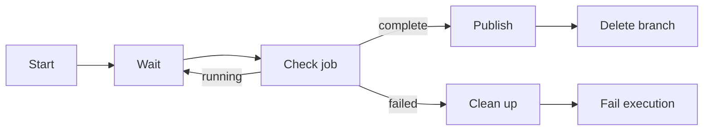

[AWS Step Functions](https://aws.amazon.com/step-functions/) coordinates AWS services through a state machine whose steps usually run as [AWS Lambda](https://aws.amazon.com/lambda/) functions. Lambda stops an invocation after 15 minutes, whereas a Bauplan job can last for hours; for this reason the function never waits for a job. Each invocation makes one short call to the Bauplan Python SDK, while the state machine waits between calls. Every execution publishes a branch of its own with a single merge.

| Bauplan | Step Functions and Lambda |
| :--- | :--- |
| A step of the pipeline, such as starting a run or merging a branch | An action of the Lambda function, which a Task state invokes |
| A job that runs for minutes or hours | A detached run, which a Wait state and a Choice state poll |
| The branch of one run, which one merge publishes | One execution of the state machine |
| The failure of a job | A status that the Choice state routes to the clean-up |
| A recurring pipeline | An EventBridge Scheduler schedule that starts an execution |



## Write one Lambda function for every Bauplan step

One function handles the four steps of the pipeline (`start`, `status`, `publish` and `cleanup`); the `action` field of the event tells it which one to run. Since the branch name and the job id travel in the execution, the function keeps no state between invocations.

```tree
orders/
  runner/
    pyproject.toml
    uv.lock
    src/
      requirements.txt        # exported from uv.lock, read by sam build
      orders_runner/
        app.py                # the handler, one action per step
        pipeline/             # the Bauplan project the function runs
          bauplan_project.yml
          models.py
  infra/
    template.yaml             # the function, the state machine and the schedule
    statemachine.asl.json     # the state machine definition
```

If the submission fails, `start` deletes the branch before raising, because no other state knows it exists yet. `status` returns a failed job as a status rather than an exception, since retrying the call would not change how the job ended:

```python type:ignore
import logging
import os
from datetime import UTC, datetime, timedelta
from pathlib import Path
from typing import Any

import bauplan
import boto3
from bauplan import JobState

# The Bauplan project is shipped inside the package, next to this module
PROJECT_DIR = Path(__file__).parent / "pipeline"

logger = logging.getLogger()

def build_client() -> bauplan.Client:
    """Build a Bauplan client with the API key read from SSM Parameter Store"""
    parameter = os.environ["BAUPLAN_API_KEY_PARAMETER"]
    response = boto3.client("ssm").get_parameter(Name=parameter, WithDecryption=True)
    return bauplan.Client(api_key=response["Parameter"]["Value"])

def lambda_handler(event: dict[str, Any], context: Any) -> dict[str, str]:
    """Run the step of the state machine named by the action in the event"""
    action = event["action"]
    if action == "start":
        return start(event["scheduled_time"])
    if action == "status":
        return status(event["job_id"])
    if action == "publish":
        return publish(event["branch"])
    if action == "cleanup":
        return cleanup(event["branch"], event.get("job_id"))
    raise ValueError(f"unknown action {action!r}")

def start(scheduled_time: str) -> dict[str, str]:
    """Create the branch of this execution, submit the run detached and return both"""
    client = build_client()
    base_branch = os.environ["BAUPLAN_BASE_BRANCH"]
    namespace = os.environ["BAUPLAN_NAMESPACE"]

    # Derive the day from the scheduled time, which a late start does not change
    day = datetime.fromisoformat(scheduled_time).date() - timedelta(days=1)
    parameters: dict[str, str | int | float | bool | None] = {
        "start_date": day.isoformat(),
        "end_date": (day + timedelta(days=1)).isoformat(),
    }

    # The timestamp gives every attempt a branch of its own
    stamp = datetime.now(UTC).strftime("%Y%m%d%H%M%S")
    branch = f"{client.info().user.username}.orders-{day.isoformat()}-{stamp}"
    client.create_branch(branch, from_ref=base_branch)

    # No later state knows about the branch yet, which leaves its deletion to this function if the submission fails
    try:
        client.create_namespace(namespace, branch, if_not_exists=True)
        state = client.run(
            project_dir=str(PROJECT_DIR),
            ref=branch,
            namespace=namespace,
            parameters=parameters,
            detach=True,
        )
        if state.job_id is None:
            raise RuntimeError(f"run on {branch} returned no job id")
    except Exception:
        client.delete_branch(branch, if_exists=True)
        raise

    return {"branch": branch, "job_id": state.job_id}

def status(job_id: str) -> dict[str, str]:
    """Report whether the job is still running, complete or failed"""
    client = build_client()
    job = client.get_job(job_id)

    # While the job is queued or running, the state machine goes back to the Wait state
    if job.status in (JobState.NOT_STARTED, JobState.RUNNING):
        return {"status": "running"}
    if job.status == JobState.COMPLETE:
        return {"status": "complete"}

    # Write the logs of the job to CloudWatch, next to the invocation that reports the failure
    if job.status in (JobState.FAIL, JobState.ABORT):
        for line in client.get_job_logs(job_id):
            logger.error(line.message)
        return {"status": "failed"}

    # Raise on any other state and let the state machine retry the invocation
    raise RuntimeError(f"job {job_id} is in state {job.human_readable_status}")

def publish(branch: str) -> dict[str, str]:
    """Merge the branch of this execution into the base branch"""
    base_branch = os.environ["BAUPLAN_BASE_BRANCH"]
    build_client().merge_branch(
        source_ref=branch,
        into_branch=base_branch,
        commit_message=f"Merge {branch} into {base_branch}",
    )
    return {"branch": branch}

def cleanup(branch: str, job_id: str | None) -> dict[str, str]:
    """Cancel the job if it is still running, then delete the branch of this execution"""
    client = build_client()

    # If CheckJob could not read the status, the job may still be writing to the branch
    if job_id is not None:
        job = client.get_job(job_id)
        if job.status in (JobState.NOT_STARTED, JobState.RUNNING):
            client.cancel_job(job_id)

    client.delete_branch(branch, if_exists=True)
    return {"branch": branch}
```

If the pipeline needs an import before the run, add one action to the function and one Task state to the state machine. When both jobs share a branch, one merge publishes all their tables.

## Poll the job from the state machine

After `start`, the state machine alternates between a Wait state and a call to `status` until a Choice state sees the job end. `TimeoutSeconds` caps the whole execution in case a job never ends:

```json
{
  "Comment": "Run the pipeline on a branch of its own, poll the Bauplan job and publish the branch",
  "StartAt": "Start",
  "TimeoutSeconds": 14400,
  "States": {
    "Start": {
      "Type": "Task",
      "Comment": "Start deletes its branch before failing, which lets the Catch go straight to Failed",
      "Resource": "arn:aws:states:::lambda:invoke",
      "Parameters": {
        "FunctionName": "${RunnerFunctionArn}",
        "Payload": { "action": "start", "scheduled_time.$": "$.scheduled_time" }
      },
      "ResultSelector": { "branch.$": "$.Payload.branch", "job_id.$": "$.Payload.job_id" },
      "ResultPath": "$.run",
      "Retry": [
        {
          "ErrorEquals": ["Lambda.ServiceException", "Lambda.AWSLambdaException", "Lambda.SdkClientException", "Lambda.TooManyRequestsException"],
          "IntervalSeconds": 5,
          "MaxAttempts": 3,
          "BackoffRate": 2
        }
      ],
      "Catch": [{ "ErrorEquals": ["States.ALL"], "Next": "Failed" }],
      "Next": "WaitForJob"
    },
    "WaitForJob": {
      "Type": "Wait",
      "Seconds": 30,
      "Next": "CheckJob"
    },
    "CheckJob": {
      "Type": "Task",
      "Resource": "arn:aws:states:::lambda:invoke",
      "Parameters": {
        "FunctionName": "${RunnerFunctionArn}",
        "Payload": { "action": "status", "job_id.$": "$.run.job_id" }
      },
      "ResultSelector": { "status.$": "$.Payload.status" },
      "ResultPath": "$.job",
      "Retry": [
        {
          "ErrorEquals": ["Lambda.ServiceException", "Lambda.AWSLambdaException", "Lambda.SdkClientException", "Lambda.TooManyRequestsException"],
          "IntervalSeconds": 5,
          "MaxAttempts": 3,
          "BackoffRate": 2
        },
        {
          "Comment": "Failing to read the status tells nothing about the job, which is why the state asks again",
          "ErrorEquals": ["States.TaskFailed"],
          "IntervalSeconds": 30,
          "MaxAttempts": 3,
          "BackoffRate": 2
        }
      ],
      "Catch": [{ "ErrorEquals": ["States.ALL"], "ResultPath": "$.error", "Next": "Cleanup" }],
      "Next": "JobDone"
    },
    "JobDone": {
      "Type": "Choice",
      "Choices": [
        { "Variable": "$.job.status", "StringEquals": "running", "Next": "WaitForJob" },
        { "Variable": "$.job.status", "StringEquals": "complete", "Next": "Publish" }
      ],
      "Default": "Cleanup"
    },
    "Publish": {
      "Type": "Task",
      "Resource": "arn:aws:states:::lambda:invoke",
      "Parameters": {
        "FunctionName": "${RunnerFunctionArn}",
        "Payload": { "action": "publish", "branch.$": "$.run.branch" }
      },
      "ResultPath": null,
      "Retry": [
        {
          "ErrorEquals": ["Lambda.ServiceException", "Lambda.AWSLambdaException", "Lambda.SdkClientException", "Lambda.TooManyRequestsException"],
          "IntervalSeconds": 5,
          "MaxAttempts": 3,
          "BackoffRate": 2
        }
      ],
      "Catch": [{ "ErrorEquals": ["States.ALL"], "ResultPath": "$.error", "Next": "Cleanup" }],
      "Next": "DeleteBranch"
    },
    "DeleteBranch": {
      "Type": "Task",
      "Resource": "arn:aws:states:::lambda:invoke",
      "Parameters": {
        "FunctionName": "${RunnerFunctionArn}",
        "Payload": { "action": "cleanup", "branch.$": "$.run.branch" }
      },
      "Retry": [
        {
          "ErrorEquals": ["Lambda.ServiceException", "Lambda.AWSLambdaException", "Lambda.SdkClientException", "Lambda.TooManyRequestsException"],
          "IntervalSeconds": 5,
          "MaxAttempts": 3,
          "BackoffRate": 2
        }
      ],
      "End": true
    },
    "Cleanup": {
      "Type": "Task",
      "Comment": "Cancels the job if it is still running, deletes the branch and fails the execution",
      "Resource": "arn:aws:states:::lambda:invoke",
      "Parameters": {
        "FunctionName": "${RunnerFunctionArn}",
        "Payload": { "action": "cleanup", "branch.$": "$.run.branch", "job_id.$": "$.run.job_id" }
      },
      "Retry": [
        {
          "ErrorEquals": ["Lambda.ServiceException", "Lambda.AWSLambdaException", "Lambda.SdkClientException", "Lambda.TooManyRequestsException"],
          "IntervalSeconds": 5,
          "MaxAttempts": 3,
          "BackoffRate": 2
        }
      ],
      "Catch": [{ "ErrorEquals": ["States.ALL"], "Next": "Failed" }],
      "Next": "Failed"
    },
    "Failed": {
      "Type": "Fail"
    }
  }
}
```

When an execution times out or someone stops it, Step Functions runs no further state. You then have to cancel the job and delete the branch by hand, as [detached runs](/common-scenarios/detached-runs) shows. `TimeoutSeconds` should therefore sit well above the longest run you expect.

## Give every state its own retry strategy

Every Task state retries the errors of the Lambda service, such as throttling, which say nothing about Bauplan. `CheckJob` also retries `States.TaskFailed`, because failing to read the status of a job tells nothing about the job itself; after the last attempt the execution moves to `Cleanup`.

No other state retries the errors of the function. When `start` fails, it has already deleted its branch; a merge conflict or a failed job would only fail again on the next attempt. Once you have fixed the cause, compute the day again with a new execution.

## Package and deploy the function

Store the Bauplan API key once as a SecureString in SSM Parameter Store:

```sh
aws ssm put-parameter --name /orders/bauplan-api-key --type SecureString --value "$BAUPLAN_API_KEY"
```

The function reads the key at runtime, which keeps it out of the code and out of the environment of the function. An AWS SAM template declares the function, the state machine, the schedule and an alarm on failed executions:

```yaml
AWSTemplateFormatVersion: "2010-09-09"
Transform: AWS::Serverless-2016-10-31
Description: Daily orders pipeline on Bauplan, orchestrated by AWS Step Functions

Parameters:
  BauplanApiKeyParameter:
    Type: String
    Default: /orders/bauplan-api-key
    Description: Name of the SSM SecureString that holds the Bauplan API key
  BauplanBaseBranch:
    Type: String
    Default: main
    Description: Branch that every execution forks from and merges into
  BauplanNamespace:
    Type: String
    Default: orders
    Description: Namespace the pipeline writes into

Resources:
  RunnerFunction:
    Type: AWS::Serverless::Function
    Properties:
      CodeUri: ../runner/src
      Handler: orders_runner.app.lambda_handler
      Runtime: python3.13
      Architectures:
        - x86_64
      MemorySize: 2048
      # Each invocation makes one short call to Bauplan; the job itself runs detached
      Timeout: 300
      Environment:
        Variables:
          BAUPLAN_API_KEY_PARAMETER: !Ref BauplanApiKeyParameter
          BAUPLAN_BASE_BRANCH: !Ref BauplanBaseBranch
          BAUPLAN_NAMESPACE: !Ref BauplanNamespace
      Policies:
        - Statement:
            - Effect: Allow
              Action: ssm:GetParameter
              Resource: !Sub "arn:aws:ssm:${AWS::Region}:${AWS::AccountId}:parameter${BauplanApiKeyParameter}"

  PipelineStateMachine:
    Type: AWS::Serverless::StateMachine
    Properties:
      Type: STANDARD
      DefinitionUri: statemachine.asl.json
      DefinitionSubstitutions:
        RunnerFunctionArn: !GetAtt RunnerFunction.Arn
      Policies:
        - LambdaInvokePolicy:
            FunctionName: !Ref RunnerFunction
      Events:
        Daily:
          Type: ScheduleV2
          Properties:
            ScheduleExpression: cron(0 6 * * ? *)
            # start derives the day to process from the scheduled time
            Input: '{"scheduled_time": "<aws.scheduler.scheduled-time>"}'

  PipelineFailureAlarm:
    Type: AWS::CloudWatch::Alarm
    Properties:
      AlarmDescription: An execution of the orders pipeline failed
      Namespace: AWS/States
      MetricName: ExecutionsFailed
      Dimensions:
        - Name: StateMachineArn
          Value: !Ref PipelineStateMachine
      Statistic: Sum
      Period: 86400
      EvaluationPeriods: 1
      Threshold: 1
      ComparisonOperator: GreaterThanOrEqualToThreshold
      TreatMissingData: notBreaching
```

SAM installs the dependencies listed in the `requirements.txt` at the root of `CodeUri`. Export that file from the lock file of the project, from the `runner` folder, and the function gets the same versions you test with:

```sh
uv export --frozen --no-dev --no-emit-project --no-header -o src/requirements.txt
```

Bauplan ships its Linux wheels for `manylinux_2_34`, the platform of the Python 3.13 Lambda runtime. With `--use-container`, SAM installs them inside a build image of that runtime, even when your machine runs another operating system. Build and deploy the stack from the `infra` folder:

```sh
sam build --use-container && sam deploy --guided
```

## Schedule the state machine

The schedule passes its scheduled time in the input. `start` derives the day from that time rather than from the clock, which means that a late start or a second run processes the same day; the day reaches the pipeline as [run parameters](/common-scenarios/parameterized-runs).

To process a day by hand, or to compute a failed day again, start an execution with the time at which the schedule would have started it:

```sh
aws stepfunctions start-execution \
  --state-machine-arn "$STATE_MACHINE_ARN" \
  --input '{"scheduled_time": "2026-11-27T06:00:00Z"}'
```

Step Functions lets two executions run at the same time. If both write the same tables, the second merge fails with a [conflict](/common-scenarios/conflict-management); to load a range of days, start the executions one at a time.

## Related

- [Detached runs](/common-scenarios/detached-runs)
- [Parameterized runs](/common-scenarios/parameterized-runs)
- [Temporal](/integrations/orchestrators/temporal)
