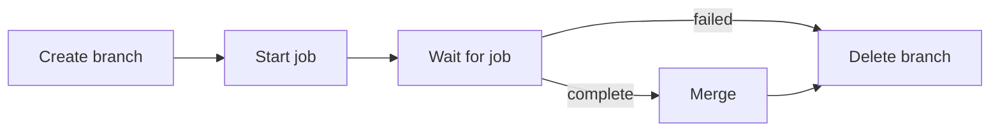

[Temporal](https://temporal.io/) already gives you durable workflows, retries and schedules. To orchestrate Bauplan with it, you turn most Bauplan commands into activities, keep them in one shared library, and compose your workflows from them. Each activity gets a retry policy and timeouts that match the operation it wraps. Each workflow run works on a branch of its own and publishes it with a single merge.

| Bauplan | Temporal |
| :--- | :--- |
| A command of the Python SDK, such as creating a branch, running a pipeline or merging | An activity in the shared library |
| A kind of operation, such as a catalog change or a long job | A retry policy and a set of timeouts |
| A branch created for one run and merged once | One workflow execution |
| A job that runs for minutes or hours | A start activity, then a wait activity that heartbeats |
| A recurring pipeline | A Schedule that starts the workflow |



## Build a shared library of Bauplan activities

Write one activity for every Bauplan command your pipelines use, and put them all in one package that every workflow imports. The activities hold no pipeline logic. Each one makes a single call to the SDK and turns its outcome into something Temporal understands, such as a return value or an error. A workflow then reads as a sequence of building blocks, and a fix to how a command is called, retried, or reported is made once for every pipeline.

```tree
bauplan_activities/
  activities.py           # one activity per Bauplan command
  entities.py             # frozen dataclasses for inputs and outputs
  policies.py             # retry policies and timeouts per kind of operation
pipelines/
  orders/
    workflow.py           # composes the activities
    projects/orders/      # the Bauplan project the workflow runs
worker.py                 # registers the workflows and the whole library
```

Inputs and outputs are frozen dataclasses, which Temporal serializes into the workflow history. Give every new field a default, because schedules and running workflows carry payloads written before the field existed:

```python
from dataclasses import dataclass, field
from typing import Literal


@dataclass(frozen=True)
class ImportParams:
    """Files to import into an existing table on a branch"""

    table: str
    search_uri: str
    branch: str
    namespace: str


@dataclass(frozen=True)
class RunParams:
    """A pipeline run to start on a branch"""

    project_dir: str
    ref: str
    namespace: str
    parameters: dict[str, str] = field(default_factory=dict)


@dataclass(frozen=True)
class JobResult:
    """How a Bauplan job ended"""

    job_id: str
    status: Literal["complete", "failed", "aborted"]
    error_message: str | None = None
```

The library below wraps the commands a typical pipeline needs, from creating its branch and namespace to starting and waiting for jobs, merging and deleting the branch. Because the Bauplan client is synchronous, the activities are plain `def` functions that the worker runs on a thread pool:

```python type:ignore
import time
from datetime import UTC, datetime

import bauplan
from bauplan.schema import JobState
from temporalio import activity
from temporalio.exceptions import CancelledError

from bauplan_activities.entities import ImportParams, JobResult, RunParams

# Seconds between two status checks of a running job, well below the heartbeat timeout
POLL_INTERVAL_SECONDS = 10


@activity.defn
def create_branch(base_ref: str, prefix: str) -> str:
    """Create a new branch for one workflow run and return its name"""
    client = bauplan.Client()

    # Building the name here and not in the workflow records it in history, and replays reuse it unchanged
    stamp = datetime.now(UTC).strftime("%Y%m%d%H%M%S")
    branch = f"{client.info().user.username}.{prefix}-{stamp}"

    client.create_branch(branch, from_ref=base_ref)
    return branch


@activity.defn
def create_namespace(branch: str, namespace: str) -> None:
    """Create a namespace on a branch if it does not exist yet"""
    bauplan.Client().create_namespace(namespace, branch, if_not_exists=True)


@activity.defn
def start_import(params: ImportParams) -> str:
    """Submit an import without waiting for it, and return its job id"""
    state = bauplan.Client().import_data(
        table=params.table,
        search_uri=params.search_uri,
        branch=params.branch,
        namespace=params.namespace,
        detach=True,
    )
    if state.job_id is None:
        raise RuntimeError(f"import into {params.table} returned no job id")
    return state.job_id


@activity.defn
def start_run(params: RunParams) -> str:
    """Submit a pipeline run without waiting for it, and return its job id"""
    state = bauplan.Client().run(
        project_dir=params.project_dir,
        ref=params.ref,
        namespace=params.namespace,
        parameters=dict(params.parameters),
        detach=True,
    )
    if state.job_id is None:
        raise RuntimeError(f"run on {params.ref} returned no job id")
    return state.job_id


@activity.defn
def wait_for_job(job_id: str) -> JobResult:
    """Wait until a job ends, heartbeating while it runs, and return how it ended"""
    client = bauplan.Client()

    try:
        job = client.get_job(job_id)
        while job.status in (JobState.NOT_STARTED, JobState.RUNNING):
            # The heartbeat tells Temporal the worker is alive and lets it deliver a cancellation
            activity.heartbeat()
            time.sleep(POLL_INTERVAL_SECONDS)
            job = client.get_job(job_id)

    # When the workflow stops waiting, stop the job too instead of leaving it to write on the branch
    except CancelledError:
        client.cancel_job(job_id)
        raise

    # Every final state is a result the workflow can act on
    if job.status == JobState.COMPLETE:
        return JobResult(job_id, "complete")
    if job.status == JobState.FAIL:
        return JobResult(job_id, "failed", job.error_message)
    if job.status == JobState.ABORT:
        return JobResult(job_id, "aborted", job.error_message)

    # Any other state is unexpected: fail the attempt and let the retry policy wait again
    raise RuntimeError(f"job {job_id} is in state {job.human_readable_status}")


@activity.defn
def merge_branch(source_ref: str, into_branch: str) -> None:
    """Publish a branch into its base branch"""
    bauplan.Client().merge_branch(
        source_ref=source_ref,
        into_branch=into_branch,
        commit_message=f"Merge {source_ref} into {into_branch}",
    )


@activity.defn
def delete_branch(branch: str) -> None:
    """Delete a branch, succeeding if it is already gone"""
    bauplan.Client().delete_branch(branch, if_exists=True)
```

Add an activity to the library whenever a workflow needs another command, for instance `revert_table` or `delete_table`, rather than calling the SDK from a workflow-specific activity.

## Give every kind of operation its own retry strategy

Temporal retries a failed activity until its policy gives up, and a retry repeats the whole call. What a retry costs, and whether it is safe at all, depends on the operation. For this reason every activity in the library is paired with a policy written for its kind of operation:

1. Branch creation is never retried. If an attempt created the branch but its completion was lost, a retry would create a second branch for the same run.
2. Catalog operations, such as creating a namespace, merging or deleting a branch, are quick and safe to repeat. They get many attempts with backoff, which lets them ride out transient errors. A merge that conflicts is the exception, because it fails the same way on every attempt.
3. Starting a job is retried a few times only, since an attempt whose completion was lost has already started a job.
4. Waiting for a job is the long operation. Its timeout comes from the pipeline, its heartbeat timeout detects a dead worker within a minute, and a new attempt resumes waiting on the same job.

Keeping the policies next to the activities guarantees that every workflow applies the same strategy to the same operation:

```python
from datetime import timedelta

from temporalio.common import RetryPolicy

# Never retried: an attempt whose completion was lost has already created the branch
BRANCH_CREATION_RETRY_POLICY = RetryPolicy(maximum_attempts=1)

# Catalog operations are quick and safe to repeat, and patient retries let them ride out transient errors.
# A merge that conflicts is not retried, because it fails the same way on every attempt
CATALOG_TIMEOUT = timedelta(minutes=3)
CATALOG_RETRY_POLICY = RetryPolicy(
    maximum_attempts=10,
    initial_interval=timedelta(seconds=30),
    maximum_interval=timedelta(minutes=5),
    non_retryable_error_types=["MergeConflictError"],
)

# A few attempts only: an attempt whose completion was lost has already started a job
JOB_START_TIMEOUT = timedelta(minutes=5)
JOB_START_RETRY_POLICY = RetryPolicy(
    maximum_attempts=3, initial_interval=timedelta(seconds=30)
)

# A new attempt resumes waiting on the same job, for instance after a worker restart, and a missed
# heartbeat detects a dead worker within a minute instead of at the end of the run timeout
JOB_WAIT_HEARTBEAT_TIMEOUT = timedelta(minutes=1)
JOB_WAIT_RETRY_POLICY = RetryPolicy(
    maximum_attempts=5, initial_interval=timedelta(seconds=10)
)
```

## Wait for jobs with a heartbeating activity

Since Bauplan jobs run for minutes or hours, the library splits each of them in two activities. `start_run` and `start_import` submit the job with `detach=True` and return its id within seconds, and `wait_for_job` waits for it. The wait activity checks the job at a fixed interval and heartbeats in between, which tells Temporal that the worker is still alive and gives Temporal a way to deliver a cancellation. When the workflow stops waiting, because the run timed out or someone cancelled it, the activity cancels the Bauplan job before raising, which keeps the job from writing to a branch nobody will merge.

The wait ends with a result for every final state of the job. A failed or aborted job is reported as such, and the workflow decides what it means. Only a state the activity does not expect fails the attempt, and the retry policy then waits again.

## Compose workflows from the library

A workflow imports the library inside `workflow.unsafe.imports_passed_through()`, which keeps the workflow sandbox from importing `bauplan` on every run. It then calls the activities in order, each with the policy of its kind of operation. The branch is created first and deleted in a `finally` block, which runs whether the run was merged, failed or was cancelled:

```python type:ignore
from dataclasses import dataclass, field
from datetime import timedelta

from temporalio import workflow
from temporalio.exceptions import ApplicationError

# The library, and bauplan through it, is imported outside the workflow sandbox
with workflow.unsafe.imports_passed_through():
    from bauplan_activities.activities import (
        create_branch,
        create_namespace,
        delete_branch,
        merge_branch,
        start_run,
        wait_for_job,
    )
    from bauplan_activities.entities import RunParams
    from bauplan_activities.policies import (
        BRANCH_CREATION_RETRY_POLICY,
        CATALOG_RETRY_POLICY,
        CATALOG_TIMEOUT,
        JOB_START_RETRY_POLICY,
        JOB_START_TIMEOUT,
        JOB_WAIT_HEARTBEAT_TIMEOUT,
        JOB_WAIT_RETRY_POLICY,
    )


@dataclass(frozen=True)
class PipelineParams:
    """What one run of the workflow computes and where it publishes it"""

    project_dir: str
    namespace: str
    base_branch: str = "main"
    branch_prefix: str = "orders-transformation-prod"
    run_timeout_minutes: int = 60
    parameters: dict[str, str] = field(default_factory=dict)


@workflow.defn
class PipelineWorkflow:
    @workflow.run
    async def run(self, params: PipelineParams) -> None:
        """Run a pipeline on a new branch and publish it with one merge"""
        branch = await workflow.execute_activity(
            create_branch,
            args=[params.base_branch, params.branch_prefix],
            start_to_close_timeout=CATALOG_TIMEOUT,
            retry_policy=BRANCH_CREATION_RETRY_POLICY,
        )

        try:
            # The target namespace may not exist yet on the base branch
            await workflow.execute_activity(
                create_namespace,
                args=[branch, params.namespace],
                start_to_close_timeout=CATALOG_TIMEOUT,
                retry_policy=CATALOG_RETRY_POLICY,
            )

            # Start the run detached, then wait for it within the run timeout of this pipeline
            job_id = await workflow.execute_activity(
                start_run,
                RunParams(
                    params.project_dir, branch, params.namespace, params.parameters
                ),
                start_to_close_timeout=JOB_START_TIMEOUT,
                retry_policy=JOB_START_RETRY_POLICY,
            )
            result = await workflow.execute_activity(
                wait_for_job,
                job_id,
                start_to_close_timeout=timedelta(minutes=params.run_timeout_minutes),
                heartbeat_timeout=JOB_WAIT_HEARTBEAT_TIMEOUT,
                retry_policy=JOB_WAIT_RETRY_POLICY,
            )

            # The workflow is not retried, because a job that failed fails again on the same data
            if result.status != "complete":
                raise ApplicationError(
                    f"job {result.job_id} {result.status}: {result.error_message}",
                    type="PipelineFailed",
                    non_retryable=True,
                )

            await workflow.execute_activity(
                merge_branch,
                args=[branch, params.base_branch],
                start_to_close_timeout=CATALOG_TIMEOUT,
                retry_policy=CATALOG_RETRY_POLICY,
            )

        # Merged, failed or cancelled, the branch of this run is not needed anymore
        finally:
            await workflow.execute_activity(
                delete_branch,
                branch,
                start_to_close_timeout=CATALOG_TIMEOUT,
                retry_policy=CATALOG_RETRY_POLICY,
            )
```

Other workflows are different sequences of the same blocks. An ingestion workflow, for instance, calls `start_import` and `wait_for_job` before the run, on the same branch, and a single merge then publishes the imported table together with the tables built from it. When several pipelines depend on each other, run each one as a child workflow and start a child only after the ones it reads from have merged.

## Run the worker

One worker can host every workflow and the whole library. Register all the activities once, and give the worker a thread pool for them:

```python type:ignore
import asyncio
from concurrent.futures import ThreadPoolExecutor

from temporalio.client import Client
from temporalio.worker import Worker

from bauplan_activities.activities import (
    create_branch,
    create_namespace,
    delete_branch,
    merge_branch,
    start_import,
    start_run,
    wait_for_job,
)
from workflow import PipelineWorkflow


async def main() -> None:
    """Host the workflows and the shared Bauplan activities on one task queue"""
    client = await Client.connect("localhost:7233")

    # The activities run on a thread pool because they call the synchronous Bauplan client
    worker = Worker(
        client,
        task_queue="bauplan-pipelines",
        workflows=[PipelineWorkflow],
        activities=[
            create_branch,
            create_namespace,
            start_import,
            start_run,
            wait_for_job,
            merge_branch,
            delete_branch,
        ],
        activity_executor=ThreadPoolExecutor(max_workers=16),
    )
    await worker.run()


if __name__ == "__main__":
    asyncio.run(main())
```

Since `client.run` submits a project from a folder, the worker also needs the Bauplan project directories on disk.

## Schedule the workflow

A Temporal Schedule starts the workflow on a cron. Choose the overlap policy by what a missed run means for the data. When every run processes its own period, such as one hour of events, use `ScheduleOverlapPolicy.BUFFER_ALL` with a catch-up window, which replays missed runs in order. When every run reads the same snapshot again, use `ScheduleOverlapPolicy.SKIP`, since a missed run carries no data the next one will not have.

A workflow that processes a time window should derive it from the scheduled time of the run rather than from the current time. A run that starts late then still processes its own period. Temporal exposes the scheduled time as the `TemporalScheduledStartTime` search attribute, and `workflow.now()` is the deterministic fallback for runs started by hand. Pass the window to the pipeline as run parameters, as in [how to parametrize a pipeline](/how-to/build-pipelines/how-to-parametrize-a-pipeline).

## Related

- [Deployment](/how-to/deploy/how-to-deploy-a-pipeline)
- [How to Write-Audit-Publish](/how-to/publish/how-to-write-audit-publish)
- [Dagster](/integrations/orchestrators/dagster)
