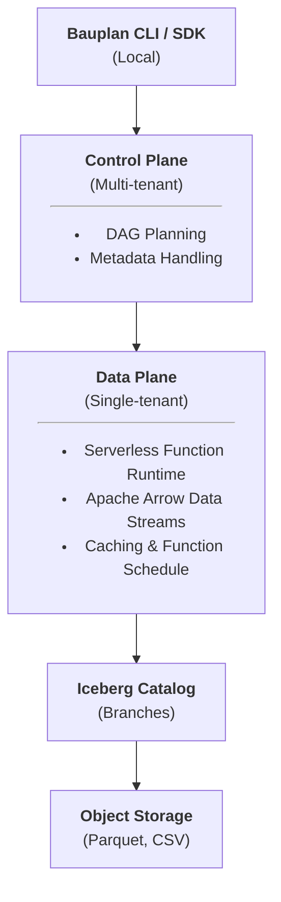

Bauplan\'s architecture is organized around three main layers:

## Control plane (multi-tenant)

The **Control Plane** is Bauplan\'s central management layer, shared
across tenants. It handles metadata, planning, and orchestration. No
user data ever reaches this layer.

- **Code Parsing and Planning:** Analyzes Python decorators and SQL
  statements to build a logical DAG of functions and package
  dependencies.
- **Metadata Resolution:** Uses the Iceberg catalog to determine the
  exact state of tables, branches, and commits necessary for
  execution.
- **Plan Compilation:** Generates an optimized physical execution
  plan, specifying exactly how functions will run and communicate.

## Data plane (Managed or BYOC)

The **Data Plane** executes your functions securely and efficiently
within isolated, tenant-specific environments.

{/* vale Google.Parens = NO */}

- **Serverless Runtime:** Spins up ephemeral containers for each
  function invocation, optimized for fast startup and minimal
  overhead.
- **Data Movement:** Shares data between functions through zero-copy
  Arrow tables (within hosts) or over high-performance Arrow Flight
  (across hosts).
- **Scheduling and Caching:** Dynamically schedules functions to
  maximize resource usage and caches results to accelerate repeated
  data accesses.

{/* vale Google.Parens = YES */}

## Storage layer (user-owned)

Bauplan interacts directly with your existing object storage, ensuring
you retain full control of your data.

- **Open Formats:** Uses open standards such as Parquet to store data in
  your own object storage buckets.
- **Iceberg Tables and Branching:** Organizes data into Iceberg tables
  with Git-like branches, enabling safe experimentation and reliable
  CI/CD workflows.
- **Immutable Metadata:** Tracks all operations through an Iceberg
  catalog, ensuring versioning, reproducibility, and full
  auditability.

### Architectural flow

The diagram below illustrates the flow from local development to
execution and data storage:

<DiagramLegend />

## Supported clouds

Bauplan runs on the following clouds, with the data plane in the same cloud as the bucket that holds your data:

- **Amazon Web Services**, with data in Amazon S3 (`s3://` URIs).
- **Google Cloud**, with data in Cloud Storage (`gs://` URIs).

The control plane is managed by Bauplan and does not depend on your cloud. The same commands, SDK methods, and pipelines work on every supported cloud. See [deployment](/overview/deployment) for the managed and BYOC options.

Cloudflare R2 is not a native storage option, but Parquet files in an R2 bucket can be registered as external tables through the [R2 integration](/integrations/warehouses-lakehouses/r2-cloudflare-object-storage), currently in preview.

[Contact us](https://www.bauplanlabs.com/contact) if you need support for another cloud or object storage service.
