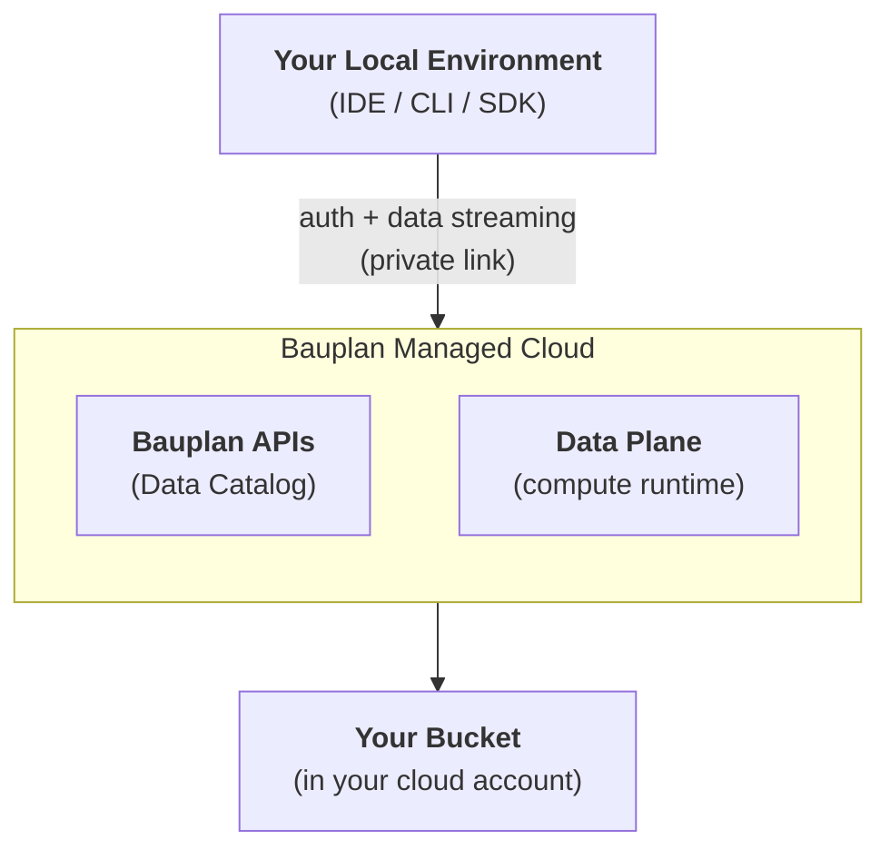
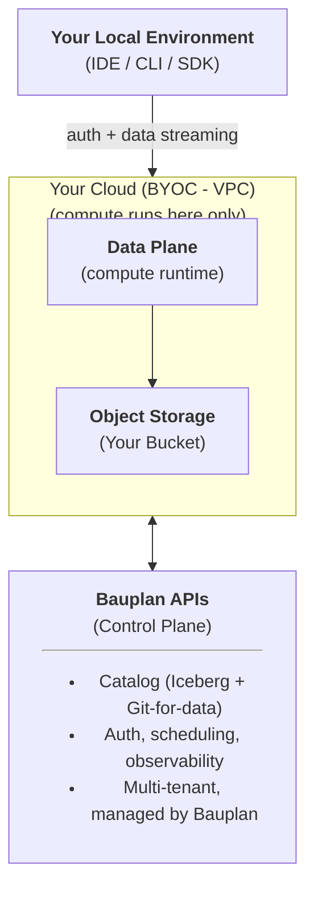

Bauplan offers two deployment options, on any of the [supported clouds](#supported-clouds).

## Single-tenant Private Link deployment

In this model, Bauplan manages a dedicated cloud environment for you,
linked to your own object storage:

<DiagramLegend />

Key Benefits:

- Fully isolated, SOC2-compliant managed environment.
- Data stays in your cloud with no egress costs.
- No infrastructure management required by your team.

## Bring your own cloud (BYOC) deployment

In the BYOC model, the entire Bauplan runtime is deployed within your
existing VPC, under your control:

<DiagramLegend />

Key Benefits:

- Maximum security and control within your infrastructure.
- No external data traffic, fully private and compliant.
- Efficient, with zero data transfer costs to external networks.

## Supported clouds

Bauplan runs on the following clouds, with the data plane in the same cloud as the bucket that holds your data:

- **Amazon Web Services**, with data in S3.
- **Google Cloud**, with data in Cloud Storage.

The control plane is managed by Bauplan and does not depend on your cloud. The same commands, SDK methods, and pipelines work on every supported cloud.

Cloudflare R2 is not a native storage option, but Parquet files in an R2 bucket can be registered as external tables through the [R2 integration](/integrations/warehouses-lakehouses/r2-cloudflare-object-storage), currently in preview.

[Contact us](https://www.bauplanlabs.com/contact) if you need support for another cloud or object storage service.
